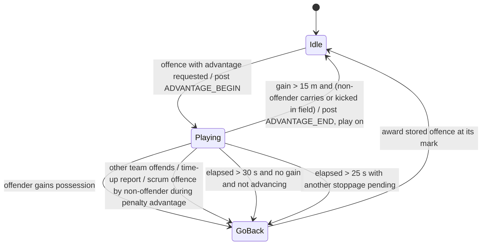

# 05 — Rules engine: referee, laws, scoring, match clock

Status: Phase 1 spec, p1-rules-lead. Ready for gate review.
Evidence: REA Evidence IDs (`ev_…`, Ghidra 12.1.4 on the SecuROM-repaired image, sha256 `aba7a647…`) and offline
listings (`local:rd <addr>` = recursive-descent disassembly by `.omc/research/rules/rd.py` on the same image;
`local:funcasm <addr>` = earlier linear listing). Every statement is tagged **O** (observed in code),
**I** (inferred) or **U** (unknown). Addresses and original class names appear only as evidence. The proposed names
are for the Godot rebuild (see the spec-style directive in the Phase 1 brief).

Working notes, sub-agent findings and helper tools: `.omc/research/rules/` (NOTES.md, clock/, refaudio/, detect/,
discipline/, inv/). Function index: `.omc/research/functions/rules.tsv`.

---

## Answers for implementation (S1 questions)

| # | Question | Answer | Tag |
|---|---|---|---|
| 1 | Does the match clock run during kick-off and stoppages? | The clock runs while the referee's period state is *running*. Nothing in the clock tick pauses it for scrums, lineouts, conversions, kick-offs or injuries. It stops when the game world is paused (pause menu and other world-pause states) and in replay/sim mode. When the period end time is reached the clock freezes at the end time and the referee enters a *time up* state. Whether cut-scenes (try celebration, conversion set-up, injury scenes) pause the world, and so the clock, is not resolved. Implement: the clock ticks during live play **and** dead-ball periods, and freezes at the period end. Keep a tunable `clock_pauses_during_stoppages` (default `false`) so the behaviour can be confirmed at runtime and changed by a mod. | O (tick and gates) / U (cut-scene pause) |
| 2 | Periods and match-length options | Two halves of 40 *game* minutes (2400 game s each). Up to three extra-time periods of 10 game minutes each (only in qualifying knock-out matches, see 2.8), then a drop-goal shoot-out. The match-length option chooses the **real** minutes per half: index 0..4 = 2, 5, 10, 20, 40 real minutes. The game clock rate is 40 / real-minutes, so 20×, 8×, 4×, 2×, 1×. The default index is 1 (5 real minutes per half). The front end lists 5 / 10 / 20 (and 40 in one string table). | O |
| 3 | Points table, penalty try | Try 5, conversion 2, penalty goal 3, drop goal 3. Team points = 5·tries + 2·conversions + 3·penalty goals + 3·drop goals (four per-team counters). **Penalty try = a normal try (+5 points, counted as a try) plus a conversion attempt**, not an automatic 7. The referee credits the try to the non-offending team, places the decision on the try line in line with the posts, and the next restart is the conversion kick (taken from in front of the posts). | O (values, try credit, decision) / I (exact conversion spot) |
| 4 | Sin-bin length and scaling | **600 game seconds (10 game minutes)**, timed on the match clock. It scales with the half-length option exactly like the clock: 30 s, 75 s, 150 s, 5 min and 10 min real time for the 2 / 5 / 10 / 20 / 40-minute options. The player returns at the first stoppage after expiry, never mid-play. Max two players off per team; red cards are permanent. | O |
| 5 | Does a half end at time-up immediately? | **No.** At the period end the clock freezes and the referee enters *time up*. Play continues. The period ends at the first qualifying stoppage reported after time up: a kick at goal or a drop goal (success or miss), the ball going into touch (a lineout would follow), the ball made dead in-goal by the defence (a 22 m drop-out would follow), or a general dead-ball stoppage (an "unplayable" scrum or drop-out). Penalties, free kicks, and scrums for knock-on or forward pass do **not** end the period, so they are played. A try does not end it either: the conversion is taken, and its result ends the period. If advantage is being played at time up, the period-end check makes the referee go back and award the original offence first. | O (code) / I (labelling of stoppage kinds) |

---

## 1. Scope and entry points

The original game uses one referee object. Its per-tick update watches the ball, and a set of event handlers
receive game events (ball out, kick result, tackle, ruck, scrum and so on). Detectors raise **reports**. A report
holds a reason (*why*), a resulting decision (*what*), the offending team, the player and the position. Reports go
through one pipeline (submit → advantage check → period-end check → handle), and that pipeline sets the **restart
kind** for the next set piece. A separate advantage tracker can delay a report. Presentation (referee cut-scenes,
commentary, referee speech, HUD) hangs off events that the pipeline posts.

| Proposed component | Responsibility | Evidence (original) |
|---|---|---|
| `Referee` | holds period state, current report, restart kind, kick-info, advantage tracker | class with 42 virtual slots, vtable 0x8ce21c (RTTI `CReferee`); practice subclass vtable 0x8cdfec |
| `Referee.submit_report(report)` | entry point for all decisions | 0x439550 `ev_6d6f5a1da8ae3eaf548fe63621b942d5da0e1a815d916bc880a1ddef462ca95f` |
| `Referee.handle_report(report)` | turns a decision into a restart kind and events | 0x439e90 (slot 26) `local:rd 0x439e90` |
| `Referee.restart_play(kind)` | starts the next set piece or period transition | 0x433b00 (slot 39) `local:rd 0x433b00` |
| `AdvantageTracker` | begin / update / end / go back | begin 0x435b10, update 0x435ef0 `ev_5f47dc500bf77a794cc6076802555a7578ee74a6df645deb946dddc5e91976c4`, go-back 0x435ce0, decide-on-new-report 0x439a40 `ev_dd2ba3f56d7f9fcafca135c842e83392cecbc80915589721be3e67d4ed6cfbc7`, clear 0x4372a0 |
| `Referee.end_period()` | half time, extra time, shoot-out, full time | 0x43baf0, period-end test 0x439700 `local:rd 0x439700` |
| `ScoreBoard` | per-team counters and points | 0x632c60 `ev_d3541098b1ede857809da67b8eb8eab75b7f6c8578304ed55907e83f3fbb031b`, counters 0x632d00/20/40/60 |
| `MatchClock` | game-time, rate, period end | tick 0x632f10, rate 0x4217d0, period ends 0x421aa0–0x421ae0 (clock sweep) |
| Detectors | knock-on, forward pass, offside, touch, in-goal, ruck/maul/tackle/scrum offences, mark | see 2.4 (p1-rules-detect) |
| `RefereeVoice` | referee speech selection | 0x498320 / 0x498aa0 (refaudio sweep) |
| Referee presentation | cut-scene and commentary cue per decision | 0x43b350 → 0x43bf70 |

All REA names (prefix `rules_`) were applied in the shared session (`ev_d71e946de3d47c1952b7d81d7cebaa97441b26f4e7f7f98ffc1efe37830e4184`)
and are listed in `.omc/research/functions/rules.tsv`.

---

## 2. Behaviour

### 2.1 The report model (O)

A **report** has these fields (`local:rd 0x4391b0`):

| Field | Meaning |
|---|---|
| `why` | reason code (enum `StoppageReason`, table in 2.4) |
| `what` | decision / next restart (enum `Decision`, below) |
| `offending_team` | team the decision is given against. For a score it is the scoring team |
| `player` | offender (or scorer, or kicker) |
| `position` | pitch position of the incident (vector3; the pitch length axis is the third component) |
| `time` | game time when the report was submitted |
| `flags` | handled, stored-for-advantage, and similar |

`Decision` (the *what*), with the restart kind it produces (`local:rd 0x439e90`, `0x433b00`, `0x43b350`):

| Decision | Meaning | Restart kind set by the handler |
|---|---|---|
| 1 | penalty | penalty / free-kick restart (options menu in penalty mode) |
| 2, 3 | scrum (3 is the normal value; 2 is handled identically, U) | scrum |
| 4 | free kick (mark is a special case: options menu in mark mode) | penalty / free-kick restart (options menu in free-kick mode) |
| 5 | end of period | none; ends the period (see 2.8) |
| 6 | 22 m drop-out | 22 m drop-out |
| 8 | lineout | lineout |
| 9 | kick-off restart (after a score, or re-kick) | kick-off |
| 10 | kick-at-goal result (informational) | none |
| 15 | penalty try | conversion kick |
| 16 | conversion due after a try | conversion kick |
| 17 | conversion/restart after a drop-goal report (U) | conversion kick path (U) |
| 7, 11–14 | other (default path) | kick-off if no restart is pending (U) |

`RestartKind` (the dispatch in `Referee.restart_play`, O): 0 none (play on), 1 kick-off, 2 penalty or free kick,
3 lineout, 4 scrum, 5 22 m drop-out, 6 U, 7 half-time break, 8 full time with possible extra time, 9 full time,
10 kick at goal (conversion), 11 U, 12 drop-goal shoot-out, 13 U. Kinds 11–13 skip one preparation step that
kinds 0–10 do, so they are inferred to be period/match-level transitions.

### 2.2 Decision pipeline (O unless tagged)

```mermaid
flowchart TD
  D[Detector raises report] --> A{Caller asks for advantage?}
  A -- yes --> B[AdvantageTracker.begin]
  A -- no --> S[submit_report]
  S --> R0{referee active?}
  R0 -- no --> X[ignore]
  R0 -- yes --> T[stamp report.time = game time]
  T --> Q{quick option pending and not yet taken?}
  Q -- yes --> QO[hand the report to the quick-option controller; stop]
  Q -- no --> AV{advantage active and the new report means 'go back'?}
  AV -- yes --> GB[AdvantageTracker.go_back: award original offence]
  AV -- no --> PE{time up and report is a period-ending stoppage?}
  PE -- yes --> EP[replace report with END OF PERIOD]
  PE -- no --> H
  EP --> H[handle_report: set restart kind, post events]
  H --> RP[restart_play(kind) when the stoppage presentation completes]
```

- The report is stamped with the current game time unless it already carries one (`ev_6d6f5a1d…`).
- "Quick option pending" means a quick tap or quick throw is offered and has not been taken. A new report then
  goes to that controller instead of stopping play (log text "letting quick option go"). (O; the controller is
  in the discipline sweep.)
- `handle_report` marks the report handled and, by decision:
  - scrum (2/3): sets restart *scrum*; posts a **knock-on** event if `why` is knock-on.
  - lineout (8): sets restart *lineout*; also writes the value 4.0 to one field on each team (meaning U).
  - penalty/free kick (1/4): opens the options controller in mode 0 (penalty), 2 (free kick from a mark) or 1 (other free kick); sets restart *penalty/free kick*; the non-offending team gets the ball.
  - 22 drop-out (6): if the last kick was a drop goal, plays the "drop goal missed" presentation and posts *drop goal failure complete*; sets restart *22 drop-out*.
  - penalty try (15): posts *penalty try* with the team; sets restart *conversion*; the scoring team is recorded as the kicking team.
  - conversion (16/17): sets restart *conversion*.
  - end of period (5): see 2.8.
  - Default path: whistle; if no restart kind is set yet, restart is *kick-off*; then the *stop play* action is queued.

### 2.3 Restarts after scores and kicks (O)

- **Try**: the referee checks that it is active. If advantage is being played it goes back to that offence and no
  try is given. If the scorer is offside, an offside decision is given instead. Otherwise the try counter goes up
  (+5), a *try touch-down* event is posted, and a report (why = try, what = conversion) is submitted. The
  conversion is the next restart. (0x4308e0 `local:rd 0x4308e0`; strings "Called Advantage instead", "Called offside instead")
- **Successful kick at goal** (0x430b30): kick type *conversion* adds +2, type *penalty goal* adds +3. The restart
  is a **kick-off by the team that conceded**: the kicking team is set to the opponent of the scorer. A
  *goal-kick result* event is posted.
- **Drop goal** (0x430f30): drop-goal counter +1 (3 points), *drop goal result success* event; then the kick-off
  restart, as above (I).
- **Penalty try** (0x430dd0 `local:rd 0x430dd0`): credits a try (+5, try counter) to the opponent of the offending
  team, blows the whistle, and submits a report with decision 15 at z = attack_dir·50 (the try line), x
  inferred 0 (in line with the posts). The scoring team's player in squad slot 9 (0-based) is set as the
  kicker (U which position that is). The referee handler then posts *penalty try* and sets the conversion
  restart.
- **Missed conversion**: kick-off restart. The presentation shows the "conversion miss" cue when the decision is
  a kick-off (O, 0x43b350). Who kicks off is not separately resolved; assume the conceding team, as for a
  successful kick (I).
- **Missed drop goal / penalty goal that goes dead in-goal**: 22 m drop-out (decision 6, with the drop-goal-miss
  presentation when the last kick was a drop goal). (O for drop goal, I for penalty goal)

### 2.4 Stoppage reasons and detection (detect sweep `.omc/research/rules/detect/detect_findings.md`; evidence `local:rd`)

Conventions:
- `side` = the team's attack direction (+1 or −1). "Forward" for a team means `side · Δz > 0`.
- For penalties and free kicks, `offending_team` is the team that committed the offence.
- For scrums, `offending_team` is the team that caused the scrum. The put-in goes to the other team.
- "Immediate" means the report is submitted with a **stop-play delay of 2.0 s** (`referee_whistle_delay`).
  "Advantage" means it goes to the advantage tracker (2.5).
- Referee level `L`: inferred to be the per-match referee profile's `strictness` (60–95, section 2.7). It
  lengthens several time limits by L/18 s.
- `ref_notices(p)`: a random draw in 0..1000 that succeeds with probability ≈ p/1000. It models the referee
  missing offences.

| Reason (why) | Proposed name | Detection (behaviour) | Decision | Whistle | Tag |
|---|---|---|---|---|---|
| 0x16 | forward pass | Judged at the moment of the pass: the throw velocity's length component points toward the passer's attack direction and its magnitude is over 0.01 m/s. The throw vector alone is used (the passer's run speed is not subtracted). Hands, catch and receiver are not checked. No knock-back exception: anything not forward is legal. | scrum | immediate (+2 s) | O |
| — | forward-pass assist (not a reason) | Before the throw, a pass that would be forward is bent to −0.01 m/s backward. This always happens if the horizontal throw speed is ≤ 8 m/s. Faster throws are bent with probability {0, .5, .6, .7, .8, .9} by a per-team option byte (0..5; probably an assist setting, U). | — | — | O (option meaning U) |
| 0x31 | knock-on | A ball tracker starts when the ball is dropped, released for a kick, or passed, and records where it left the hands. It notes when the ball bounces. When someone next holds or kicks the ball, it is a knock-on if the ball has bounced **and** moved more than 0.1 m forward (dropper's direction) from the release point. The dropper re-gathering his own drop before it bounces is legal. A tracked pass is never called a knock-on here; the forward-pass rule covers it. | scrum (feed to non-offenders) | **advantage** if the opposition now holds the ball, else immediate | O |
| 0x2c | offside | Offside monitor (see below). A listed (offside) player is penalised only when he plays the ball, is hit by it, makes a tackle or kicks. | penalty | advantage (immediate when it blocks a try) | O |
| 0x21 | hands in ruck / killing the ball | A ruck handling event is noticed with p = 0.8; a ruck killing event with p = 0.6. The offender is the nearest offending player to the ball. The same reason code is used for both. Also posts the quick-penalty check. | penalty | immediate | O |
| 0x0f | ruck not used (unplayable) | Ruck older than `8 + L/18` s and the ball is not available. | scrum to the team in possession (I) | immediate | O |
| 0x2b | ruck in in-goal | During a ruck the ball is beyond the in-goal bound. | scrum | immediate | O |
| 0x1e | ruck time-wasting | Compiled out; never produced. | (penalty) | — | O |
| 0x14 | maul collapse | Maul-collapse event. Within 5 m of the opposition try line → **penalty try**. Within 22 m the offender is also recorded for discipline. Otherwise a penalty. | penalty or penalty try | immediate | O |
| 0x36 | dangerous / high tackle | Torpedo (spear) tackle event: noticed with p = 0.9. Dangerous-tackle event: p = 0.9, or 0.07 for a mild one (severity ≤ 1.2 and flags). If the ball carrier is the tackler's team-mate → immediate. Otherwise a visibility test (within 150° and 45 m) decides between immediate and advantage. Triggers the card decision (2.7). | penalty | immediate, or advantage if "unseen" | O (severity meaning U) |
| 0x32 | delay of game / slow set piece | Delay-of-game event (player holding the ball too long); lineout not taken within `10 + L/18` s; scrum team too slow. | free kick (ball position + 2 m for delay of game) | immediate | O |
| 0x33 | slow lineout (second stage) | Lineout age > 0.75 × the limit (order relative to 0x32 U). | free kick | immediate | I |
| 0x1f | lineout offence | Lineout cheat flag (inferred: not straight or similar); posts a lineout-cheat event. | penalty | immediate | I |
| 0x13 | collapsed scrum | Scrum in its "collapse" state for more than 2.0 s, then a roll against `2L + 700` per-mille (and a second weighted roll). Scrum mechanics: set-pieces spec. | penalty | immediate | I |
| 0x1c, 0x1d | scrum feed offences | ~1 % `ref_notices(10)` rolls during the scrum. | free kick | immediate | I |
| 0x20 | scrum-half offence | Per-player probability skill/100. | free kick | immediate | I |
| 0x0d, 0x0e | scrum wheeled too far | Scrum rotation beyond the limit (event *scrum rotate too far*). | scrum reset | immediate | O/I |
| 0x1a, 0x1b | scrum decisions | Scrum turnover / formation decisions (details U). | scrum | immediate | O/U |
| 0x30 | mark | A clean catch called as a mark inside the catcher's own 22 (conditions not fully decoded). | free kick (mark mode) | immediate | I |
| 4 | try | The attacker grounds the ball in the opponents' in-goal, is not offside, and no advantage is running for the opponents. | conversion | immediate | O |
| 0x2d | ball grounded by defence in own in-goal | Defensive touch-down. If the last touch/kick was by the attackers (kick into in-goal) → 22 m drop-out. If the defence took it in → 5 m scrum to the attackers. (Which "last-touch kinds" map to which is partly U.) | 22 drop-out or scrum | immediate | I |
| 0x34 | ball dead in in-goal, not grounded (incl. held up, I) | Ball beyond the dead-ball area (\|z\| > 50 plus in-goal) after attacking play. | 5 m scrum | immediate | I |
| 0x11 | ball dead / unplayable (general) | Ball-dead decisions in general play. | scrum or 22 drop-out | immediate | I |
| 0x12, 0x2f | ball in touch, kick-off not 10 m | Section 2.4b. | lineout or centre scrum | immediate | O |
| 1 / 2 | kick at goal result | Ball through / outside the uprights. | (info) → kick-off | — | O |
| 3, 5 | drop-goal / end-of-period restart reasons | Internal. | 17 / 9 | — | U |
| 0x35 | general penalty | Producer not found (only the cue mapping). | penalty | — | U |

**Offside monitor** (O; `local:rd 0x4a8730`, `0x4a89e0`, `0x434b50`, `0x4a8ad0`):
- *After a kick*: every team-mate of the kicker standing strictly in front of the kicker is listed offside. A
  listed player becomes onside when a non-listed team-mate (the kicker or a player who was behind him) runs past
  him. The reference line moves up to the most advanced onside team-mate. There is **no** 10 m law for open-play
  kicks.
- *At a formation* (scrum, ruck, maul), for the team without the ball (I): the offside line is the formation
  position minus 2.0 m (scrum), 1.4 m (maul) or 0.7 m (ruck), in that team's direction. Players beyond it are
  listed. They become onside by retiring behind the line.
  - Exemptions: the defending scrum-half in a scrum (up to 2.5 m beyond the line); players bound in the
    formation; four special roles (U).
- *Penalty / free kick*: the line is 10 m from the mark toward the offenders' goal.
- Lines are clamped to the field (half-length − 0.1 m).
- *Delayed formation check*: 0.2 s after the ball leaves a formation (or a maul starts), each opponent still
  beyond the line is checked:
  - retreating at ≤ −0.5 m/s → tolerated;
  - moving forward faster than 0.1 m/s, or holding the ball → penalised (advantage allowed).
- The monitor clears when play stops or the ball goes out.

**Event chain** (O, `local:rd 0x42cc80`): each game event is offered to the detectors in a fixed order (bounce
timer, kick-result, out-of-bounds / through-uprights / crossed try line, ball tracker, kick classification,
dangerous tackle, offside enforcement, then the per-event switch). The first detector that handles the event
consumes it.

### 2.4b Ball in touch: lineout, scrum or "no gain" (O unless tagged; 0x428dd0 `local:rd 0x428dd0`, lineout award 0x428d40)

Pitch frame used by the referee: z is the length axis, halfway at z = 0, try lines at |z| = 50, 22 m lines at
|z| = 28 (50 − 22), touchlines at x = ±`touchline_half_width` (read from the stadium/pitch, not hard-coded).
"Own 22" for a team means the 28..50 band at the end it defends.

The touch handler looks at the **last kick** (kick type recorded when the ball was kicked, plus a flag for
whether the ball has touched the ground or a player since the kick; inferred meaning) and decides:

| Last kick | Condition | Decision | Throw-in / put-in |
|---|---|---|---|
| kick-off | ball crosses touch less than 10 m from halfway (\|z\| < 10) | scrum at the centre spot (reason "kick-off not 10 m") | non-kicking team |
| kick-off | otherwise, ball went into touch on the full | scrum at the centre (reason "in touch") | non-kicking team |
| kick-off | otherwise (bounced first) | lineout where it crossed touch | non-kicking team |
| 22 m drop-out | on the full | scrum on the kicking team's 22 m line (z = 28 on their side) | non-kicking team |
| 22 m drop-out | bounced | lineout where it crossed | non-kicking team |
| penalty kick to touch | any | lineout where it crossed | **kicking team** (penalty advantage) |
| open-play kick (and the set-kick type labelled "3", U) | kicked from inside own 22 (and, for open play, the ball was also received/taken inside own 22) | lineout where it crossed; event *touch kick gain* with the metres gained | non-kicking team |
| open-play kick | kicked from outside own 22, on the full | **no gain**: lineout level with the kick position; event *set no gain* | non-kicking team |
| open-play kick | kicked from outside own 22, bounced | lineout where it crossed; event *touch kick gain* | non-kicking team |
| kick at goal into touch (types 5/6, U) | any | kick-off restart decision (and the referee's goal-kick-miss handler is called) | — |
| no kick (ball carried out) | any | lineout where it crossed ("calling LO NO kick") | team that did not carry it out |

The lineout report is (reason *ball in touch*, decision *lineout*, offending team = team that put it out).
Practice/tutorial modes bypass this (mode checks at the top of the handler).

### 2.5 Advantage (O unless tagged)

The tracker holds `active`, `elapsed` (seconds; per-tick delta from the game timer, U whether real or game
seconds), the stored report and a link to the referee.

**Begin** (a detector raised an advantageable offence) (0x435b10):
- If no advantage is active: store the report, set elapsed = 0, set active, post **REF_ADVANTAGE_BEGIN** with the
  report. If the offence is offside, also post **REF_START_OFFSIDE**.
- If an advantage is active and the **other** team (the non-offender of the stored advantage) now offends: go
  back immediately and award the original offence.
- If the **same** team offends again:
  - With the same decision type: the stored report is replaced by the new one when a position comparison
    succeeds (exact test U; inferred "the new mark is better for the non-offending side").
  - If the new offence is a scrum-type decision and the stored one is a penalty: the stored report is replaced by
    the new one. This was observed but looks odd, so treat it as a possible original bug and expose it as
    `advantage_downgrade_penalty_to_scrum` (default `true` for fidelity).

**Update** (each tick while active) (0x435ef0):

- `gain = (ball.z − mark.z) · attack_dir(non-offending team)` in metres. `attack_dir` is the ±1 direction each
  team attacks; it is stored on the team and swaps at half time.
- **Go back to the offence** immediately if the offending team takes possession (ball carrier on the offending
  team), or if a contest (phase type 1, inferred ruck/maul) is won by the offending team.
- elapsed += dt.
- **Advantage over (play on)** if `gain > advantage_gain_metres` (15 m) **and** either a non-offender carries the
  ball, or the ball was kicked by the non-offenders and is inside the field of play
  (|ball.z| < 50 m, i.e. not in in-goal). Then post **REF_ADVANTAGE_END** and clear.
- Otherwise:
  - If another stoppage is pending (a report not yet restarted, other than a kick-at-goal result) and
    `elapsed > advantage_pending_stoppage_seconds` (25 s), go back to the offence (I: this branch's intent
    is unclear).
  - Else if `elapsed > advantage_timeout_seconds` (30 s), the ball is carried, the carrier is not ahead of
    the mark (`gain ≤ 1e-5`), and the ball has not advanced since its previous reference position, go back to
    the offence.

**Go back** (0x435ce0): blow the whistle; for foul-play reasons 0x35 / 0x36 run the card decision for the
offender (see 2.7); for offside run the offside follow-up (runtime-keyed call, U); clear the tracker; resubmit the
stored report marked "from advantage". The advantage branch of `submit_report` then does not apply, so the
penalty, scrum or free kick is awarded at the original mark.

**New reports while advantage is active** (0x439a40): go back to the original offence when:
- the new report is *end of period*;
- the new report's offender is the same team as the advantage offender;
- the new report has the same decision type, and the position test passes;
- the new report is a scrum decision and the advantage is for a penalty (the non-offending team knocked on, so
  the referee comes back for the penalty).

Reports for decisions 15–17 (penalty try, conversions) are never absorbed. Advantage is skipped altogether when
the tracker is inactive.



Which offences use advantage: the caller decides. Offside raised by the offside monitor can be either
advantage-played or immediate (an argument from the caller; O at 0x435680). Others: see the detect sweep.

### 2.6 Penalty and free-kick options (discipline sweep `.omc/research/rules/discipline/discipline_findings.md`; `local:rd`)

- When the decision is a penalty or free kick, the referee creates the **award**: offender, awarded team, mark
  (= the report position, i.e. where the offence happened) and kind (0 penalty, 1 free kick, 2 mark). The restart
  kind becomes *penalty / free kick* and the options menu (human) or the CPU chooser opens. (O)
- Options per kind (O from the front-end screens and the option handlers):

  | Kind | Options |
  |---|---|
  | Penalty | **kick at goal**, **kick for touch** (punt), **scrum**, **tap and run** |
  | Free kick, mark | **punt**, **scrum**, **tap and run**; no kick at goal |

  The penalty screen lists Kick At Goal / Scrum / Run plus a fourth button (#7) that its navigation links point
  to. The fourth button is inferred to be the shared Punt button, which the CPU's option 3 also uses for
  penalties (I).
- Option results:
  - Kick at goal → place-kick restart (conversion-style goal kick).
  - Scrum → scrum at the mark with the awarded team feeding.
  - Punt → the kicker punts. A penalty kick that goes into touch gives the **kicking team** the throw-in
    (O, touch handler 2.4b).
  - Tap and run → the ball is live at the mark.
- **Positions**: the mark is not moved forward. The kick-at-goal spot is kept at least 5 m in from the touchline
  (I). There is **no 15 m-in rule** (U whether intended).
- **10 m retreat**: the offside monitor puts the offending team's line 10 m from the mark (2.4).
- **Quick tap**: penalty paths post a *quick penalty check* event. The awarded team can tap immediately: the
  quick-run state machine moves the player into position (1.0 m / 2.0 m tolerances), then offers the tap. If a new
  infringement happens while a quick option is pending and not yet taken, the option is dropped and the new
  report goes on. If an offside player tackles the quick-tapper, another penalty is awarded (UI help text). (O)
- No time limit on the options menu was found (U).
- **CPU choice**: a separate chooser (AI spec `docs/re/08-ai.md` §2.5) returns 0 kick at goal, 1 scrum, 3 punt or
  4 tap-run. The chosen option is stored on the referee and dispatched by the restart. (O)

### 2.7 Cards and sin bin (discipline sweep; `local:rd 0x429d70` and related)

**Referee personality**: one of six built-in referees is drawn uniformly at random per match. Each has a
`discipline_factor` and a `strictness`. The six names are data (Brett Shaw, Eddie Foskett, Pierre Dubois, Gerry
Maher, Steve Smith, Victor Scholtz). Which name goes with which profile follows table order (I).

| Profile | discipline_factor | strictness | yellow/warning split T (per mille) |
|---|---|---|---|
| 0 (default) | 22 | 80 | 400 |
| 1 | 29 | 70 | 500 |
| 2 | 30 | 90 | 300 |
| 3 | 24 | 60 | 600 |
| 4 | 19 | 75 | 450 |
| 5 | 28 | 95 | 250 |

`strictness` is also the referee level `L` used in the time limits of 2.4 (ruck 8 + L/18 s, lineout 10 + L/18 s)
(I, from the matching field).

**When a card is considered** (O): the assessor runs only for some offences:
- penalty tries;
- defender infringements near their own goal line (within 22 m);
- (a ruck-time-wasting card path with a 75 % roll exists but is compiled out, so it never runs; O `local:rd 0x4327c0`);
- scrum-half offences (0x20) and delay of game (0x32);
- foul play (0x35 / 0x36) once the offence is finally penalised;
- repeated offences in a team's own 22.

It never runs while another card is pending, or for a player wearing shirt **1, 2 or 3** (front row: never carded
or warned).

**Card roll** (O):
1. `p = card_pressure + 5` (percent). Inside the offender's deep zone, add `|depth| · discipline_factor / 50`.
   Which axis and region is U.
2. Draw R1 in 0..999. **No card** if `R1 > 10·p`; then `card_pressure += 10`. So repeated offences make a
   card more and more likely.
3. Otherwise draw R2 in 0..999. If `R2 ≤ T`, or the player already has a yellow, the card is a **yellow**; a
   player who already has a yellow gets a **red** (second yellow = red). Otherwise it is a **warning** (lecture
   cut-scene only).
4. A card needs a free sin-bin slot: at most **2 players off per team**. A third card becomes a warning. A
   player with an unknown flag bit set gets only a warning (U).
5. Creating a sin-bin entry lowers `card_pressure` by 20 (floor 0).
6. Foul play penalised after advantage (0x35/0x36) is a **straight red with 5 % chance**; otherwise the
   standard roll applies.

Own-22 repeat offences (only for one team flag value, probably the human team, U): a per-team counter in the own
22 gives card chances 0 / 10 / 20 / 30 / 55 % for the 1st / 2nd / 3rd / 4th / later offence. A failed roll with
counter > 1 gives a warning.

**Applying a card** (O):
- Cards take effect when the referee processes the stoppage: card cut-scene, *player carded* event (→ HUD
  yellow/red overlay).
- When the cut-scene ends, the player leaves the pitch and the team lineup is rearranged. The team plays a man
  short.
- Statistics: yellow/red counts per player; form −8 (yellow) / −15 (red).

**Sin bin** (O):
- Length 600 **game** seconds (10 game minutes) on the match clock. It therefore scales with the half-length
  option: 75 real seconds with 5-minute halves, 10 real minutes with 40-minute halves.
- The player returns only when the referee processes a stoppage and the elapsed game time is > 600 s, i.e. at
  the first stoppage after expiry, never mid-play. A *penalty expired* event is posted.
- Red-carded players never return and keep one of the two off-field slots.
- Timers use absolute match time, so they carry over half time (I).

**Difficulty**: no match setting scales cards. ("Discipline" in the UI is a player attribute used by ruck AI.)
When a human-team player is carded, a difficulty "card adjuster" is created. It lasts while the player is off;
its effect is in the AI spec.

### 2.8 Match clock and periods (O unless tagged; clock sweep `.omc/research/rules/clock/clock_findings.md`)

- **Game time** is a float in game seconds from kick-off. It is stored with the match settings, with a period
  index alongside (0 first half, 1 second half, 2–4 extra time 1–3, 5 shoot-out).
- **Period end times**: 2400, 4800, 5400, 6000, 6600 game seconds.
- **Tick**: `time += real_dt · clock_rate` while the referee period state is *running*, the world is not paused
  and the game is not in sim/replay mode. Time is clamped to the current period end. (0x632f10, gate 0x4331e0 →
  referee period state == running `local:rd 0x4331e0`)
- **Clock rate** = 40 / half_real_minutes. The table is {20, 8, 4, 2, 1} for options {2, 5, 10, 20, 40} real
  minutes.
- **Referee period state**: running → *time up* (the clock reached the end) → *period ended* → next period or
  match over. The labels for the values 1/2/4/3 are inferred from where they are set and read (0x437ab0 ==1 is
  the clock gate, 0x437ad0 ==2 enables the period-end check, 0x43fe10 sets 4 in the end-period handler).
- **Which stoppages end a period** while time is up (0x439700): kick-at-goal results (why 1/2) and a scored drop
  goal (why 3) end it immediately. Ball unplayable/dead (why 0x11) with a scrum or 22 decision, ball in touch
  (0x12) with a lineout decision, and defensive grounding in-goal (0x2d) with a 22 decision end it when the
  report time is at or past the period end. Every other report does not end the period. One more gate (U)
  refuses the end in the second half under a referee condition; inferred to be the "still level, extra time
  pending" case.
- **End-of-period transitions** (0x43baf0):
  - After the first half: *half time* event, half-time break, second-half kick-off. In the second half the teams
    swap ends; the kick-off team is derived from the first-half kicker, presumably the other team (I).
  - After the second half or an extra-time period, if the scores are level and the match qualifies: *extra time*
    event, next period, and a coin toss for the kick-off.
  - After extra time 3, still level: drop-goal shoot-out.
  - Otherwise: *full time*.
- **Extra time qualifies** only for knock-out matches. The match type must be knock-out, and either the
  competition is a specific one (id 0x19, U which) or the match sub-type is 8–10 (later knock-out rounds, I).
  Each extra-time period is 10 game minutes. The front-end text says the third period is "first score wins"
  (golden point), but the early stop was not found in code (U).
- **Drop-goal shoot-out**: its own state machine and events (start, next kicker, success, miss, end). The number
  of kicks, positions and sudden-death rules were not recovered (U). Shoot-out kicks use a per-difficulty
  timing modifier of 4.5 / 4.0 / 4.0 (easy / normal / hard) that makes the kick easier.

### 2.9 Referee presentation and speech

**Decision cut-scene / commentary cue** (0x43b350 → 0x43bf70, O). The decision picks a cue. When the decision is a
lineout the cue is "lineout", varied by whether the ball was kicked out. Otherwise the cue comes from the reason:
- knock-on;
- forward pass;
- offside;
- free kick;
- mark;
- penalty (general, ruck or quick variant);
- collapsed-scrum penalty;
- scrum decision;
- scrum reset (when the reason is unplayable and the decision is a scrum);
- defensive touch-down;
- penalty try;
- 22 drop-out;
- drop goal miss;
- penalty kick miss;
- conversion miss / success;
- drop goal success;
- penalty kick success;
- try scored (big or consolation);
- restart;
- half time;
- yellow card, red card, lecture;
- injury (serious or not), substitution.

**HUD decision captions** (data: UI strings 177–203; the reason mapping is I):

| Caption | Reason |
|---|---|
| Player offside → Penalty to | 0x2c |
| Collapsing Scrum → Penalty / Penalty Try to | 0x13 |
| Collapsing Maul → Penalty / Penalty Try to | 0x14 |
| Forward Pass → Scrum to | 0x16 |
| Throw not straight → Penalty Kick to | 0x1f |
| Feed not straight / Foot Up → Free Kick to | 0x1c / 0x1d |
| Handling in the Ruck / Killing the ball / Foul in the Ruck → Penalty (Try) to | 0x21 and related |
| Knock-on → Scrum to | 0x31 |
| Mark called for by | 0x30 |
| Advantage to | advantage begin |
| Ball didn't go 10 metres → Scrum to | 0x2f |
| Delay of game → Free Kick to | 0x32 |

The rebuild should drive the HUD caption from `(reason, decision)` through a table.

The cue names are data (the strings `knock_on_TeamA_01` and so on). The rebuild should map them through a resource
table, `RefereeCueTable`.

**Referee speech** (refaudio sweep `.omc/research/rules/refaudio/refaudio_findings.md`, O): the referee voice is one
of four accent banks (Australia, England, France, Ireland). It is chosen per match by a weighted random pick from
six referee nationalities:
- the two teams' own nations are excluded, except when both teams share a nation, which then gets weight ×20;
- neighbouring nations are favoured;
- a French referee is possible only if a French side plays;
- New Zealand, South Africa and Australia all use the Australian voice bank.

Lines are picked uniformly at random within a range. There is no anti-repeat logic and no cooldown. The table
below gives event → line range. Each accent bank is 249 lines; a range is (category, first..last), 1-based within
the category.

| Trigger | Lines |
|---|---|
| referee whistle, reason forward pass | General 26–29 |
| whistle, reason mark | General 34–35 |
| whistle, reason knock-on | General 5–10 or 14–19 (selected by an event flag bit) |
| advantage begins (once per advantage) | General 11–13 |
| advantage ends | General 20–22 |
| ruck formed (80 % chance, plus a further gate) | Rucks 1–8 |
| ruck won (80 % chance) | Rucks 22–23 |
| maul formed | Mauls 1–3 |
| lineout won | Lineouts 6–7 |
| ball out of bounds (gated) | Lineouts 1–3 |
| scrum ball ready | Scrums 18–20 |
| scrum pick-up | Scrums 21–23 |
| scrum cut-scene cues | Scrums 1–4, 11–14 / Mauls 6–7 |
| discipline cut-scene | Discipline 1–18 (three groups of 3 opening lines + 3 closing lines; group chosen by the card/lecture selector, closing line by reason 0x19 / 0x21 / 0x1e) |
| injury cut-scene | Injury 1–2 |

The 99 "Colours" lines per accent ("Advantage, blue!" style) and the 30 Misc lines are **never referenced by
code** (O, absence in the binary). The rebuild can ship them unused or give them to a mod.

---

## 3. Constants and tunables

| Proposed name | Value | Unit | Used in | Evidence | Tag |
|---|---|---|---|---|---|
| `points_try` | 5 | points | score total | `ev_d3541098…` 0x632c60 | O |
| `points_conversion` | 2 | points | score total | same | O |
| `points_penalty_goal` | 3 | points | score total | same; counter +2 used by penalty-goal path 0x430b30 | O |
| `points_drop_goal` | 3 | points | score total | same; counter +3 used by drop-goal path 0x430f30 | O |
| `advantage_gain_metres` | 15 | m (pitch units = metres, I) | advantage update | `ev_5f47dc50…` constant 15.0 | O |
| `advantage_pending_stoppage_seconds` | 25 | s | advantage update | same, constant 25.0 | O (meaning I) |
| `advantage_timeout_seconds` | 30 | s | advantage update | same, constant 30.0 | O |
| `advantage_no_gain_epsilon` | 1e-5 | m | advantage update | same | O |
| `kickoff_min_distance` | 10 | m from halfway | touch handler (kick-off not 10 m → centre scrum) | `local:rd 0x428dd0` constant 10.0 | O |
| `line_22_from_halfway` | 28 | m (try line 50 − 22) | own-22 test for kicks to touch, 22 drop-out scrum position | `local:rd 0x428c60` constants ±28 | O |
| `field_half_length` | 50 | m (try line at z = ±50) | advantage update (ball in field of play); computed from 50 × 0.111 × (1 / 0.111) at start-up | static initialisers 0x8aa9f0 `local:rd` | O (value) / I (meaning) |
| `period_end_seconds` | [2400, 4800, 5400, 6000, 6600] | game s | clock / period end | 0x421aa0–0x421ae0 | O |
| `reference_half_minutes` | 40 | game min | clock rate | 0x632f10 | O |
| `half_length_options_real_minutes` | [2, 5, 10, 20, 40] | real min | clock rate | 0x632f10 / 0x4217d0 | O |
| `clock_rate_by_option` | [20, 8, 4, 2, 1] | game s / real s | clock | 0x4217d0 | O |
| `default_half_length_option` | 1 (5 min) | index | settings reset | clock sweep | O |
| `extra_time_period_seconds` | 600 | game s | periods | period ends | O |
| `extra_time_periods` | 3 | count | periods | 0x43baf0 | O |
| `dropgoal_shootout_kick_modifier` | 4.5 / 4.0 / 4.0 | scale (easy/normal/hard) | shoot-out kick timing | goal-kick xml (clock sweep) | O |
| `ref_speech_random_variants` | uniform | — | referee speech | refaudio sweep | O |
| `ruck_speech_chance` | 0.80 | probability | referee speech | refaudio sweep | O |
| `referee_same_nation_weight` | 20 | weight multiplier | referee nationality pick | 0x423680 | O |

| `referee_whistle_delay` | 2.0 | s | immediate reports (stop-play delay) | detect sweep, callers of 0x439550 | O (meaning I) |
| `forward_pass_min_speed` | 0.01 | m/s (throw-vector length component) | forward pass | `local:rd 0x74d4a0` | O |
| `forward_pass_assist_speed_limit` | 8.0 | m/s horizontal | pass assist | `local:rd 0x74d2a0` | O |
| `forward_pass_assist_probability` | [0, 0.5, 0.6, 0.7, 0.8, 0.9] | probability per option level 0..5 | pass assist | same | O |
| `forward_pass_assist_backward_speed` | 0.01 | m/s | pass assist (forced backward component) | same | O |
| `knock_on_min_forward_travel` | 0.1 | m | knock-on | `local:rd 0x42eca0` | O |
| `knock_on_requires_bounce` | true | — | knock-on | same | O |
| `offside_line_offset_scrum` | 2.0 | m | offside line | `local:rd 0x434b50` | O |
| `offside_line_offset_maul` | 1.4 | m | offside line | same | O |
| `offside_line_offset_ruck` | 0.7 | m | offside line | same | O |
| `penalty_retreat_distance` | 10 | m | offside line at penalties/free kicks | same | O |
| `scrum_half_offside_leniency` | 2.5 | m | scrum offside | `local:rd 0x4354d0` | O |
| `formation_offside_check_delay` | 0.2 | s | delayed offside check | `local:rd 0x4373d0` callers | O |
| `offside_retreat_speed_ok` | −0.5 | m/s (attack-direction velocity) | delayed offside check | `local:rd 0x435220` | O |
| `offside_advance_speed_penalised` | 0.1 | m/s | delayed offside check | same | O |
| `ruck_handling_notice_per_mille` | 800 | per mille | hands in ruck | `local:rd 0x432950` | O |
| `ruck_killing_notice_per_mille` | 600 | per mille | killing the ball | `local:rd 0x432f10` | O |
| `ruck_use_it_seconds` | 8 + L/18 | s | ruck unplayable → scrum | `local:rd 0x4327c0` | O |
| `lineout_take_seconds` | 10 + L/18 | s | slow lineout → free kick | `local:rd 0x432fa0` | O |
| `lineout_slow_second_stage_fraction` | 0.75 | × limit | second slow-lineout free kick | same | I |
| `dangerous_tackle_notice` | 0.9 (mild: 0.07) | probability | dangerous tackle | `local:rd 0x42e400` | O |
| `torpedo_tackle_notice` | 0.9 | probability | spear tackle | same | O |
| `dangerous_tackle_mild_severity_max` | 1.2 | severity units (U) | dangerous tackle | same | O (unit U) |
| `referee_vision_angle` / `referee_vision_range` | 150 / 45 | degrees / m | "unseen" tackle → advantage | same | O |
| `maul_collapse_penalty_try_zone` | 5 | m from try line | maul collapse | `local:rd 0x4321d0` | O |
| `maul_collapse_record_offender_zone` | 22 | m from try line | maul collapse | same | O |
| `scrum_collapse_hold_seconds` | 2.0 | s | collapse penalty | `local:rd 0x431c20` | I |
| `scrum_collapse_roll` | 2L + 700 | per mille | collapse penalty | same | I |

| `sin_bin_game_seconds` | 600 | game s | sin bin | `local:rd 0x42a770` (float 600) | O |
| `max_players_off_per_team` | 2 | players | cards | `local:rd 0x61b3e0` | O |
| `card_exempt_shirt_numbers` | 1, 2, 3 | shirt | cards | `local:rd 0x429d70` | O (shirt meaning I) |
| `card_pressure_base` | 5 | % | card roll | `local:rd 0x429d70` | O |
| `card_pressure_step_on_no_card` | +10 | % points | card roll | same | O |
| `card_pressure_relief_on_card` | −20 | % points (floor 0) | card roll | `local:rd 0x42a9c0` | O |
| `card_roll_scale` | card if R1 ≤ 10·p, R1 ∈ 0..999 | — | card roll | `local:rd 0x429d70` | O |
| `card_position_divisor` | 50 | — | card roll depth term | same | O |
| `yellow_split_formula` | T = (100 − strictness)·10 + 200 | per mille | yellow vs warning | same | O |
| `referee_profiles` | table 2.7 | — | per-match referee | `local:rd 0x42f130` | O |
| `foul_play_straight_red_chance` | 5 | % | delayed foul play | `local:rd 0x442470` | O |
| `own22_repeat_card_chance` | [0, 10, 20, 30, 55] | % by offence count | repeat check | `local:rd 0x4358f0` | O |
| `form_points_yellow` / `form_points_red` | −8 / −15 | form points | player form | data xml | O |
| `penalty_kick_touch_margin` | 5 | m from touchline | kick-at-goal spot | `local:rd 0x425af0` | I |

---

## 4. Data structures for the rebuild

- `RefereeReport` (Resource or plain struct): `reason: StoppageReason`, `decision: Decision`, `offending_team`,
  `player`, `position: Vector3`, `time: float`, `from_advantage: bool`.
- `AdvantageState`: `active`, `elapsed`, `report: RefereeReport`.
- `Referee`: `period_state` (running, time_up, period_ended, match_over), `restart_kind`, `pending_report`,
  `last_kick` (kick type: penalty goal = 1, conversion = 2, kick-off = 6, drop goal = 8; flags: in flight),
  `kicking_team` for the next kick-off.
- `ScoreCounters` per team: `tries`, `conversions`, `penalty_goals`, `drop_goals` (bytes in the original), plus
  per-player statistics (conversion attempts/made, penalty attempts/made).
- `MatchClock`: `time`, `period`, `half_length_option`.
- `RulesConfig` (Resource, one per law set): every tunable in section 3 plus the enum → decision mappings in 2.4.

---

## 5. Mod hooks

1. `RulesConfig` values: points table (for example the modern-laws pack: same values but 7-point penalty try),
   advantage distances and times, period lengths, extra-time count and length, shoot-out on/off, half-length
   options, sin-bin length.
2. `decision_for_reason(reason, context) -> Decision`: overridable so a mod can change outcomes, for example a
   50:22, the goal-line drop-out (modern law: held up gives a goal-line drop-out, not a 5 m scrum) or
   uncontested scrums.
3. `period_end_policy(report, period_state) -> bool`: which stoppages end a half.
4. `advantage_policy`: whether a reason is advantage-played, and the begin/over/go-back predicates.
5. `penalty_try_policy`: 5 + conversion (classic) or automatic 7 (modern).
6. Referee nationality and voice selection, and the speech line table (`RefereeVoiceTable`), including the unused
   "Colours" lines.
7. Presentation cue table (`RefereeCueTable`).
8. Card policy (2.7): pressure step and relief, the yellow split formula, front-row exemption, max players off, sin-bin length, straight-red chance, own-22 repeat table, referee profiles.
9. Penalty/free-kick option sets per kind (2.6), the 15 m-in rule (absent in the original; a modern-laws mod may add it), quick-tap enable.
10. Detection tunables (2.4): forward-pass threshold and assist, knock-on distance, offside offsets, notice probabilities, ruck and lineout time limits.

---

## 6. Acceptance tests (GDScript-checkable)

1. Team with 2 tries, 1 conversion, 1 penalty goal, 1 drop goal has 5·2 + 2 + 3 + 3 = 18 points.
2. With `half_length_option = 1` (5 min), advancing 300 real seconds of live play moves game time from 0 to 2400 and no further. The clock stays at 2400 until the period ends.
3. With option 4 (40 min), the clock rate is 1.0; with option 0 it is 20.0.
4. At game time 2400 with the period state *time up*, a knock-on report does not end the half. A scrum is awarded and the period state stays *time up*.
5. At time up, a report "ball in touch → lineout" with report time ≥ 2400 ends the half: a half-time event is posted and no lineout is played.
6. At time up, a successful conversion ends the period immediately, whatever the report time.
7. A try scored at time up: the conversion is still taken, and its result then ends the period.
8. Advantage: an offside by team B at z = 0 (team A attacks +z) with advantage requested posts ADVANTAGE_BEGIN. If team A carries the ball to z = 15.1, ADVANTAGE_END is posted and no penalty is awarded.
9. Advantage: in the same set-up, if team B gains possession at any time before the end, a penalty to team A is awarded at the original mark (z = 0), not where possession changed.
10. Advantage: in the same set-up, team A knocks on at z = 5 while the penalty advantage is active. The referee awards the original penalty, not a scrum.
11. Advantage: team A carries at z = −2 with the ball not advancing after 30.1 s. The penalty to team A is awarded at z = 0.
12. Advantage: time reaches the period end during advantage, and then a period-ending stoppage occurs. The original penalty is awarded instead of ending the half.
13. After a successful conversion by team A, the next restart is a kick-off taken by team B.
14. Kick-off by team A that crosses touch at z = 6 gives a scrum to team B at the centre spot. At z = 15 on the full, also a centre scrum. At z = 15 after a bounce, a lineout to team B at z = 15.
15. Team A kicks from its own half outside its 22 (z = −20, A attacks +z) and the ball goes out on the full at z = +10: lineout to team B at z = −20 and a *set no gain* event. The same kick from z = −35 (inside A's 22): lineout at z = +10 and a *touch kick gain* event.
16. A penalty kick to touch by team A at z = +30: lineout at z = +30 with team A throwing in.
17. A 22 m drop-out follows when team B grounds the ball in its own in-goal after a kick by team A (reason 0x2d → decision 22 drop-out).
18. After the second half with scores level in a qualifying knock-out match, the period becomes extra time 1, ending at 5400 game seconds; after extra time 3 (6600) still level, a shoot-out starts.
19. A level score in a non-knock-out match ends at 4800 with full time.
20. Referee voice: with team nations England vs England, the referee pick weight for England is ×20; for England vs France, the England and France slots have weight 0.
21. Pass with throw velocity length component +0.02 m/s by the team attacking +z → forward pass, scrum to the other team, whistle after 2.0 s. A component of −0.001 m/s or +0.005 m/s → no offence.
22. Pass assist: a would-be forward throw with horizontal speed 7 m/s is always bent to a backward component of −0.01 m/s.
23. Knock-on: a team A player (attacking +z) drops the ball at z = 0, it bounces, and a team B player picks it up at z = 0.5 → knock-on, played with advantage for team B. If a team A player picks it up instead → immediate scrum to team B.
24. Knock-on: the ball moves only 0.05 m forward before being held → no knock-on. The dropper re-catches before any bounce → no knock-on.
25. After a kick by a team A player at z = 10, a team-mate standing at z = 12 who catches the ball is penalised for offside, unless the kicker or another team-mate behind him has first run past z = 12.
26. Ruck at z = 0, defending team attacks −z: the offside line for the defenders is z = 0.7. A defender at z = 0.6 tackling the ball carrier is penalised (advantage path); a defender at z = 0.8 is not.
27. A ruck lasting 8 + L/18 s without the ball being made available ends in a scrum.
28. A maul collapse event 4 m from team A's attacking try line, with team B collapsing → penalty try to team A (5 points, conversion).
29. A spear (torpedo) tackle is penalised in about 90 % of trials over a large seeded sample.
30. A player wearing shirt 1, 2 or 3 is never carded, whatever the rolls.
31. With referee profile 0, zero pressure and no depth term, an assessed offence gives a card iff R1 ≤ 50, and the card is a yellow iff R2 ≤ 400. Otherwise it is a warning.
32. A player who already has a yellow and is carded again gets a red and never returns.
33. With 5-minute halves, a player sin-binned at game time 1000 s is still off at a stoppage at 1600 s and returns at the first stoppage with game time > 1600 s (≈ 75 real seconds later).
34. A team never has more than two players off; a third card becomes a warning.
35. Penalty options are {kick at goal, kick for touch, scrum, tap}; free-kick and mark options are {punt, scrum, tap} (no kick at goal).


---

## 7. Open questions / unknowns

REA residual unknowns recorded with `record_unknown` (in the evidence bundle `.omc/research/evidence/rules/rules-evidence-bundle.json`):
`unk_3386e595…` (clock pause during cut-scenes), `unk_b7eb58c3…` (advantage 25 s branch and position test),
`unk_915edc3e…` (SecuROM runtime-keyed calls), `unk_4b5cbf66…` (penalty-try points path; **resolved** in 2.3 by
0x430dd0, left open in REA for the verifier).

1. Whether cut-scenes and set-piece set-up pause the world, and so the clock. The clock tick never pauses for
   stoppages by itself. (U; runtime)
2. SecuROM runtime-keyed calls (`xor`-computed targets) in advantage go-back (offside branch), advantage
   apply-if-active and the penalty-try presentation helper cannot be resolved statically. (U; runtime)
3. Advantage: intent of the "pending stoppage > 25 s" branch, and the exact same-decision position comparison. (I)
4. Decision values 2, 7, 11–14, 17, restart kinds 6, 11, 13, and stoppage reasons 0, 3, 5, 0x1b, 0x35 (no producer
   found) are not fully labelled. (U)
5. Golden-point early stop in extra time 3; drop-goal shoot-out format (number of kicks, spots, sudden death).
   The shoot-out restart only lines players up; the format is in the player shoot-out state and its data object,
   not traced. (U)
6. The extra second-half gate in the period-end test. (U)
7. Mark trigger conditions (inside own 22, clean catch, call) not fully decoded; scrum-offence probabilities in
   the scrum judge (setpieces lead owns the mechanics). (I/U)
8. Source of referee level `L` for time limits: inferred to be the referee profile `strictness` (60–95). The
   detect sweep assumed a difficulty byte. (I)
9. Card eligibility: unknown player flag bit that forbids yellow/red; which team flag value enables the own-22
   repeat check (inferred human team); the depth-zone axis of the card position term. (U)
10. Penalty screen fourth button (#7) inferred to be Punt; free-kick vs mark screen ids 95/97. (I)
11. Kick-off team in the second half (inferred: the team that received in the first half). (I)
12. Forward-pass assist option byte (team owner field, levels 0..5): which front-end option sets it. (U)
13. What the value 4.0 written to both teams when a lineout is awarded means. (U)

---

## 8. Confidence summary

| Area | Confidence |
|---|---|
| Points table and score counters | high |
| Penalty try = 5 points + conversion | high (conversion spot medium) |
| Report → decision → restart pipeline | high |
| Restart after score (the conceding team kicks off) | high |
| Period end at the next qualifying stoppage, and which stoppages qualify | high (structure) / medium (reason labels) |
| Clock rate, period lengths, extra-time structure | high |
| Clock behaviour during stoppages | medium (the tick has no pause; cut-scene pause unknown) |
| Advantage: begin, 15 m gain, possession go-back, 30 s timeout, absorb rules | high (values) / medium (conditions) |
| Advantage: 25 s pending-stoppage branch, position comparison | low |
| Forward pass, knock-on detection | high |
| Offside monitor (kick, formation lines, 10 m at penalties) | high (lines and offsets) / medium (onside rules) |
| Ruck/maul/tackle offences and notice probabilities | high (values) / medium (team attribution) |
| Scrum and lineout offence detection | medium/low (partial; mechanics owned by setpieces) |
| Touch: lineout / centre scrum / no-gain rule / penalty-touch throw | high |
| Cards: roll, pressure, referee profiles, yellow/red, front-row exemption | high |
| Sin bin 600 game s, return at stoppage, max two off | high |
| Penalty / free-kick option sets | medium-high |
| Referee speech selection and nationality pick | high |
| Drop-goal shoot-out format, golden point | low / not covered |

Not covered: competition and bonus-point rules (modes lead), set-piece mechanics (set-pieces lead) and ball
physics (physics lead). This spec fixes only when and why a set piece is awarded, and its restart position and
team.

Sub-sweep sources (offline evidence, read alongside): `.omc/research/rules/clock/clock_findings.md`,
`refaudio/refaudio_findings.md`, `detect/detect_findings.md`, `discipline/discipline_findings.md`,
`inv/*.tsv`, `gevents.tsv` (event id table). REA names applied: `ev_d71e946d…`, `ev_7097e1e9…`, `ev_710e07cf…`.
