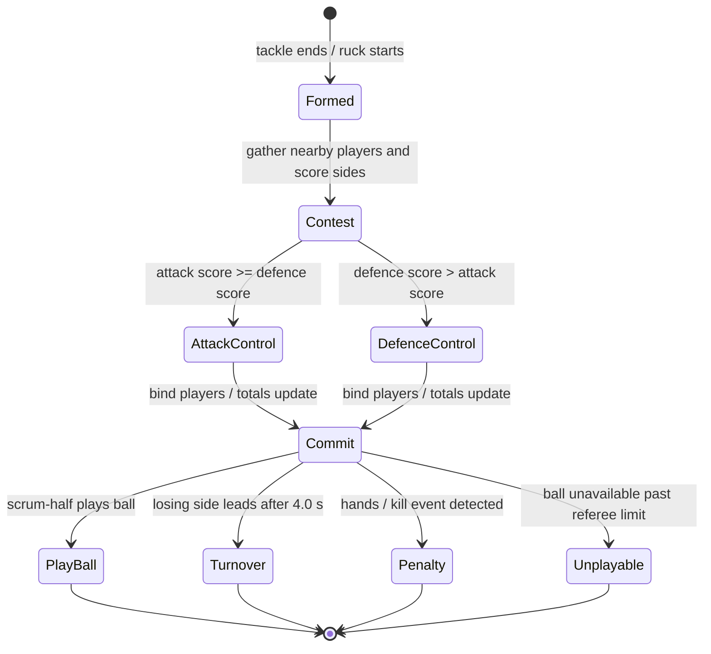
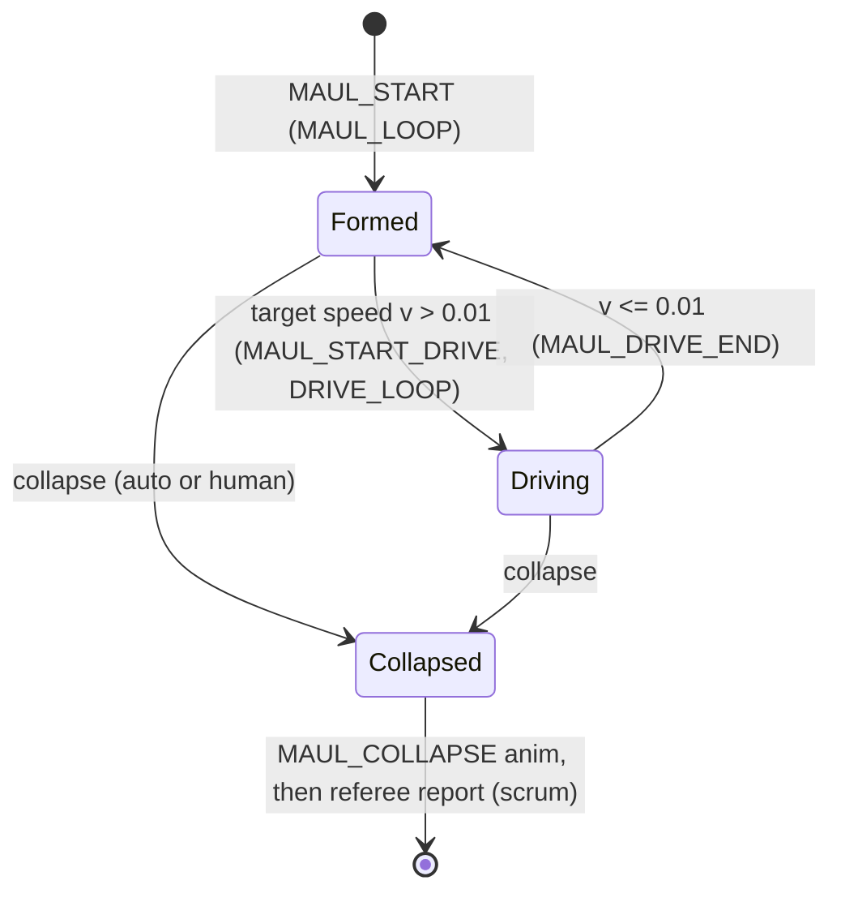
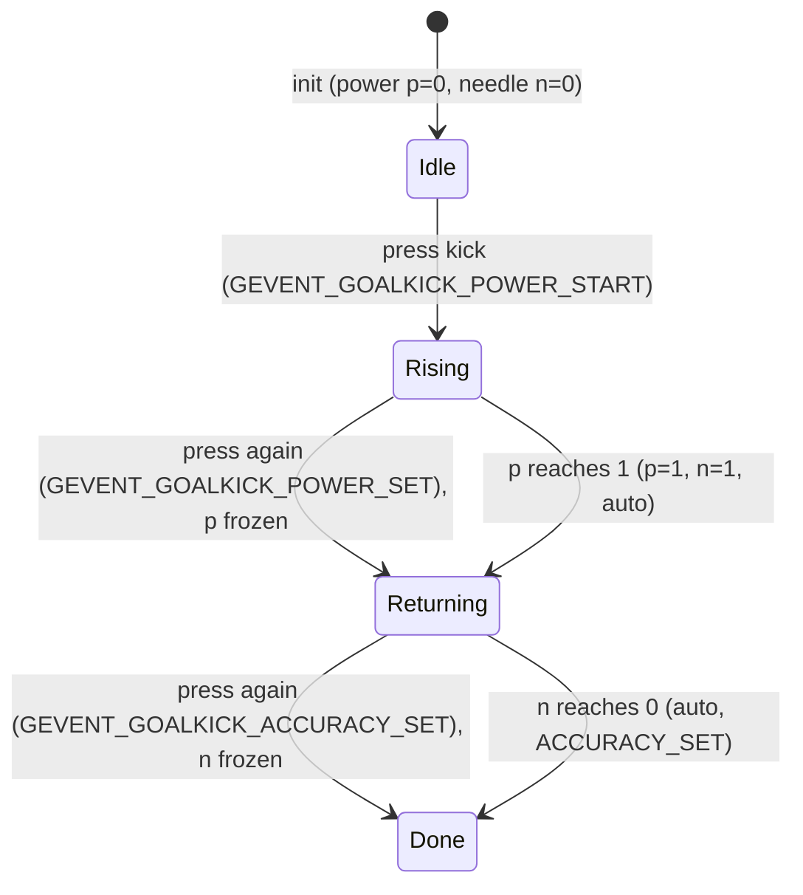
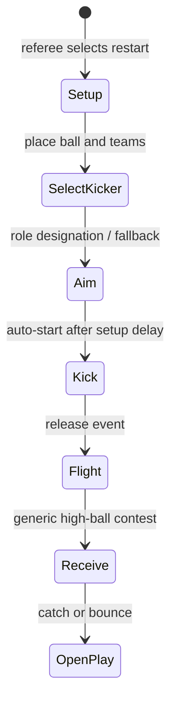
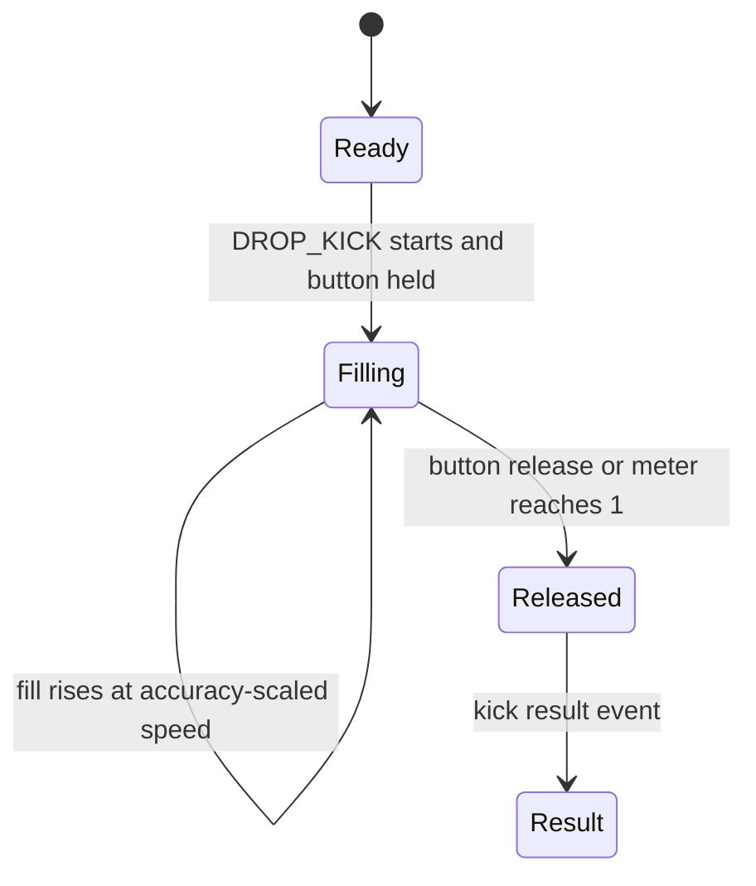
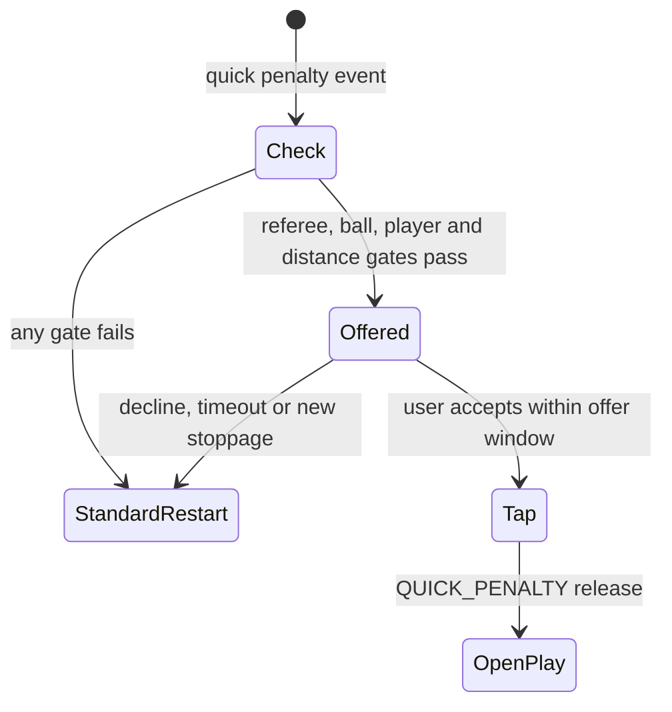

# 07 — Set pieces (scrum, line-out, ruck, maul, kicks and restarts)

Status: Phase 1 spec (setpiece lead). The evidence comes from static analysis of
the SecuROM-repaired unpacked image `Rugby08_unpacked.exe` (sha256
`aba7a647…`, same addresses as the original dump) and from the shipped XML in
`data.gob`. Every claim is tagged **observed** (read in the code or data),
**inferred** (reasoned from observed facts) or **unknown**. REA Evidence IDs
(`ev_…`, prefixes shown) are cited where an REA record exists. `LOCAL:<addr>`
marks claims read from the offline disassembly with SecuROM trampolines
inlined (`.omc/research/rules/funcasm.py`, `rules/rd.py`). This file contains
no game code. A focused REA confirmation pass was completed against the repaired
target with Ghidra 12.1.4. New REA Evidence IDs are cited in Q and N below.
The analysis is static: it confirms code and data relationships, not in-game
execution. Unresolved paths and indirect dispatch remain explicitly bounded.

**Boundaries.** The rules lead decides when a set piece is awarded and what
an infringement costs. The physics lead owns ball flight and tackle contact.
The AI lead owns team tactics and positioning. This file covers the
mechanics inside each set piece: inputs, timing, contests and outcome
formulas. Where a mechanic hands over to another lead, the hand-off event or
report is named.

## 0. Conventions used throughout

- **Pitch frame (inferred from constants).** $z$ runs along the pitch with
  the halfway line at $z=0$, the 22 m lines at $|z| = 28$ and the try lines at
  $|z| = 50$. Each team has a direction $d = \pm 1$ (`0x426490`).
  `setpiece_FieldZone` 0x664f20 classifies a point for a team: zone 1
  "own 22" if $z\,d < -28$, 2 "own half" if $< 0$, 3 "opp half" if $< 28$,
  4 "opp 22" otherwise (observed).
- **Time.** Animation clocks run at 50 ticks per second (constant 50.0,
  observed). All times below are seconds.
- **Randomness.** $U(a,b)$ is a uniform float (`0x819b20`). "With probability
  $p$" is `0x81a030` ($U(0,1) < p$). $\mathrm{randInt}$ and percent rolls use
  `0x819b00` and `0x819ac0` (a roll of 1..100 at most $p$). Inclusive or
  exclusive upper bounds of `randInt` are unverified.
- **Difficulty.** Set-piece tables are indexed by the game setting at
  `settings+0x190c` (0 easy, 1 medium/normal, 2 hard). This is inferred from
  `scrum_parameters.xml` indexing and the line-out CPU-defence table. The
  goal-kick tables use the kick object's own difficulty getter (`0x7416f0`),
  which is likely the same setting.
- **Human or CPU.** A team is human when its controller-type field
  (`team+0x120`) is 2. `0x40bd40` is IsHuman and `0x40bd60` is IsCpu
  (observed).

### 0.1 Player attributes as the code sees them (observed, confirmed with the players lead)

The attribute getter `setpiece_PlayerAttrGet` 0x6558b0 has 25 indices. They
follow `Xml/Chemistry/PlayerAttributes.xml` with **KickingPower left out**.
Indices 0–7 match the XML (Attack … Kicking). From index 8 the code index is
the XML value minus 1:

| Code index | Attribute | Player-data byte |
|---|---|---|
| 7 | Kicking | +0x28 |
| (none) | KickingPower | +0x29 (read directly by kick code) |
| 8 | GoalKicking | +0x2a |
| 9 | Tackling | +0x2b |
| 10 | Strength | +0x2c |
| 11 | Rucking | +0x2d |
| 12 | Scrummaging | +0x2e |
| 13 | Hooking | +0x2f |
| 14 | LineOuts | +0x30 |
| 15 | Discipline | +0x31 |
| 16 | Aggression | +0x32 |
| 17 | Stamina | +0x36 |
| 20 | Creativity | +0x39 |
| 21 | Bravery | +0x3a |

Special abilities are a u16 at player data +0x54: bit 9 BallWinner, bit 11
Scrummager, bit 12 Jumper (observed in set-piece code). Weight is a u16 at
+0x16 (lbs − 100) and height is at +0x1c (in − 60), per the players lead.
`0x6563c0` returns a player's current 0..100 condition derived from Stamina
through the fatigue model (players lead). `0x656510` is the fatigue penalty
on an attribute: $F = \lfloor (100-v)/2 \rfloor$ for Tackling and Rucking,
$\lfloor (100-v)/3 \rfloor$ for Passing, else 0 (observed).

### 0.2 Document map (brief sections)

Scope and entry points: R.1, S.1, L.1, M.1, K.1 (also `functions/setpiece.tsv`).
Behaviour: R–K below, plus the input summary in section I. Constants: section C
(plus the data tables in S.3 and K.2). Data structures: D. Mod hooks: H.
Acceptance tests: T. Open questions: Q. Confidence: Z.

## R. Ruck
### R.1 Entry points

| Address | Name | Role | Evidence |
|---|---|---|---|
| 0x657bc0 | setpiece_RuckStart | CRugbyRuck start (vtable slot 21): phase counter, random seed, post GEVENT_RUCK_START | LOCAL:0x657bc0 |
| 0x659760 | setpiece_RuckChooseWinner | formation contest, decides which side wins the ruck | ev_2669ebdd… |
| 0x6594c0 | setpiece_RuckGatherScore | sums the strength of nearby players for one side | LOCAL:0x6594c0 |
| 0x655900 | setpiece_RuckPlayerStrength | per-player ruck strength | ev_b7d9869a… |
| 0x662f40 | setpiece_RuckSideUpdate | per-side per-frame update: commitment and late turnover | ev_540b7e97… |
| 0x662ac0 | setpiece_RuckCpuCommit | CPU commitment decision | ev_030aaf96… |
| 0x6629b0 | setpiece_RuckHumanCommit | human "bind player" button | LOCAL:0x6629b0 |
| 0x663820 | setpiece_RuckAddPlayer | sends one player to bind | LOCAL:0x663820 |
| 0x663480 | setpiece_RuckTeamTotal | side total used for every comparison | LOCAL:0x663480 |
| 0x662820 | setpiece_RuckMaxCommit | per-side commit cap | LOCAL:0x662820 |
| 0x6576c0 | setpiece_RuckMeterValue | HUD ruck meter value | ev_7bc3e7ce… |
| 0x658cb0 | setpiece_RuckCheatInput | hands in the ruck / killing the ball | LOCAL:0x658cb0 |
| 0x659f00 | setpiece_RuckDoTurnover | performs a turnover | LOCAL:0x659f00 |
| 0x6175f0 | setpiece_RuckCpuHandsChance | CPU "hands" probability (AI-owned table) | LOCAL:0x6175f0 |
| 0x664f20 | setpiece_FieldZone | field zone of a point for a team | LOCAL:0x664f20 |
| 0x660eb0 | setpiece_RuckDecisionLogicLoad | loads and parses `config/ruckdecisionlogic.xml`; query use unresolved (see R.7) | LOCAL:0x660eb0 |

Classes (RTTI): `CRugbyRuck` (vtable 0x8ea884, 30 slots), `CRuckTeam`
(0x8eaf7c, one per side), `CRuckChooser`, `RuckScrumHalf`,
`COverlayItemRuck` (HUD), `RuckTutorial`. Events: GEVENT_RUCK_START (0),
WON (1), PLAYED_OUT (2), TURNED_OVER (3), HANDLING (4), KILLING (5), CHEAT (6),
PLAYER_ADDED (7), TURNED_CLOSE (8), PICKUP (9) (`rules/gevents.tsv`).

### R.2 Per-player ruck strength (observed, ev_b7d9869a…)

$$S(p) = \text{Rucking} + \left\lfloor \tfrac{\text{Aggression}}{20} \right\rfloor + \left\lfloor \tfrac{\text{Bravery}}{20} \right\rfloor + \left\lfloor \tfrac{\text{Strength}}{5} \right\rfloor - F(p,\text{Rucking}) + 30\cdot[\text{BallWinner}]$$

Attribute names use the in-code attribute order, which is the
`PlayerAttributes.xml` order with KickingPower removed (see D.1).
$F(p, a)$ is the fatigue penalty `0x656510`: with $v$ the player's current
condition (0..100), $F = \lfloor (100-v)/2 \rfloor$ for Rucking and Tackling,
$\lfloor (100-v)/3 \rfloor$ for Passing, 0 for other attributes (observed;
the source of $v$ is the players lead's fatigue model).

### R.3 Formation contest (observed, ev_2669ebdd…)

Runs once when the ruck forms. "Attack" is the side that had the ball,
"defence" the other.

1. **Gather.** For each side take the $N$ nearest players within radius
   $R$ of the ruck and sum $S(p)$: $R_{att} = 10$ m, $R_{def} = 8$ m.
   $N = 4$ for the side currently in possession at match level, else 3
   (reset to 3 in a direction-dependent case after several phases;
   inferred). Separately count forwards (shirts 1–8) inside $R$:
   $n_{att}$, $n_{def}$.
2. **Carrier and tackler.** Attack $+50$ if the tackled carrier passes check
   `0x60be00` (unknown, likely "presented the ball well"). Defence
   $+ \text{Tackling}(\text{tackler}) + 30[\text{BallWinner}] - F$.
   Attack $+ \text{Rucking}(\text{carrier}) - F$.
3. **Numbers handicap** (skipped at setting level 2 when
   `0x65a700` holds): if $n_{def} > n_{att}+2$ or $n_{att}=0$ then
   attack $\times 4/5$, else defence $\times 4/5$ (integer).
4. **Easy-level human bonus**: at setting level 0, a human side playing a
   CPU side gets $+100$.
5. **Team tendency**: with probability $t/10$, where $t$ is the attacking
   team's runtime value `team+0x124` (0..10, tactic, unknown which),
   attack $\leftarrow \max(\text{att}, \text{def}+50)$.
6. **Advantage owner**: if the tackle record names a favoured side (record
   `+0x14`), that side gets $\max(\cdot, \text{other}+50)$. Otherwise, after
   more than 3 consecutive rucks won by the same attack (1 if both sides
   are human), with probability 0.2 the defence gets
   $\max(\text{def}, \text{att}+50)$ (forced turnover).
7. **Sniping scrum-half**: if tackle-record byte `+0x28` > 1 (inferred:
   ruck formed off a scrum-half break), with probability 0.6 the defence
   gets $\max(\text{def}, \text{att}+50)$.
8. Training mode: the human side gets the other's score $+1$.
9. **Defence wins iff** $\text{def} > \text{att}$ (ties go to the attack).
   The two side objects store their final scores (word `+0x296`) as the
   starting part of their totals. If the defence wins, a turnover is
   raised, GEVENT_RUCK_TURNED_CLOSE is posted when $|z| > 45$ m (within
   5 m of the try line), and the consecutive-phase counter resets;
   otherwise the counter increments.

The "setting level" is the 0..2 game setting at `settings+0x190c`
(observed comparisons with 0 and 2; inferred to be a difficulty-like
option, name unknown).

### R.4 Commitment and totals

- Side total (observed): $T = s_0 + \sum_{p \in \text{bound}} S(p) + 100\cdot[c_{self}\ge 1 \wedge c_{other}=0]$,
  where $s_0$ is the formation score from R.3 and $c$ the number of extra
  players committed by each side.
- Cap: 6 extra players, or 5 for the side that won the formation.
- Human: each press of the bind button (`$X`, RuckAddPlayer, tutorial text
  "Each time $X is pressed a new player will make his way towards the ruck")
  commits one more player.
- CPU (one decision per ruck, by field zone of the ball for that team,
  `own22` $z\cdot d < -28$, `own half` $< 0$, `opp half` $< 28$, else
  `opp22`; $u \sim U(0,1)$):

| Zone | Players committed |
|---|---|
| own 22 | 1 if $u < 0.5$, else 0 |
| opp 22 | 2 if $u > 0.5$; 3 if $0.1 < u \le 0.5$; 4 otherwise |
| own half / opp half | 1 if $u > 0.3$; 2 if $0.1 < u \le 0.3$; 3 if $0.05 < u \le 0.1$; 4 otherwise |

  A formation winner with none committed adds one. A branch meant to keep
  reinforcing every $U(0.05, 0.10)$ s while behind is unreachable (its
  condition requires both $T_{self} < T_{other}$ and $T_{self} > T_{other}$),
  so the CPU never reinforces after the first decision (observed,
  ev_030aaf96…).
- A committed player is the nearest free player (flankers preferred);
  his arrival time is $d / (0.8\, v_{run}) + \delta$ where $v_{run}$ comes from
  his Speed. He counts toward $T$ only once bound.

### R.5 Late turnover and the ruck meter

- Only the side that **lost** the formation can still turn the ruck over,
  and only once the ruck is at least **4.0 s** old. When its total first
  exceeds the other side's, a latch starts; on the next frame, if the ruck
  is still live, the turnover happens if its total is still higher
  (debug flags can force or forbid it). One decision per ruck (global
  state 0 → 1 → 2) (observed, ev_540b7e97…).
- **Ruck meter** (HUD textures `ruckball`, `ruckbg`, `ruckred1-3`,
  `ruckgren`): value
  $m = \operatorname{clamp}\left(\frac{T_{+} - T_{-} + 400}{800}, lo, hi\right)$ where $+$ is the side
  attacking towards $+z$. Normally $[lo,hi]=[0,1]$; once decided, the
  winning side's half is locked: $lo=0.65$ or $hi=0.35$ (observed,
  ev_7bc3e7ce…).

### R.6 Cheating at the ruck

- Defending human, hands button (input mask 0x2000): holding accumulates
  $h$. On release:
  - $0 < h < 0.3$ s is **hands in the ruck**: if at least 2 defenders are
    bound, a turnover is attempted and GEVENT_RUCK_HANDLING is posted
    (the referee decides on a penalty); otherwise it is ignored.
  - $h \ge 0.3$ s is **killing the ball**; if $h > 0.2$ at the turnover,
    GEVENT_RUCK_KILLING is posted.
  The help text matches: tap to use hands, "click and hold" to kill.
- CPU defending side: the "kill ball" decision function always returns
  false (CPU never kills the ball, observed). The CPU uses hands with a
  percentage chance from a table keyed by field zone, match time
  (minute < 20, < 65, < 80, later) and score situation (values 5–60 %),
  plus about 2 % per forward with Discipline < 80 and +5 % for three
  specific player IDs (`0x6175f0`, partially decoded; AI-owned).
- Attacking side: help text describes automatic release "after a while",
  holding `$RUCK_CHEAT` to delay release, and a referee penalty if held too
  long. This is help-text evidence only; these are not confirmed runtime rules.
  The release timer remains unknown.

### R.7 Data and query accessors

`config/ruckdecisionlogic.xml` (per difficulty club/pro/elite, per
player class and field zone, probability ranges of a "binding intensity"
10–110) is loaded and parsed at boot (see R.1). Separately, the three
specifically inspected query/accessor routines had no **resolved direct
callers** in this static check. This does not establish whether they are used
through indirect dispatch or at runtime; that remains unknown
(`unk_c194…`). Do not exclude this data from behavior. Any implementation
guidance about its runtime use is provisional until those paths are resolved.

## S. Scrum

### S.1 Entry points

| Address | Name | Role | Evidence |
|---|---|---|---|
| 0x66c340 | setpiece_ScrumLoadParameters | parses `config/scrum_parameters.xml` | LOCAL |
| 0x66e760 | setpiece_ScrumStart | SCRUM_START set-up, state 0 | LOCAL |
| 0x66edb0 | setpiece_ScrumHoldLoopEnter | bind/hold loop, state 1, computes pack ratings | LOCAL |
| 0x66f2f0 | setpiece_ScrumComputeCpuTimings | CPU hook/drive/collapse times | LOCAL |
| 0x66ffc0 | setpiece_ScrumFeedEnter | feed, state 2 | LOCAL |
| 0x66fcd0 | setpiece_ScrumAnalogTilt | feed lateral offset (crooked feed) | LOCAL |
| 0x670ef0 | setpiece_ScrumUpdate | per-frame state machine | LOCAL |
| 0x6705e0 | setpiece_ScrumHandleInput | push inputs | LOCAL |
| 0x670740 | setpiece_ScrumPushContest | weighted push-result draw | LOCAL |
| 0x670b70 | setpiece_ScrumHookResolve | hook winner | LOCAL |
| 0x676d50 | setpiece_ScrumSuperHook | per-team hook test (incl. "super hook") | LOCAL |
| 0x676080 / 0x6763d0 | (per-player strength / pack rating writer) | pack ratings | LOCAL |
| 0x676a40 | setpiece_ScrumTeamInit | push energy, CPU collapse threshold | LOCAL |
| 0x678680 | (CPU push stamina) | energy drain | LOCAL |
| 0x6741c0 | setpiece_ScrumDynamicsUpdate | scrum body motion, turnover rule | ev_301593a8… |
| 0x674ed0 | setpiece_ScrumDynamicsForces | push forces and wheel torque | ev_a3e04efe… |
| 0x6756d0 | (damping) | linear/angular damping | ev_3bdb705b… |
| 0x6784f0 | setpiece_ScrumTeamCollapseCheck | three collapse triggers | ev_bbf1ac85… |
| 0x66fb60 | setpiece_ScrumCollapseEnter | collapse, state 6 | LOCAL |
| 0x672ca0 | setpiece_ScrumCanRetrieve | READY_TO_RETRIEVE gate | LOCAL |
| 0x678af0 / 0x678950 | setpiece_ScrumTeamPushoverCheck / setpiece_ScrumPushoverTry | pushover try | LOCAL |
| 0x676750 / 0x676810 / 0x6768c0 / 0x6769d0 | Ball-turnover / End / Reset / Slide actions | scrum outcomes | LOCAL |
| 0x431c20 | setpiece_RefScrumMonitor | referee's scrum checks (rules-owned) | LOCAL |

Classes: `Hbs::Rugby::Scrum::CScrum`, `CParameters`, `Team`, actions
`BallTurnoverAction`, `EndAction`, `ResetAction`, `SlideAction`;
`ScrumSetplayChooser`, `ScrumHalfState`, `ScrumRunState`, `ScrumTutorial`.
Events 0x4c–0x5c: SCRUM_START, RESTART, BIND, FEED, ROTATES, BIG_DRIVE,
ANY_DRIVE, HOOK, PICKUP, READY_TO_RETRIEVE, WON, COLLAPSE, ILLEGAL_ROTATE,
SCORE, ROTATE_TOO_FAR, TURNED_OVER, CHEAT.

In this section "team A" is the scrum's first team (`+0x60`, the feeding
side) and "team B" is the other (`+0x64`) (observed).

### S.2 State machine (observed, LOCAL:0x670ef0)

```mermaid
stateDiagram-v2
    [*] --> S0_Setup: ScrumStart (players placed, sequences loaded)
    S0_Setup --> S1_Bind: hold loop (SCRUM_HOLD_LOOP), pack ratings computed
    S1_Bind --> S2_Feed: feed (human feed button, or CPU after 2.0 s)
    S2_Feed --> S3_Hooked: a hooker wins the hook (GEVENT_SCRUM_HOOK, WON)
    S3_Hooked --> S5_Push: winner's push starts; loser's push starts 3.0 s later
    S4_Busy --> S5_Push: cutscene/busy check clears
    S5_Push --> S6_Collapse: collapse trigger (S.7)
    S5_Push --> S7_Done: ball reaches posts check ("HIT THE POSTS")
    S5_Push --> Release: scrum-half retrieves (READY_TO_RETRIEVE), state 99
    S5_Push --> Release: ball nearer the other No.8 -> BallTurnoverAction
    S6_Collapse --> Reset: ResetAction 4.38 s later (Rescrum cutscene)
```

A per-state timer accumulates while the scrum is stationary
($|v|<0.001$, $|\omega|<0.01$, `0x673f90`) and always in states 1, 2 and 4.
The referee uses this timer to detect a stalled scrum (S.9).

### S.3 Parameters (`scrum_parameters.xml`, observed)

| Field | Easy | Medium | Hard | Use |
|---|---|---|---|---|
| EarlyCPUDriveTime / LateCPUDriveTime (s) | 0.4 / 3.0 | 0.0 / 2.0 | 0.0 / 1.5 | CPU drive start time range |
| EarlyOffCPUHookTime / LateOffCPUHookTime (s) | 0.7 / 2.0 | 0.1 / 1.5 | 0.0 / 0.9 | CPU feeding side hook time range |
| EarlyDefCPUHookTime / LateDefCPUHookTime (s) | 0.8 / 1.7 | 0.7 / 1.2 | 0.6 / 0.9 | CPU defending side hook time range |
| HookRadius (m) | 0.85 | 0.85 | 0.85 | ball-to-hooker-foot distance that counts as a hook |
| SuperHookChance | 0.75 | 0.80 | 0.85 | chance the CPU feeder denies a human hook |

The file comment says an optional fourth "reveal" level can exist; it is
commented out in the shipped file.

### S.4 Pack strength (observed, LOCAL:0x676080, 0x6763d0)

Per-player scrum strength:
$$S_i = \left\lfloor 0.30\,W_i + 0.40\,\text{Scrummaging}_i + 0.20\,\text{Strength}_i + 0.10\,\text{Stamina}_i \right\rfloor + 10\,[\text{Scrummager}_i],\qquad W_i = \left\lfloor \tfrac{100\,w_i}{255} \right\rfloor$$
where $w_i$ is the raw weight field (lbs − 100). Raw bytes are used, with no
fatigue.

Pack rating over scrum positions 1–8 (loosehead, hooker, tighthead, two
locks, two flankers, No.8):
$$P = \Big\lfloor \sum_{i=1}^{8} \omega_i S_i \Big\rfloor,\quad \omega = [0.20, 0.15, 0.20, 0.12, 0.12, 0.08, 0.08, 0.05]$$
Two ratings are stored, ordered as (hook winner's pack, other pack). On easy
(setting 0), a CPU team's rating is multiplied by 0.75. Both bytes test the
same slot-1 team (probably a copy-paste bug), so only truncation changes the
ratio.

### S.5 Feed and hook (observed unless marked)

- **Feed.** The scrum-half plays SCRUM_SCRUM_HALF_FEED (anim speed 0.75 if
  team A is human, else 0.25) and posts GEVENT_SCRUM_FEED. A human feeder
  needs the feed button (input mask 0x200000; help text "Press $X to feed")
  and at least **2.0 s** since bind. A CPU feeder feeds automatically at 2.0 s.
- **Crooked feed.** At the feed, a lateral offset is computed as
  $c = 0.7\,a$. For a human, $a$ is the pad tilt axis, replaced by
  $+U(0.4,1)$ or $-U(0.4,1)$ while the left/right cheat buttons
  (masks 0x2000 / 0x400) are held. For the CPU, $a = U(0.1,1)$. The referee
  flags a crooked feed when $\text{tol} < c^2$, with tol = referee leniency
  byte / 100. It then posts GEVENT_SCRUM_CHEAT and reports against the
  scrum-half (S.9).
- **Hook test** (`0x676d50`, per team, every frame): the team is ready, the
  hooker's SCRUM_HOOK animation has passed its keyframe, and the ball is
  within **HookRadius** of the hooker's foot point. Humans trigger
  SCRUM_HOOK with `$SCRUM_HOOK`. The CPU triggers it at its CPU hook time.
- **CPU hook times** (`0x66f2f0`, drawn once per scrum):
  - Feeding side: $t_{hook}^{off} = U(\text{EarlyOff}, \text{LateOff})$.
  - Defending side: depends on the defending hooker's Hooking. With
    $k=\mathrm{randInt}(1,10)$, the time is exactly EarlyDef when $k \le$
    the threshold, else $U(\text{EarlyDef}, \text{LateDef})$:

    | Hooking | $k$ threshold | ≈ chance of EarlyDef |
    |---|---|---|
    | > 90 | 7 | 67 % |
    | > 80 | 6 | 56 % |
    | > 70 | 5 | 44 % |
    | > 60 | 4 | 33 % |
    | > 50 | 2 | 11 % |
    | > 40 | 1 | ≈ 0 % |
    | ≤ 40 | — | always LateDef |

  - Drive times: $t_{drive} = \text{Early} + U(0,1)(\text{Late}-\text{Early})$
    for each side.
  - When both sides are CPU, with $\Delta = P_A - P_B$: if $\Delta > 1$ the
    feeding side's hook and drive times are scaled by $(100 - 2\Delta)/100$;
    if $\Delta < -1$ the defending side's times are scaled by
    $(100 + 2\Delta)/100$.
  - CPU collapse time: $U(|s_{38}|, 60)$ s, where $s_{38}$ is an unknown
    scrum field.
- **Super hook.** At start, if team A is CPU and team B is human, with
  probability SuperHookChance a flag is set. While it is set, the human
  hook test fails ("HOOKING: super hooking!!"). So against a CPU feeder the
  human wins the hook only if the flag was not drawn (observed mechanism;
  the effect is inferred from the code shape).
- **Both hook on the same frame** (`0x670b70`):
  $s_A = \text{Hooking}_A + \mathrm{randInt}[1,50)$,
  $s_B = \text{Hooking}_B + \mathrm{randInt}[1,20)$. A wins iff
  $s_A \ge s_B$, which strongly favours the feeding side. Otherwise the side
  that hooked first wins. The winner posts GEVENT_SCRUM_HOOK and
  GEVENT_SCRUM_WON, and the scrum is positioned at $x = -2.5\,d_{winner}$.
- **Non-natural hooker** (`0x66cbc0`, "Non-Natural Hooker: Forcing %s to lose
  scrum."): a side without a natural hooker is forced to lose. Exact
  condition not decoded (unknown).

### S.6 Push contest and scrum motion

**Inputs** (`0x6705e0`, observed). A human pack pushes with stick Y times
its direction, but only if the team's control flag is set. CPU team A
pushes $U(0,1)$; CPU team B pushes $-U(0,1)$. Help text: "move $LEFT_ANALOG
in the direction you want them to drive".

**Push-result draw** (`0x670740`, observed; result meaning inferred). With
$r = P_{winner}/P_{other}$ and base weights
$w = (0.35, 0.5, 0, 0.1, 0.05)$ if the hook winner is team A, else
$(0.1, 0.2, 0, 0.5, 0.2)$:
$$w_0 \leftarrow w_0 r^3,\quad w_1 \leftarrow w_1 r^2,\quad w_3 \leftarrow w_3/r^2,\quad w_4 \leftarrow w_4/r^3$$
A human team A with input $\le 0$ zeroes $w_0, w_1$. A human team B with
input $\ge 0$ zeroes $w_3, w_4$. Normalise and draw: buckets 0–2 (or an
all-zero sum) give result **A**, buckets 3–4 give result **B**. Inferred:
result A means "team A gains ground" and B means "team B gains ground". The
human gating supports this reading. The $r$ scaling is applied the same way
whichever side won the hook. When team B is the winner this favours team A
as B gets stronger, which looks like a bug; keep it for fidelity.

**Push energy** (observed). Each team starts with
$E = \sum_i \omega_i (0.2 + 0.8\,c_i/100)$, using condition $c_i$ and the
same weights $\omega$. While pushing, a CPU pack drains $E$ over
$T = 8 + 3\,\mathrm{clamp}((P-55)/45, 0, 1)$ s at full input, twice as fast
when it is not pushing but the opponent is.

**Motion and wheel** (ev_a3e04efe…, ev_301593a8…). Each side whose energy is
$> 0$ and whose push has started applies a force
$$\vec F = 0.8\,u\,(-\sin\varphi,\ 0,\ \cos\varphi),\quad \varphi = \text{pushAngle}\cdot d$$
at its No.8. The torque is the vertical component of
$(\vec r_{No8} - \vec r_{scrum}) \times \vec F$ ("FeedTourque" and
"OtherTourque"). The net torque has a dead-zone of 0.2 and angular
acceleration $= 20 \times$ net torque. The linear force is $\vec F_A + \vec F_B$.
Linear velocity decays at 0.5/s and angular velocity at 10/s toward 0.
Position is clamped to $\pm 40$ (x) and $\pm 70$ (z). The loser of the hook
starts pushing 3.0 s after the winner. It starts early if, 0.5 s after the
winner's onset, the winner's force is below 0.1. Help text: "angle the drive
against the opposing pack" rotates (wheels) the scrum.

**Rotation limit.** While $|\theta| > 90°$, GEVENT_SCRUM_ROTATE_TOO_FAR is
posted for the side contributing more torque (random on a tie). A visual
animator posts it once when the displayed angle crosses 90°. Its consumer
(reset or turnover) is **unknown**. `Rotate`/`Unrotate` (0x6703a0/0x670500,
GEVENT_SCRUM_ROTATES) have no direct callers (unknown).

### S.7 Collapse (ev_bbf1ac85…, observed)

Checked per team per frame unless the scrum is ending:
1. A human team presses the collapse button (mask 0x2000; `$SCRUM_COLLAPSE`).
2. Either team: the sideways-acceleration idle timer (lateral acceleration
   above 1.5) exceeds **0.5 s**.
3. A CPU team that lost the hook, in state ≥ 4, is pushed back past its
   threshold $U(0.1, 2.0)$ m (drawn at team init).

Collapse sets that team's input to 0, records the collapsing team, plays
SCRUM_HOLD_LOOP_COLLAPSE, posts GEVENT_SCRUM_COLLAPSE, enters state 6 and
schedules a ResetAction (Rescrum cutscene) 4.38 s later. The referee decides
the sanction (S.9).

### S.8 How the scrum ends

- **Ball retrieval** (`0x672ca0`): the hook winner's scrum-half can take the
  ball (GEVENT_SCRUM_READY_TO_RETRIEVE) once the 2.0 s countdown after the
  hook has expired and the ball is within **2.0 m** (xz) of him.
- **Turnover in the scrum**: every frame in the push state, if the ball is
  nearer the non-winner's No.8 than the winner's, BallTurnoverAction makes
  the other team the winner and posts GEVENT_SCRUM_TURNED_OVER (observed).
- **Pushover try** (`0x678af0`): the winner's pack, a human holding the drive
  buttons (mask 0xc003) or a CPU automatically, takes the ball beyond the
  try-line limit. This plays SCRUM_PUSHOVER_TRY, posts GEVENT_SCRUM_SCORE and
  calls the referee (try award is rules-owned).
- No.8 pick-up (SCRUM_PICKUP_LEFT/RIGHT, SCRUM_NO8RUN*) and the scrum-half
  pass, run or kick choice (SCRUM_HALF_PASS/RUN/KICK, SCRUM_NO9RUN*) exist
  as commands and animations. The choice logic was **not decoded**
  (`unk_725baa59…`).

### S.9 Referee hand-off (rules-owned; mechanism observed, sanctions inferred)

`setpiece_RefScrumMonitor` 0x431c20 runs while play is in the scrum phase:
- **Collapse, more than 2 s after it happened**: penalty against the
  collapser with a chance that depends on two referee attributes and on
  whether the collapser is the user's team (constants 700 + 2·attr out of
  1000 and similar).
- **Stalled scrum**: the stationary timer exceeds
  $\max(2, 6 - \text{attr}_2) + \text{strict}/12$ s, which triggers a
  reset-type report.
- **Early hook** (hooking during the bind state): report against the hooker.
- **Crooked feed** (S.5): GEVENT_SCRUM_CHEAT, report against the scrum-half.

The referee leniency byte (referee +0x110, units cm) is drawn at random per
match. Its range is unknown.

## L. Line-out and quick line-out

### L.1 Entry points

| Address | Name | Role | Evidence |
|---|---|---|---|
| 0x642880 | (CRugbyLineOut::Update) | per-frame state machine | LOCAL |
| 0x6404e0 | (LineOut start) | set-up, GEVENT_LINEOUT_START, logs referee tolerance | LOCAL |
| 0x63fdb0 | setpiece_LineOut_CpuPickThrowGroup | CPU throw-length choice | ev_fe9463a9… |
| 0x63fff0 | setpiece_LineOut_CpuPlanThrow | release and jump scheduling | LOCAL |
| 0x63f380 | (throw release) | throw error, cheat aim, launch | LOCAL |
| 0x63f150 | setpiece_LineOut_ThrowError | thrower error table | ev_b509ab4b… |
| 0x63eac0 | setpiece_LineOut_CpuJumpUpdate | human jump/defence buttons, CPU defence | LOCAL |
| 0x642500 | ai_Player_StaggerResolve (AI lead's name) | CPU defence group choice | LOCAL |
| 0x640b40 | setpiece_LineOut_ExecuteJumps | executes flagged jumps | LOCAL |
| 0x640d90 | setpiece_LineOut_ResolveCatchContest | who wins the ball | ev_c4e1c4a2… |
| 0x647dc0 | setpiece_LineOut_BestCatchSample | reach geometry | ev_fc4e300c… |
| 0x645400 / 0x646870 | setpiece_LineOut_JumperReachStats / setpiece_LineOut_CatchRadius | reach radius | LOCAL |
| 0x641810 / 0x641ae0 | setpiece_LineOut_FindCatcher / setpiece_LineOut_OnCatch | physical catch and outcome | ev_5f977c1c…, ev_e86d7fab… |
| 0x646e40 | setpiece_LineOut_PlacePlayers | non-jumper placement | ev_6df8f780… |
| 0x432e70 / 0x432fa0 | RefShouldCallLineoutCheat / referee line-out judge | not-straight and time-wasting | LOCAL |
| 0x62c3a0 | setpiece_QuickLineOut_CheckEligibility | quick line-out gate | LOCAL |
| 0x649f60 / 0x649ca0 | setpiece_QuickLineOut_TaskUpdate / ShouldBail | quick line-out task | LOCAL |

Classes: `CRugbyLineOut` (vtable 0x8e989c), `CLineOutTeam` (two embedded,
offence and defence), `ILineOutSkill` with `LineOutEasy/Medium/Hard`,
`QuickLineOut`, `ThrowToSelfTask`, `LineOutState`, `LineOutLeavingState`.
Events 0x41–0x4b: START, PREP_THROW, THROW, JUMP, WON, BALL_HIT_GROUND, CATCH,
TRY, TURNOVER, OVER, CHEAT.

### L.2 Groups and control modes

- Three jump groups (pods): **front (0), middle (1), back (2)**. Buttons:
  `$X` front, `$KICK_DROP` (circle) middle, `$TRIANGLE` back (help text and
  masks 0x1 / 0x8000 / 0x4000, observed).
- Two control modes. **Basic** is the default. **Advanced** is the user
  option "Advanced Line-out Control". The mode is forced to Basic in
  tutorials. Mode values 2 and 3 exist in the code but are never set
  (observed).

### L.3 State machine (observed, LOCAL:0x642880)

```mermaid
stateDiagram-v2
    [*] --> Start: GEVENT_LINEOUT_START, speed scale s=1
    Start --> Wait: state 0xb
    Wait --> Select: after 1.5 s
    Select --> Hold: length chosen (human button / CPU plan)
    Hold --> Release: button released or 0.4 s (basic); stick flick (advanced); CPU at planned time
    Release --> Thrown: thrower anim reaches release frame (GEVENT_LINEOUT_PREP_THROW earlier)
    Thrown --> Flight: throw (error + cheat), contest, GEVENT_LINEOUT_THROW
    Flight --> Caught: winner's hand reaches ball (WON or TURNOVER, CATCH)
    Flight --> Ground: nobody catches (GEVENT_LINEOUT_BALL_HIT_GROUND)
    Caught --> Distribute: maul option or scrum-half pass/tap (CPU); free play (human)
    Distribute --> Over: +0.2 s, GEVENT_LINEOUT_OVER
    Ground --> Over
```

### L.4 Throw (offence)

**Basic mode, human** (observed):
1. 1.5 s after the start, the first of `$X`/circle/triangle pressed fixes the
   length. It cannot be changed afterwards.
2. While that button is held, the hold time $h$ grows up to 0.4 s and sets
   the speed scale
   $$s = 0.3 + 2.2\cdot\mathrm{clamp}\!\left(1 - \frac{h - 0.04}{0.36},\ 0,\ 1\right)$$
   so a tap ($h \le 0.04$) gives $s = 2.5$ (fast, flat) and a 0.4 s hold
   gives $s = 0.3$ (slow lob).
3. Releasing the button, or reaching 0.4 s, commits the throw.
4. The jumper is **not** player-timed in basic mode. The game schedules the
   jump so that the jumper's catch frame meets the ball. With release
   delay $E = (\ell/50 - 3.1)/s$ ($\ell$ = thrower clip length in ticks, not
   extracted), flight time $T_f$ from a ballistic solve with $g = 9.8$ and
   catch frame $f_c$: jump time $t_j = t_0 + E + T_f - f_c/50$.
5. Launch angle passed to the solver, in degrees (inferred):
   $P(s) = 30\,(1.5 - (s-0.3)/0.7)$ for $s<1$; 30 at $s=1$; $50/s$ for
   $s>1$. Note the discontinuity at $s = 1$ (about $h \approx 0.285$ s):
   15° just below, 50° just above (observed as coded).

**Advanced mode, human** (observed): length is chosen with stick Y
(forward = front, back = back; middle only on D-pad pads). Speed modifiers
are held during the throw: one button gives $s = 2.5$, another $s = 0.3$,
neither gives $s = 1.0$. The throw is released by flicking the stick forward
($Y > 0$, $|stick| > 0.95$) after pulling back. A "back" throw whose pull-back
was not below −0.9 is downgraded to middle. Jumps are triggered manually:
`$X`/circle/triangle flag the front/middle/back group, even before the throw
(`LINEOUT_JUMPCLOSE/MEDIUM/FAR`).

**CPU throw choice** (observed, ev_fe9463a9…). $u \sim U(0,1)$, zone from S.0,
skill level $L$ = 1/2/3 (inferred Easy/Medium/Hard):

| Zone | L | front if $u\le$ | middle if $u\le$ | else |
|---|---|---|---|---|
| 1 (own 22) | any | — | 0.3 (middle) | front |
| 4 (opp 22) | 1 | 0.10 | 0.75 | back |
| 4 | 2 | 0.35 | 0.80 | back |
| 4 | 3 | 0.60 | 0.80 | back |
| 2, 3 | 1 | 0.15 | 0.90 | back |
| 2, 3 | 2 | 0.35 | 0.90 | back |
| 2, 3 | 3 | 0.65 | 0.90 | back |

(In zone 1: middle if $u \le 0.3$, else front.) The CPU throws at $s = 1$
and its jumper's time includes a random delay $U(0, X)$ from the jump
animation.

**Throw error** (observed, ev_b509ab4b…), from the thrower's LineOuts:

| LineOuts | Error chance | Max error angle (deg, inferred) |
|---|---|---|
| ≥ 90 | 0 % | — |
| 80–89 | 10 % | 0.5 |
| 60–79 | 20 % | 1.0 |
| 40–59 | 30 % | 2.0 |
| < 40 | 50 % | 5.0 |

If the error triggers, the angle is $U(-\max, +\max)$. It is applied
sideways to the target and also adds to the lateral cheat value.

**Deliberate crooked throw** (observed). The lateral aim value is
$c = 0.5\,a$ m. For a human, $a$ is stick X, replaced by $\pm U(0.4, 1)$
while the lean buttons (masks 0x2000 / 0x400) are held. For the CPU,
$a = U(0.1, 1)\,d$. The throw is called not straight when the cheat distance
(only when the throw leans toward the throwing side) exceeds the referee
tolerance (referee byte / 100 m, "Ref cheat tolerance is %dcm"). The referee
judge posts GEVENT_LINEOUT_CHEAT and files a penalty-type report (rules-owned).
The same judge reports time-wasting when the select phase exceeds
$10 + L/18$ s, or the hold phase exceeds $0.75\times$ that ($L$ = a signed
settings byte).

### L.5 Defence

- **Human defender**: presses `$X`/circle/triangle once to pick the group
  that jumps, at any time up to the throw. If the offence triggers a back
  jump and the human defender has not chosen, the back group jumps
  automatically 1.0 s later (observed).
- **CPU defender**: 0.05 s after the offence flags a jump, it jumps in the
  thrown group with probability **0.70 / 0.85 / 0.985** (easy / medium /
  hard), else in a random group. If it still has not jumped at the release
  frame (the usual case, because the contest runs at release), it jumps
  front or middle at 50/50 just before the contest (observed).

### L.6 Contest and catch (observed, ev_c4e1c4a2…)

Let $O$ be the offence group that jumped and $D$ the defence group that
jumped. Rating $R$ is the jumper's LineOuts byte.

1. Offence jumped, defence did not: **offence wins**.
2. Defence jumped, offence did not: **defence wins**.
3. Neither jumped: nobody wins; the ball falls (BALL_HIT_GROUND).
4. Both jumped:
   $$o = R_O + \mathrm{randInt}(0,20) + 50\,[O = 0 \wedge D \ne 0],\qquad \delta = R_D + \mathrm{randInt}(0,20)$$
   $$p_{off} = \frac{o}{o + \delta},\ \text{and } p_{off} = 1 \text{ if the offence is human and } o > \delta$$
   Offence wins iff $U(0,1) < p_{off}$. Jump timing and group match do not
   enter the probability.

The contest runs once, at the release frame, or when the offence jump
executes after release (advanced mode).

**Physical catch** (observed). The winner still has to get a hand to the
ball. Fifteen samples across the jumper's catch window find the closest
hand-to-ball distance. The ball is caught if that distance is within the
reach radius
$$r = 0.45 + 0.4\,(S/100)^3 \;(+0.2 \text{ back},\ +0.3 \text{ front jumper vs another group}),\ \times 0.75 \text{ on easy for a CPU team}$$
with reach stat
$$S = 0.1\,b_{3c} + 0.4\,\text{LineOuts} + 30\,[\text{Jumper}] + 0.1\,b_{38} + 0.1\,\text{Stamina}$$
($b_{3c}$, $b_{38}$ are attribute bytes at +0x3c and +0x38, code indices 23
and 19). In tutorials the radius is fixed at 0.7 m. So in advanced mode the
human's jump timing matters through reach, not through the contest roll.
A catch posts GEVENT_LINEOUT_WON (offence) or GEVENT_LINEOUT_TURNOVER
(defence), then GEVENT_LINEOUT_CATCH.

**After the catch**: for a CPU catching side whose scrum-half is not human,
either a maul is formed (predicate `0x644560`, not decoded) or the ball is
passed or tapped to the scrum-half (50/50 between two receiver animations).
For a human catching side nothing is scripted: players are released and
the line-out ends 0.2 s later. The post-catch branch also depends on an
owner field (values 1 and 2 select scrum-half pass set-ups; meaning
unknown).

### L.7 Placement (observed, low–medium confidence on frame)

Relative to the touch point, along-pitch $u$ (team direction) and
across-pitch $v$: line players $i = 0..4$ at $u = 19 + 9i$, $v = -10$; the
first receiver at $u = 26$ (or 8 if a 15 m box test fails), $v = -11$.
Jumpers and lifters are placed by the line-out animation.

### L.8 Quick line-out (observed)

- **Eligibility** (`0x62c3a0`, on ball into touch). Rejected if:
  - a quick option is already pending;
  - a player is injured;
  - the referee is inactive or the advantage period has ended;
  - it is the other team's line-out or a penalty;
  - a CPU team's ball went out on the full;
  - the ball is too far away (`0x64cbf0`).

  Otherwise the nearest player (or the carrier) is sent to fetch the ball
  ("quick line out coming up").
- **Task** (`0x649f60`): run to the ball (retry until within 2.0 m), then
  throw to self ("QL – catcher is thrower", `ThrowToSelfTask`,
  QUICK_LINEOUT_PASS(_TO_SELF)). Bail if **8.0 s** elapse, the other team
  holds the ball, the ball is back in play, it is far out of the pitch
  (> 3.0 m), or the stadium is hit. The human prompt uses `$SCRUM_HOOK`
  (help text).

## M. Maul

### M.1 Entry points

| Address | Name | Role | Evidence |
|---|---|---|---|
| 0x63ab50 | (CMaul::Update, vtable 0x8e96c4 slot 4) | state machine, idle/collapse | LOCAL |
| 0x63a800 | (drive speed) | target drive speed | ev_1ebcf154… |
| 0x6362b0 | (CMaulTeam update) | power, drain, CPU recruiting, human collapse | LOCAL |
| 0x636160 / 0x637760 | (binder power / join) | power added per joiner | LOCAL |
| 0x635bf0 | (push input) | stick heading window | LOCAL |
| 0x63a740 | (collapse) | enter collapsed state | LOCAL |
| 0x627210 / 0x63ba60 | setpiece_MaulIdleTimeLog / setpiece_MaulSlide | debug / slide | LOCAL |

Classes: `CMaul`, `CMaulTeam` (two embedded: side 0 is the ball side driven
forward, side 1 the defence), `MaulSetplayChooser`, `MaulScrumHalf`,
`COverlayItemMaul`. Events 0x31–0x35: MAUL_START, COLLAPSE, BIG_DRIVE,
DRIVE, PLAYER_JOINS_MAUL. Animations MAUL_START/LOOP/START_DRIVE/DRIVE_LOOP/
DRIVE_END/COLLAPSE_n/GET_UP/SETUP1–4.

### M.2 State machine (observed)

### M.3 Power and joining (observed)

- Each side has power $P \in [0, 100]$ and push input $u \in [0,1]$.
- A joiner (n-th player, at most 7 per side) adds
  $B(n)\,(0.2 + 0.8\,c/100)$, where $c$ is the player's 0..100 condition
  rating (`0x6563c0`, Stamina-based through fatigue; inferred) and:

| $n$ | 1–3 | 4 | 5 | 6 | 7 |
|---|---|---|---|---|---|
| $B$ human side | 41.2 | 30 | 40 | 50 | 60 |
| $B$ CPU side | 41.2 | 40 | 50 | 60 | 70 |

  Help text: "You can bind up to 4 additional players, each will increase
  maul power" (`$MAUL_ADDPLAYER`). This matches 3 initial + 4 additional.
- **Human push**: the stick magnitude counts only if the stick heading,
  measured relative to forward, is within 44°–136° (±46° around "up"). The
  CPU pushes $u = 1$ whenever $P > 0$.
- **Drain** per second: $\delta = 15 + 5\,(1 - (m - 150)/450)$ with $m$ an
  unknown clamped quantity in [150, 600] (probably maul age in ticks), so
  15–20/s. A side not pushing while the opponent pushes drains at $2\delta$.
  A pushing side whose opponent has $P=0$ drains at $0.3\,\delta$.
- **CPU recruiting**: when a CPU side's $P$ falls below a threshold drawn
  from $U(60, 70)$, the nearest candidate joins after a delay of
  **2.0 / 1.5 / 1.0 s** (easy / medium / hard).

### M.4 Drive speed (observed, ev_1ebcf154…)

With $P_0, u_0$ the ball side and $P_1, u_1$ the defence:
- Both $P \le 0$, or both $u = 0$: $v = 0$.
- Ball side unopposed ($P_0 > 0$ and the defence has $u_1=0$ or $P_1 \le 0$):
  $v = 1.175$ if $P_0 > 5$, else $1.165\,P_0/5$.
- Defence unopposed: $v = 1.175$ backward if $P_1 > 5$. Otherwise the code
  uses $1.165\,P_0/5$ (it divides the *ball side's* power, a quirk; keep it).
- Both pushing, with $\Delta = P_0 - P_1$: if $|\Delta| \le 5$ the maul
  **stalls** ($v=0$). Else $v = 0.05(|\Delta| - 5)$, doubled if either side
  has no input or no power, clamped to $[0.01, 1.175]$ m/s. Direction is
  toward the side with less power.
- The maul speed ramps toward $v$ at $1.0\,|v|$ per second and decays at
  $0.5\,|v|$ per second.

### M.5 Use it or lose it and collapse (observed)

- The idle timer accumulates while the ball side is not winning the drive
  (stalled or going back). It resets when the ball side gains ground.
- On medium and hard, when idle time > **1.5 s** and the maul is older than
  **4 s**, a collapse is armed and fires after **1.0 s**. On easy the
  threshold is 9999 (never). A large maul heading change (> 55) also arms it.
- A human side can pull the maul down with the collapse button
  (`$MAUL_COLLAPSE`, mask 0x2000) once it has more than one binder and an
  internal timer exceeds 1 s.
- After the collapse animation, the maul files a referee report (why 0x1b,
  "what" = scrum). Which team gets the scrum is decided by the referee (from
  ball velocity sign; not confirmed, `unk_b26b385f…`).
- Not decoded: maul formation trigger and approach (0x634a80), joiner
  candidate search, slide, exits (MAUL_RUN_LEFT/RIGHT, MAUL_KICK_*,
  MAUL_PASS_LEFT) and the CPU pass-versus-drive chooser.

## K. Kicks and restarts

### K.1 Kick object, types and kicker selection

All placed and restart kicks use one kick object (`CKick`, vtable 0x8f62fc;
constructor 0x7418c0) with a type at +0x60 (observed):

| Type | Kick | Control path |
|---|---|---|
| 1, 6 | punt | generic gauge (`0x746950`) |
| 2 | up-and-under | generic |
| 3 | grubber (±5° random) | generic |
| 4, 5 | goal kick (conversion, penalty goal) | goal-kick meter (K.2) |
| 7 | kick-off | restart aim (K.4) |
| 8 | drop kick / drop goal | drop meter (K.5) |
| 9 | scrum-half kick | generic |
| 10 | 22 m drop-out | restart aim (K.4) |
| 11, 12 | penalty / free-kick kick to touch | restart aim (K.4), yaw limit ±90° |
| 13 | quick tap | QUICK_PENALTY anim |

**Kicker stats** (observed, ctor 0x7418c0):
- accuracy $a = \mathrm{clamp}((A-50)/50, 0, 1)$, with $A$ = GoalKicking for
  types 4/5, Kicking otherwise;
- power rating $r = 0.25 + 0.0075\,\mathrm{clamp}(\text{KickingPower}, 50, 100) \in [0.625, 1]$,
  used for types 1, 2, 4, 5, 8 and 9, else $r = 1$.

Debug and tutorial modes force $A = P = 85$ or 95.

**Designated kickers** (observed). The team holds five designations:
LongGoalKicker, ShortGoalKicker, LongPunter, ShortPunter, KickoffTaker
(`setpiece_Team_GetDesignatedKicker` 0x61aae0).
- Auto-assignment on team-sheet change:
  - LongGK = best GoalKicking with +100 if KickingPower ≥ 85;
  - ShortGK = best GoalKicking;
  - LongPunter = best Kicking with +100 if KickingPower ≥ 80;
  - ShortPunter = best Kicking;
  - KickoffTaker = squad slot 9 (fly-half).
- Fallbacks when the designee is missing are "best of" the same attribute.
- Restart kicker:
  - kick-off uses the KickoffTaker;
  - 22 m drop-out and penalty/free-kick punts use the ShortPunter if the
    ball is in zone 3 or 4, else the LongPunter.

So the drop-out normally goes to the LongPunter, not the kick-off taker.

### K.2 Goal-kick meter (conversions and penalty goals, kick types 4 and 5)

Data: `GoalKickSettings` XML (`data.gob/2a49d4edce33edfed090c978dbc10d2c.xml`,
comment "Rugby 2005 Goalkicking Settings … see kickxml.cpp"), parsed by
`setpiece_GoalKickSettingsLoad` 0x450010 (observed): a per-difficulty table
(easy, normal, hard), a drop-goal table, and five kicker classes.

| Field | Easy | Normal | Hard | Use |
|---|---|---|---|---|
| PrimaryAngle (deg, inferred) | 5.0 | 10.0 | 11.0 | angle error at \|x\| = 1 |
| SecondaryAngle | 8.0 | 12.0 | 12.0 | angle error at \|x\| = 2 |
| SwingThreshold | 0.866 | 0.866 | 0.866 | power above which red-zone and swing apply |
| MaxSwing | 0.0 | 0.0 | 0.0 | swing (curl) at full power; zero ships |
| RedZoneMultiply | 1.02 | 1.05 | 1.075 | angle-error factor at full power |
| MinTime / MaxTime (s) | 1.3 / 2.3 | 1.0 / 2.0 | 0.8 / 1.3 | AI gauge traverse time, stat 40 → 100 |
| MinPower / MaxPower | 10 / 33 | 10 / 33 | 10 / 33 | launch power range (units: see K.3) |
| MinAccel / MaxAccel (1/s²) | 0.5 / 1.3 | 0.8 / 2.0 | 1.0 / 2.4 | human gauge acceleration, stat 100 → 40 |
| DropGoalMaxSpeed | 2.0 | 2.5 | 3.0 | drop-goal meter (K.4) |
| DropGoalSpeedExponent | 1.25 | 1.3 | 1.32 | drop-goal meter |
| DropGoalShootoutModifier | 4.5 | 4.0 | 4.0 | drop-goal shoot-out mode |

| Kicker class | Top | Centre | Bottom | Zone width |
|---|---|---|---|---|
| 0 Excellent | 0.343 | 0.230 | 0.125 | 0.218 |
| 1 Good | 0.311 | 0.230 | 0.159 | 0.152 |
| 2 Average | 0.286 | 0.230 | 0.182 | 0.104 |
| 3 Poor | 0.262 | 0.230 | 0.197 | 0.065 |
| 4 Terrible | 0.250 | 0.230 | 0.210 | 0.040 |

Other flags: `FakeStat` (-1 = off), `ForceAI`, `ShowLines` (debug aim
lines), and a debug difficulty override (int, -1 = off).

**Stat-dependent gauge parameters** ($k$ = kicker stat 0..100, $d$ = difficulty):

$$t(k) = \begin{cases} \text{MinTime} & k < 40\\ \text{MinTime} + \frac{k-40}{60}(\text{MaxTime}-\text{MinTime}) & k \ge 40\end{cases}\qquad
a(k) = \begin{cases} \text{MaxAccel} & k < 40\\ \text{MaxAccel} - \frac{k-40}{60}(\text{MaxAccel}-\text{MinAccel}) & k \ge 40\end{cases}$$

(`0x44fe20`, `0x44fe80`, observed.) Better kickers get a slower, easier gauge.

**Meter state machine** (`setpiece_KickMeterUpdate` 0x73e860, observed;
init `setpiece_KickMeterInit` 0x73dbb0, ev_32651610…):

- Human: both channels start at speed 0 and accelerate at $a(k)$ (two
  separate speed/acceleration pairs). In *Rising*, $p$ and $n$ climb
  together: $v \mathrel{+}= a\,\Delta t$, $p \mathrel{+}= v\,\Delta t$. Time to fill from rest:
  $\sqrt{2/a}$ (normal: 1.0 s for $k<40$, 1.58 s for $k=100$). On the power
  press, all speeds reset to 0 and the needle falls back from where it was
  with its own acceleration. Values are clamped to $[0,1]$. If the gauge
  tops out by itself the power is 1 and one more press is consumed to
  "set power" before the accuracy press (observed branch).
- AI: constant speed $1/t(k)$ toward precomputed targets (below).
- Training mode with a human: speeds ×0.75.

**Accuracy error** (`0x740830`, observed): with the kicker's class zone
$(T, C, B)$ and the frozen needle $n$:
$$e = \begin{cases} \frac{n - C}{T - C} & n > C \\ -\frac{n-C}{B-C} & n \le C\end{cases}$$
so $e=0$ at the centre line, $|e| = 1$ at the zone edges, $|e|>1$ outside.
Help text: "stop the gauge when it returns back to the middle of the
accuracy zone".

**Angle error** (`0x7408c0` → `setpiece_GoalKickAngleError` 0x44fca0,
ev_c2034c80…): input $x = e\cdot p/0.9$ for a human, the precomputed AI
error for the CPU; $x$ is clamped to $[-2, 2]$.
$$f = \begin{cases}\frac{p - S}{1 - S}\,\text{RZM} & \text{RZM} > 1 \wedge p > S\\ 1 & \text{otherwise}\end{cases}\qquad
\theta(x) = \begin{cases} f\,P\,x & |x| \le 1\\ \operatorname{sign}(x)\left(fP + f(Q-P)(|x|-1)\right) & |x| > 1\end{cases}$$
with $S$ = SwingThreshold, $P$ = PrimaryAngle, $Q$ = SecondaryAngle. Note:
for $S < p < S + (1-S)/\text{RZM}$ the factor $f$ is below 1, so a
slightly-overhit kick is *more* accurate. This is what the code does
(recorded as `unk_f6a73ff9…`); keep it for fidelity and expose $f$ as a
mod hook. Swing: $\sigma = \frac{p-S}{1-S}\text{MaxSwing}$ for $p > S$, else 0
(zero with shipped data).

**AI accuracy** (`setpiece_KickMeterAiTarget` 0x740990, ev_542cd3a1…): miss
probability $q = 0.9$ if $k \le 50$, else $q = (1.8 - 1.8k/100)^{1.5}$; at
normal and hard difficulty $q \mathrel{/}= 1.2$. The AI error is
$x = \pm U(0.4, 1.0)$ with probability $q$, else $\pm U(0, 0.3)$ (random
sign). AI power target comes from the kick distance (`0x64efc0`), clamped to
$[0,1]$. Examples: $k=100 \Rightarrow q=0$; $k=75 \Rightarrow q\approx0.30$
(0.25 at normal).

### K.3 Goal-kick launch (observed; ev_8044ed38…, ev_0b5b4dbf…)

- **Placement.** The ball spot is the rules lead's award: the try line
  position for conversions, the mark for penalties. No player-controlled
  slide of the ball back from the try line was found. A UI string
  "ACCEPT KICK POSITION" and practice-mode repositioning exist (unknown,
  `unk_35655171…`). The kicker is the designated goal kicker. Kick
  animations: normal when $|x_{spot}| < \text{half width} - 10$ m, "wide"
  variants otherwise, with left-footed variants.
- **Aim.** The aim arrow (yaw) starts at a random offset:
  - human: $U(-10°, +10°)$ (tutorial: $\pm U(10°, 20°)$);
  - AI: 0.

  A human turns it with the stick at **9°/s** (clamped ±70°) and raises or
  lowers elevation at **3°/s** within **30°–60°** (default 45°). The stick
  must be above 0.1 to count.
- **Speed**: $v = \text{MinPower} + (\text{MaxPower} - \text{MinPower})\,\mathrm{clamp}(r\,p, 0, 1) = 10 + 23\,r\,p$
  (m/s, inferred units). Full power from a KickingPower-100 kicker gives
  33 m/s; KickingPower 50 at $p=1$ gives 24.4 m/s.
- **Quality penalty at release**: with needle error $e$:
  - $|e| \le 1$: $p$ unchanged;
  - $1 < |e| \le 2$: $p \leftarrow p\,(0.75 + 0.25(2-|e|))$;
  - beyond 2: $p \leftarrow 0.75\,p$.
- **Direction** = aim yaw + angle error $\theta$ (K.2); elevation as set.
- **AI extras**:
  - impulse x-component $\times (1 \pm 0.05)$ (coin flip);
  - aim offset $\pm(1-a)\times 8.294°$, scaled ×1.5 / ×2 / ×3 by the
    setting at settings+0x18d8.
- **No wind term** in the launch path (observed absence); wind is a
  ball-flight effect (physics lead).

### K.4 Kick-off, 22 m drop-out, kick to touch (partly observed)

- **Set-up** (`0x68f2d0`; states KickoffState 0x68c620, DropOut22State
  0x68bf70, PuntState 0x68ca80):
  - kick-off: type 7 at $z = 0$, posts GEVENT_KICKOFF_START;
  - drop-out: type 10 on the 22 m line ($z = -28\,d$);
  - penalty/free-kick punt: type 11 (penalty) or 12 (free kick), with the
    ball spot clamped at least 5 m inside touch.
- **Human control** (`setpiece_Kick_RestartHumanAim` 0x745e50): no goal-kick
  meter. Before the kick starts the stick turns yaw at **90°/s** (±70°;
  ±90° for touch kicks) and elevation at **30°/s** within **40°–80°**
  (default 60°). The kick animation starts automatically **0.5 s** after
  set-up for a human, 1.5 s for the CPU. No button was found in this path.
  How a human sets kick-off power is **unknown** (`unk_351f46b4…`).
- **Speed** for types 7/10/11/12: $v = 10 + 10\,g$ m/s (row 10–20, $r = 1$).
  The CPU uses $g = U(0.5, 1)$ and searches five candidate targets to pick
  the elevation (partly decoded). Side-on kicks (45°–140° off the run
  direction) cap the speed range at 0.66 (0.5 for type 8); backward kicks
  (≥ 140°) cap it at 0.5.
- The receiving contest for a high ball is generic catching (physics/AI
  leads). The kick-off variant animations (KICK_OFF_2_RIGHT, _3_LEFT_2,
  _TORPEDO) are used by non-kicker formation code and were not decoded.

### K.5 Drop goal meter (observed, `0x745a90`)

Hold `$KICK_DROP` to power the kick and release when the fill meter is
between the posts (help text). The fill is
$$f = \mathrm{clamp}\!\left(\frac{m\,t}{T}, 0, 1\right),\qquad m = \mathrm{clamp}\!\left(a^{-E},\ 1,\ S\right)$$
with $T$ the drop-kick animation duration (× DropGoalShootoutModifier in a
drop-goal shoot-out), $S$ = DropGoalMaxSpeed and $E$ = DropGoalSpeedExponent
(K.2 table), and $a$ the kicker's accuracy ($a \le 0 \Rightarrow m = S$).
Poorer kickers get a faster meter (harder timing). How the target zone
between the posts is sized from distance and angle was not decoded.

### K.6 Penalty options and quick tap (observed)

- **Options** (CPenalty dispatcher 0x42637a):

  | Option | Action | Handler |
  |---|---|---|
  | 0 | kick at goal | 0x425af0 (goal-kick meter) |
  | 1 | scrum | 0x425fa0 |
  | 2 | none | — |
  | 3 | kick to touch | 0x426150 |
  | 4 | tap and run | 0x4260c0 |

  A CPU team decides automatically (AI lead's `ai_CpuChoosePenaltyOption`);
  a human gets the overlay menu (GEVENT_OVERLAY_PENALTY_KICK/SCRUM/RUN/PUNT).
  The menu timeout was not decoded. GEVENT_PENALTY_EXPIRED is the sin-bin
  expiry, not a menu timeout (rules lead).
- **Quick tap** (`0x62c3a0`, GEVENT_QUICK_PENALTY_CHECK). Allowed only when:
  - the referee is active;
  - nothing else is pending;
  - it is not the end of a period, and no card or injury is in progress;
  - the ball is in a valid position;
  - no defender is too close ("no quick run, too close defense"; constants
    50, 28 and 5 m, exact rule not decoded).

  The prompt appears and `$SCRUM_HOOK` takes the tap and runs. The quick
  option delay is $\max(2.0 - t, 0.1)$ s, with $t$ the time since the
  referee's signal.

## I. Player inputs at a glance

| Set piece | Human input (token) | Timing / window | Evidence |
|---|---|---|---|
| Scrum feed | `$X` (mask 0x200000) | ≥ 2.0 s after bind | LOCAL:0x6702c0 |
| Scrum crooked feed | lean buttons (0x2000/0x400) or tilt at feed | referee tol vs $(0.7a)^2$ | LOCAL:0x66fcd0 |
| Scrum hook | `$SCRUM_HOOK` | ball within 0.85 m of foot after keyframe | LOCAL:0x676d50 |
| Scrum drive/wheel | left stick Y (drive), angled stick (wheel) | continuous | LOCAL:0x6705e0, ev_a3e04efe… |
| Scrum collapse | `$SCRUM_COLLAPSE` (0x2000) | any time before collapse | ev_bbf1ac85… |
| Pushover | drive buttons held (0xc003) | ball beyond try-line limit | LOCAL:0x678af0 |
| Line-out length (basic) | `$X` / `$KICK_DROP` / `$TRIANGLE` | after 1.5 s; hold 0.04–0.4 s sets speed | LOCAL:0x642880 |
| Line-out (advanced) | stick pull-back then flick; modifiers; jump buttons | flick at \|stick\| > 0.95 | LOCAL |
| Line-out defence | `$X` / `$KICK_DROP` / `$TRIANGLE` once | before the throw | LOCAL:0x63eac0 |
| Line-out crooked throw | stick X / lean buttons | at release | LOCAL:0x63f380 |
| Quick line-out / quick tap | `$SCRUM_HOOK` at the prompt | QL bails after 8.0 s | LOCAL |
| Ruck bind | `$X` (RuckAddPlayer) per player | up to 6 (5 if formation winner) | LOCAL:0x6629b0 |
| Ruck hands / kill (defence) | `$RUCK_CHEAT` tap < 0.3 s / hold ≥ 0.3 s | needs ≥ 2 bound defenders for hands | LOCAL:0x658cb0 |
| Maul bind / collapse | `$MAUL_ADDPLAYER` / `$MAUL_COLLAPSE` | ≤ 7 per side; collapse after 1 s and > 1 binder | LOCAL:0x6362b0 |
| Maul drive | left stick, heading 44°–136° | continuous | LOCAL:0x635bf0 |
| Goal kick | stick aim; `$X` start, `$X` power, `$X` accuracy | gauge K.2 | LOCAL:0x73e860 |
| Drop goal | hold `$KICK_DROP`, release in zone | fill meter K.5 | LOCAL:0x745a90 |
| Kick-off / drop-out / touch | stick aim only | auto-start 0.5 s | LOCAL:0x745e50 |

## C. Constants and tunables (Resource fields)

Data-driven values (already in shipped XML) are listed in S.3 (scrum), K.2
(goal kick, drop goal, kicker classes) and R.7 (ruck decision logic; query use
unresolved).
The table lists **hard-coded** constants that the rebuild should expose as
`Resource` fields.

| Resource field | Value | Unit | Where | Evidence |
|---|---|---|---|---|
| ruck.attack_gather_radius | 10.0 | m | 0x659760 | ev_2669ebdd… |
| ruck.defence_gather_radius | 8.0 | m | 0x659760 | ev_2669ebdd… |
| ruck.gather_count | 4 (in-possession side) / 3 | players | 0x6594c0 | LOCAL |
| ruck.strength_weights | Rucking 1, Aggression 1/20, Bravery 1/20, Strength 1/5, BallWinner +30 | — | 0x655900 | ev_b7d9869a… |
| ruck.carrier_bonus | 50 | pts | 0x659760 | ev_2669ebdd… |
| ruck.numbers_handicap | 4/5, threshold def > att + 2 | — | 0x659760 | ev_2669ebdd… |
| ruck.easy_human_bonus | 100 | pts | 0x659760 | ev_2669ebdd… |
| ruck.force_margin | 50 | pts | 0x659760 | ev_2669ebdd… |
| ruck.long_sequence_turnover | p 0.2 after > 3 phases (1 if both human) | — | 0x659760 | ev_2669ebdd… |
| ruck.sniper_turnover_p | 0.6 | prob | 0x659760 | ev_2669ebdd… |
| ruck.turned_close_z | 45 | m | 0x659760 | ev_2669ebdd… |
| ruck.max_commit | 6 (formation winner 5) | players | 0x662820 | LOCAL |
| ruck.sole_commit_bonus | 100 | pts | 0x663480 | LOCAL |
| ruck.joiner_speed_factor | 0.8 | × run speed | 0x663de0 | LOCAL |
| ruck.cpu_commit_table | see R.4 | prob | 0x662ac0 | ev_030aaf96… |
| ruck.late_turnover_min_age | 4.0 | s | 0x662f40 | ev_540b7e97… |
| ruck.meter_offset / scale | 400 / 800 | pts | 0x6576c0 | ev_7bc3e7ce… |
| ruck.meter_locks | 0.65 / 0.35 | — | 0x6576c0 | ev_7bc3e7ce… |
| ruck.hands_tap_max | 0.3 | s | 0x658cb0 | LOCAL |
| ruck.hands_min_defenders | 2 | players | 0x658cb0 | LOCAL |
| ruck.killing_event_hold | 0.2 | s | 0x659f00 | LOCAL |
| scrum.player_strength_weights | weight 0.30, Scrummaging 0.40, Strength 0.20, Stamina 0.10, Scrummager +10 | — | 0x676080 | LOCAL |
| scrum.position_weights | 0.20, 0.15, 0.20, 0.12, 0.12, 0.08, 0.08, 0.05 | — | 0x8ebc6c | LOCAL |
| scrum.easy_cpu_pack_factor | 0.75 | × | 0x6763d0 | LOCAL |
| scrum.push_bucket_weights | A-winner (0.35, 0.5, 0, 0.1, 0.05); B-winner (0.1, 0.2, 0, 0.5, 0.2) | — | 0x670740 | LOCAL |
| scrum.feed_min_time | 2.0 | s | 0x6702c0 | LOCAL |
| scrum.feed_tilt_scale | 0.7 | m/unit | 0x66fcd0 | LOCAL |
| scrum.hook_tiebreak_rand | A [1,50), B [1,20) | pts | 0x670b70 | LOCAL |
| scrum.cpu_adv_time_factor | 2 % per rating point | — | 0x66f2f0 | LOCAL |
| scrum.cpu_collapse_time_max | 60 | s | 0x66f2f0 | LOCAL |
| scrum.loser_push_delay | 3.0 | s | dynamics +0x190 | ev_a3e04efe… |
| scrum.push_force_scale | 0.8 | — | 0x674ed0 | ev_a3e04efe… |
| scrum.torque_deadzone / gain | 0.2 / 20 | — | 0x674ed0 | ev_a3e04efe… |
| scrum.lin_damping / ang_damping | 0.5 / 10 | 1/s | 0x6756d0 | ev_3bdb705b… |
| scrum.pos_clamp | x ±40, z ±70 | — | 0x6741c0 | ev_301593a8… |
| scrum.rotate_limit | 90 | deg | 0x6741c0 | ev_301593a8… |
| scrum.lateral_idle_threshold / time | 1.5 / 0.5 | —/s | dynamics +0x194/+0x198 | ev_bbf1ac85… |
| scrum.cpu_pushback_collapse | U(0.1, 2.0) | m | 0x676a40 | LOCAL |
| scrum.reset_delay_after_collapse | 4.38 | s | 0x66fb60 | LOCAL |
| scrum.retrieve_countdown / radius | 2.0 / 2.0 | s / m | 0x672ca0 | LOCAL |
| scrum.push_energy_time | 8 + 3·clamp((P−55)/45) | s | 0x678680 | LOCAL |
| lineout.ready_delay | 1.5 | s | 0x642880 | LOCAL |
| lineout.hold_deadzone / full | 0.04 / 0.4 | s | 0x642880 | LOCAL |
| lineout.speed_scale_min / max | 0.3 / 2.5 | × | 0x996a80/84 | LOCAL |
| lineout.throw_anim_skip | 3.1 | s | 0x996a78 | LOCAL |
| lineout.throw_error_table | see L.4 | — | 0x63f150 | ev_b509ab4b… |
| lineout.cheat_scale | 0.5 | m/unit | 0x63f380 | LOCAL |
| lineout.cpu_group_table | see L.4 | prob | 0x63fdb0 | ev_fe9463a9… |
| lineout.cpu_def_correct_p | 0.70 / 0.85 / 0.985 | prob | 0x642500 | LOCAL |
| lineout.cpu_def_reaction | 0.05 | s | 0x63eac0 | LOCAL |
| lineout.human_def_auto_back | 1.0 | s | 0x63eac0 | LOCAL |
| lineout.contest_rand / front_bonus | 0..20 / 50 | pts | 0x640d90 | ev_c4e1c4a2… |
| lineout.reach_radius | 0.45 + 0.4(S/100)³, +0.2 back, +0.3 front, ×0.75 easy CPU | m | 0x645400/0x646870 | LOCAL |
| lineout.catch_samples | 15 | n | 0x647dc0 | ev_fc4e300c… |
| lineout.time_waste_limit | 10 + L/18 (hold 0.75×) | s | 0x432fa0 | LOCAL |
| lineout.quick_bail_time | 8.0 | s | 0x649ca0 | LOCAL |
| maul.join_base | 41.2 ×3; human 30/40/50/60; CPU 40/50/60/70 | pts | 0x636160 | LOCAL |
| maul.max_joiners | 7 | players | 0x637760 | LOCAL |
| maul.push_heading_window | 44–136 | deg | 0x635bf0 | LOCAL |
| maul.drain | 15–20 /s; ×2 not pushing; ×0.3 unopposed | /s | 0x6362b0 | LOCAL |
| maul.cpu_join_delay | 2.0 / 1.5 / 1.0 | s | 0x996a04 | LOCAL |
| maul.cpu_join_threshold | U(60, 70) | pts | 0x6362b0 | LOCAL |
| maul.stall_margin / gain / v_max / v_min | 5 / 0.05 / 1.175 / 0.01 | pts, m/s | 0x63a800 | ev_1ebcf154… |
| maul.accel / decel factor | 1.0 / 0.5 | 1/s | 0x63a800 | ev_1ebcf154… |
| maul.idle_collapse | 9999 / 1.5 / 1.5 (age > 4, fuse 1.0) | s | 0x996a34 | LOCAL |
| kick.accuracy_map | (A−50)/50 | — | 0x7418c0 | LOCAL |
| kick.power_rating | 0.25 + 0.0075·clamp(KP,50,100) | — | 0x7418c0 | LOCAL |
| goalkick.yaw_rate / elev_rate | 9 / 3 | deg/s | 0x745ba0 | LOCAL |
| goalkick.yaw_limit / elev_range | ±70 / 30–60 (45) | deg | 0x749b70 | LOCAL |
| goalkick.initial_yaw_noise | U(−10, 10) | deg | 0x743430 | ev_0b5b4dbf… |
| goalkick.power_ref | 0.9 | — | 0x7408c0 | LOCAL |
| goalkick.quality_floor | 0.75 | × | 0x7470f0 | LOCAL |
| goalkick.ai_aim_offset | 8.294 ×(1.5/2/3) | deg | 0x746ff0 | LOCAL |
| goalkick.ai_miss_curve | 0.9 if k ≤ 50 else (1.8 − 1.8k/100)^1.5, ÷1.2 normal/hard | prob | 0x740990 | ev_542cd3a1… |
| goalkick.ai_error_bands | good U(0,0.3), bad U(0.4,1.0) | x | 0x64f040 | LOCAL |
| goalkick.training_slowdown | 0.75 | × | 0x73dbb0 | ev_32651610… |
| restart.yaw_rate / elev_rate | 90 / 30 | deg/s | 0x745e50 | LOCAL |
| restart.elev_range | 40–80 (60) | deg | 0x745e50 | LOCAL |
| restart.auto_start | 0.5 human / 1.5 CPU | s | 0x743920 | LOCAL |
| restart.speed_range | 10–20 | m/s | 0xa605e0 table | LOCAL |
| quick_tap.delay | max(2.0 − t, 0.1) | s | 0x62eba0 | LOCAL |

## D. Data structures needed for reimplementation

- **RuckState**: two `RuckSide` objects (formation score $s_0$, committed
  count, bound player list with arrival times, one-shot CPU flag);
  formation winner; consecutive-phase counter (per match, reset on
  turnover); late-turnover latch (0/1/2); random seed $U(0,1)$; flags
  (defence-won, forced turnover, forced no turnover, ball played).
- **ScrumState**: state enum (0 setup, 1 bind, 2 feed, 3 hooked, 4 busy,
  5 push, 6 collapse, 7 posts, 99 released); timers (state, stationary,
  countdown); hook winner; pack ratings (winner, other); per-team push
  angle, input, energy, onset time, collapse threshold; dynamics body
  (position, velocity, angle, angular velocity, idle timer); feed offset $c$;
  super-hook flag; CPU times (hook ×2, drive ×2, collapse).
- **LineOutState**: state enum; control mode; length (−1/0/1/2); hold time
  $h$; speed scale $s$; planned times ($t_0$, $t_r$, $t_j$); cheat value $c$;
  per-team three group records (jumper, rating, Jumper flag, flags:
  jump flagged / executed / valid, trigger time); reach status; catcher;
  select and hold clocks for the referee.
- **MaulState**: state (formed, driving, collapsed); two `MaulSide`
  (power, input, joined count, CPU join threshold and pending flag); speed;
  idle time; collapse fuse; age.
- **KickMeter**: power $p$, needle $n$, speeds and accelerations ×2, state
  (0, 1, −1, 99), kicker class, stat, Min/MaxPower, AI targets.
- **KickSettings** `Resource`: the GoalKickSettings tables (per difficulty,
  per class, drop goal).

## H. Mod hooks (PLAN 1d)

Expose as data (`Resource` fields): every constant in the table above, the
XML tables (scrum parameters, GoalKickSettings, ruck decision logic as an
optional table) and the CPU probability tables (ruck commit, line-out group,
line-out defence). Expose as script hooks (rule/extension points):
- `ruck_player_strength(player) -> int` and `ruck_formation_contest(att, def, ctx) -> winner`.
- `ruck_cpu_commit(zone, rng) -> int`, plus an opt-in fix for the dead
  reinforcement branch.
- `scrum_pack_rating(players) -> int`, `scrum_push_result(r, inputs, winner) -> side`,
  `scrum_hook_resolve(...)`.
- `lineout_contest(o_rating, d_rating, groups, human) -> side`,
  `lineout_throw_error(lineouts) -> angle`, `lineout_reach_radius(player, group) -> m`.
- `maul_join_power(n, rating, human) -> float`, `maul_drive_speed(P0, P1, u0, u1) -> v`.
- `goalkick_angle_error(x, p, difficulty) -> deg` (for the red-zone quirk) and
  `kick_launch_speed(type, r, p) -> m/s`.
- Events to subscribe to: all GEVENT ids listed per section.

Known quirks a "Modern" mod might fix while Classic keeps them: the CPU
ruck reinforcement never fires; the scrum $r$-scaling when team B wins the
hook; the goal-kick red-zone factor below 1; the maul unopposed-defence
speed using the wrong side's power; the line-out launch-angle discontinuity
at $s = 1$; the easy scrum 0.75 factor applied to both packs from one team.

## T. Acceptance tests (GDScript-checkable)

Ruck:
1. `ruck_player_strength` for Rucking 80, Aggression 59, Bravery 40, Strength 74, condition 100, no BallWinner returns 80 + 2 + 2 + 14 = 98; with BallWinner 128; with condition 60 it returns 98 − 20 = 78.
2. Formation contest (both CPU, setting level 1, no other modifiers): att 300, def 300, $n_{att}=3$, $n_{def}=3$ gives def = 240 and the attack keeps the ball; with $n_{def} = 6$, $n_{att} = 3$ the attack becomes 240 and the defence (300) wins the turnover.
3. Ties go to the attack: att == def means no turnover.
4. A side that won the formation can never be turned over later (late turnover applies only to the formation loser), and only once the ruck is ≥ 4.0 s old.
5. Ruck meter with totals 600 vs 200 gives 1.0 (clamped); 400 vs 400 gives 0.5; after a decision in favour of the −z side the value never exceeds 0.35.
6. A human defender tap of 0.25 s with one bound defender does not cause a turnover; with two it posts GEVENT_RUCK_HANDLING.
7. The CPU commits 1 player in its own 22 with probability 0.5 and never more than one there; never more than 6 (5 if it won the formation).

Scrum:
8. Pack rating of eight players with S = 50 each is 50; a Scrummager adds 10 × weight.
9. With pack ratio 1, hook winner team A, team A input > 0 and team B input < 0 (both pushing), P(result A) = 0.85.
10. A human team A with input ≤ 0 can never draw result A unless all weights are zero.
11. If both hookers hook on the same frame with equal Hooking, team A wins with probability ≥ 0.5 (rand [1,50) vs [1,20)).
12. On hard, a CPU feeder against a human sets the super-hook flag with probability 0.85; while set, the human hook test always fails.
13. A human feed before 2.0 s after bind is ignored.
14. A scrum with lateral acceleration above 1.5 for more than 0.5 s collapses and posts GEVENT_SCRUM_COLLAPSE.

Line-out:
15. Basic mode: tap ($h \le 0.04$) gives $s = 2.5$; hold 0.4 s gives $s = 0.3$; $h = 0.22$ gives $s = 1.4$.
16. A thrower with LineOuts ≥ 90 never produces a throw error; with LineOuts 30, about 50 % of throws have an error in [−5, 5].
17. If only the offence jumps, the offence wins the contest regardless of group; if only the defence jumps, the defence wins.
18. Both jump with $R_O = R_D = 70$, offence group 0 and defence group 1: $p_{off} = (70+x+50)/(140+x+y+50)$.
19. A human offence whose roll exceeds the defence's wins with probability 1.
20. The CPU defender on hard picks the thrown group with probability 0.985 when it reacts after the offence flag.
21. A quick line-out task bails after 8.0 s without a throw.

Maul:
22. Both sides pushing with $P_0 = 60$, $P_1 = 56$: $v = 0$ (stall); $P_0 = 70$, $P_1 = 50$: $v = 0.75$ m/s; $P_0 = 100$, $P_1 = 0$ (pushing, no power): $v = 1.175$.
23. The 4th joiner adds 30·(0.2 + 0.8c/100) on the human side, 40·(…) on the CPU side.
24. On easy a stalled maul never collapses automatically; on medium it collapses 1.0 s after being stalled > 1.5 s once older than 4 s.

Kicks:
25. Goal-kick speed with KickingPower 100 and $p = 1$ is 33 m/s; with KickingPower 50 and $p=1$ it is 24.375 m/s; at $p = 0$ it is 10 m/s.
26. Needle at the Centre (0.23) gives $e = 0$ and angle error 0; at Top gives $e = 1$. On normal with $e = 1$: $p = 0.8$ gives $x = 0.889$ and 8.89°; $p = 0.9$ gives $f \approx 0.266$ and about 2.66° (red-zone quirk); $p = 1$ gives $x = 1.11$, $f = 1.05$, angle $1.05\,(10 + 2\cdot 0.11) \approx 10.73°$.
27. Kicker stat 40 on normal: human gauge acceleration 2.0; stat 100: 0.8; AI traverse time 1.0 s / 2.0 s.
28. AI miss probability for stat 100 is 0; for stat 50 it is 0.9 (easy) or 0.75 (normal, hard).
29. Drop-goal fill multiplier for accuracy 1 is 1; for accuracy 0.5 on normal it is clamp(0.5^−1.3, 1, 2.5) ≈ 2.46.
30. The 22 m drop-out kicker is the LongPunter when the drop-out spot is in the team's own half.
31. Penalty option 1 starts a scrum and option 4 a tap-and-run.

## Q. Open questions and unknowns

The confirmation pass used static REA analysis of the shared repaired image. Every row separates what was observed from interpretation and what still needs a direct path or runtime check.

| Topic | Observed | Inferred | Unknown / Evidence |
|---|---|---|---|
| Ruck release, attacking-side `RUCK_CHEAT`, holding on | The inspected ruck input path handles the human defending-side `0x2000` action and a CPU decision path. Literal searches find the `RUCK_CHEAT` control/event labels, but no reference to the `GEVENT_RUCK_CHEAT` label. | The analyzed cheat handler does not establish an attacking-side hold-to-delay rule or an automatic release timer. | Release timing and referee holding-on limit remain unknown; literal search coverage does not exclude numeric or indirect event dispatch. **Evidence:** `ev_dc2c6cda4b4e07178d82caf248241128eea9a4beacaa00af8d17a8ac6afc2a89`, `ev_f0ec2ba9a0e5dacc1a33646acf82cf5c191d91aeb0a3b89bd167077c134d7ab2`, `ev_070c80f406f3dbb7f73eed8506d8ce3b5439fd23aa5d4a9364588d45c087df35`. Unknown: `unk_1a583179f124034edf74be9ad166d13fefee9f05ff96a0e9aabe3f088d66902f`. |
| Scrum rotation and events | Ghidra returned no resolved direct callers for the rotate and unrotate entries. A literal search finds the `ROTATE_TOO_FAR` event and a handler-text string reference; `ILLEGAL_ROTATE` has no literal references in this search. | Rotation may be driven through indirect/event dispatch, which the direct-call and literal-string views do not resolve. | Caller/input paths and event consumers remain unknown. The scrum-half update is a multi-state routine; `NUMBER8_PICKUP` clip strings are referenced by a separate function, while `SCRUM_PICKUP` event strings occur in a relocated routine. These facts do not recover the No.8 choice or scrum-half run/pass/kick decision. **Evidence:** `ev_b7b72a05a98a02f85194732dc5516b741a40b821aea2c5f02cca718672be2c0a`, `ev_17552e6d90b382bb11f7af72a656af8b31d55030bca40426890f1f7a70bc61e3`, `ev_2b898ece294441b398dd9ee1722852af8d6ad6a1e051be01afbd8b34ea9427e3`, `ev_decaf801e784e2bb3bcb3ac5e75c5c6302d5cc1d6107a3c544b3b41f5c35b7fc`, `ev_940e709821d9008b3f226fbc29d69c19cf34459721473479d760a99f7f4e205f`, `ev_bfc0760fb0b84e98b391e3e52e9ba22e62d00067853e1b1e544b3fe836f68006`, `ev_b1463de4f0757689eed4f087d2e51c63d381bf34e840ff772c04a96128be4fa6`, `ev_1d1f7df4b05c286a95b7bb2e8927369cc7d22921e5054da8f39df1304898a22e`. Unknown: `unk_e9644bbd24631e5e99fabe0f81b0ea578df8b1c6a2d23d47db2d00e50d4d8c66`. |
| Line-out catch ownership and referee range | Catch handling records the catching side, then branches on an owner value: values 1 and 2 select separate follow-up states; other values enter the ordinary catch state. The maul-option predicate requires a valid catcher/owner context and checks player/group fields. The leniency setter stores one byte; its direct caller is at `0x47beee`. | Those branches are behavior gates, but the owner value and predicate inputs do not disclose their rugby meaning by themselves. | Owner-value semantics, the exact maul condition, ground-ball possession consequence, and random bounds for referee leniency remain unknown. **Evidence:** `ev_3fe7ca7489c1fe4e3dd2aaf22d7b2f7aad1ed218bf511881d9af65f9b1019718`, `ev_319de22f3b7f3af811234af162df1d62612a8f2b09a02123fe77313297f3f799`, `ev_0872df8c183e35758ebcc54ab037fbc6fc46a8ee528773d56e4b0b998a1a32c4`, `ev_e466eef23016d974f81f5cdd22322e67d2522184a8644962d2d426e2479dfafb`. Unknown: `unk_875e581f5f82fe255c46ce39e3c78f60049cfd0195e1c584d9167b830c4af04a`. |
| Maul formation, exits, collapse restart | The maul update invokes collapse handling, and both the main update and team-update paths resolve through the collapse entry. The inspected update also runs drive-speed and team-input/update paths. | This establishes a collapse transition inside maul processing, not the restart decision after collapse. | Formation trigger, CPU pass-versus-drive choice, exit variants, collapse cause mapping, and which side receives the scrum remain unknown. **Evidence:** `ev_e19816e058fbc437031289997116bfaf388a2ef642aafee2b6eb768e5b45d737`, `ev_2a66a9c34b80852edb607b5ef9e1071697e0fd98e93e16f4f145a046d5d55f35`, `ev_0ac4a56ef196b98687a7fc994066b77115407fe879848c1b8a85ce90475d9864`, `ev_8f39da80758161693b5d11e334c09d0b5967aa3595a5bb358bad7d9328f5555b`. Unknown: `unk_ada45768392ded4269ac6f6c69b513bd98cfb8ba4e61d7455ee9c68e33ef398d`. |
| Restart power, kick targets, quick tap, penalty menu | Human restart aim calls the shared kick gauge advance unless its power-control flag is set; gauge advance adds `dt × stored_rate`; a threshold warning path resets the gauge to 1.0, while the referenced threshold value was not recovered in this view. Kick-off setup selects a designated kicker. Quick-run setup checks a “too close to defence” gate and a valid-player result; this does not establish quick-tap eligibility. Quick-penalty setup derives a delay from a remaining-time value and applies a lower-bound branch, but the referenced numeric bounds were not recovered in this REA view. | The shared gauge path suggests a restart power meter, but does not identify the rate source for kick-off/drop-out or a target table. | Human restart power rate and target table, exact quick-tap window/distance, and human penalty-menu timeout remain unresolved. **Evidence:** `ev_3347e062314c23e31cd5050e21eaaf9b8763adebbfa03d2a2dedd09904b0d757`, `ev_abb5d0dda4125286bc07cd323bddfd9b4fd05f9ab8b681be1ce6aba3265e0d65`, `ev_68d5ec8bf084e08148e0fbcfb8346eff4c6a672745615deb72ae1ab72f7bb0f4`, `ev_14846bf0926519cb6df38c85480cec91b8eb375380794afd672360b6bb6b0917`, `ev_d7d9d9162901a038cecd94cfb34eaaf39ae8c07470ebaaa49c96d2cd05b8a71b`, `ev_33e2b1891fe0746b6ab0d03074125e4eabe3c433e1ffbd71b3995c6a33e18ae9`, `ev_45d8c5cd48b404a8346e4a7c4b7e2a3d6e622a531e611ebee83ffda204ba20f5`. Unknown: `unk_9c11b247e68aba5df3604dc284c3a26c08691ee2de871eef49deab642c00de02`. |
| Ruck XML and tackle/player record fields | The ruck decision XML loader builds a config path and invokes the parser. The three specifically inspected query/accessor routines had no resolved direct callers in the focused static check. | The load/parse path and query/accessor call findings are separate; direct-call results do not resolve indirect or runtime use. | Whether the ruck decision values are consumed indirectly or at runtime remains unknown. The cited tackle-record bytes and player/team fields were not traced in this pass. **Evidence:** `ev_8c0ade5feedd0cb4c80ee7b175806bf61794e54eaa0ef91408a1f88e71aacf0d`, `ev_921fe2efd664802b55f932d5831073f42c72173199eb75dea1fd7b4fdb8d1dd4`, `ev_08c1174084f20d4ad58fd13ada85ac42c7ced8003e8d432a053b4f393c8274a0`, `ev_98928fa929c4e0b2288fb1c7f65f8a34d56d842fb7dcc8a1dc10d0ce996e1be9`, `ev_1e4aeae2fa11b474115972c313def7ff199b9f4278ec5ea42229fa2aeadb131a`. Unknown: `unk_c1947521b001ed94760c54a74cfa49ab69ca4e7142a3f7fbc2e3fdc9e94e15bf`, plus prior record `unk_e8952913…`. |

## N. Not covered

The following are explicit coverage limits for this pass; “not covered” does not mean absent from the game.

- **Drop-goal target-zone sizing:** not inspected here. The restart gauge evidence only covers the shared power-meter update (`ev_3347e062314c23e31cd5050e21eaaf9b8763adebbfa03d2a2dedd09904b0d757`).
- **Receiving contests for kick-offs:** kick-off setup selects a designated kicker, but this pass did not follow the receiving side or resolve a catch/contest path (`ev_68d5ec8bf084e08148e0fbcfb8346eff4c6a672745615deb72ae1ab72f7bb0f4`). Receiver behavior remains unknown.
- **Set plays launched from rucks and scrums:** not traced from the XML records to launch behavior in this pass. No runtime-use conclusion is made; the relevant ruck data loader was only checked for direct query callers (`ev_8c0ade5feedd0cb4c80ee7b175806bf61794e54eaa0ef91408a1f88e71aacf0d`, `ev_08c1174084f20d4ad58fd13ada85ac42c7ced8003e8d432a053b4f393c8274a0`, `ev_98928fa929c4e0b2288fb1c7f65f8a34d56d842fb7dcc8a1dc10d0ce996e1be9`, `ev_1e4aeae2fa11b474115972c313def7ff199b9f4278ec5ea42229fa2aeadb131a`).
- **Referee sanctions:** this pass followed only selected set-piece/referee links; the wider sanction outcomes remain with the rules spec (`ev_881393c2d4357949c4b6775462acdc8786d2ea0e9a263f8a8c7c16ac4d7d5a96`).
- **Ball flight:** not analyzed here; the kick evidence cited above covers meter accumulation only, not launch or trajectory (`ev_3347e062314c23e31cd5050e21eaaf9b8763adebbfa03d2a2dedd09904b0d757`).
- **Animation blending:** no broad blending review was performed; the scrum-half and maul reads were limited to state/update paths (`ev_940e709821d9008b3f226fbc29d69c19cf34459721473479d760a99f7f4e205f`, `ev_e19816e058fbc437031289997116bfaf388a2ef642aafee2b6eb768e5b45d737`).

## Z. Confidence summary

- **High**: ruck strength, formation contest, commitment, late turnover and
  meter (REA-confirmed); goal-kick meter, angle error, AI accuracy and launch
  speed (REA-confirmed for the key functions); line-out throw error, CPU
  group choice, contest tree and hold-time mapping; maul drive speed;
  attribute index mapping (cross-checked with the players lead's DB layout).
- **Medium**: scrum pack strength, push draw, hook timings, dynamics and
  collapse triggers; maul power, drain and collapse; line-out reach
  geometry, CPU defence; kicker designations; quick line-out and quick tap
  gates.
- **Low or unknown**: scrum outcome semantics after the push, rotation consumers, No.8 and scrum-half options; maul formation and exits; kick-off/drop-out power and target tables; quick-tap and penalty-menu timing; ruck ball release; ruck tackle-context fields. This pass adds static REA evidence for the state/input boundaries, but does not resolve the listed outcomes.

## Appendix: files

- Working notes (gitignored): `.omc/research/setpiece/ruck-notes.md`,
  `goalkick-meter-notes.md`, `scrum-maul-notes.md`, `scrum-RESUME.md`,
  `lineout-notes.md`, `lineout-RESUME.md`, `kicks-notes.md`,
  `kicks-RESUME.md`, `text_catalogue.md` (help text, command tokens, events,
  HUD art).
- Function index: `.omc/research/functions/setpiece.tsv`.
- Evidence bundle: `.omc/research/evidence/setpiece/`.
