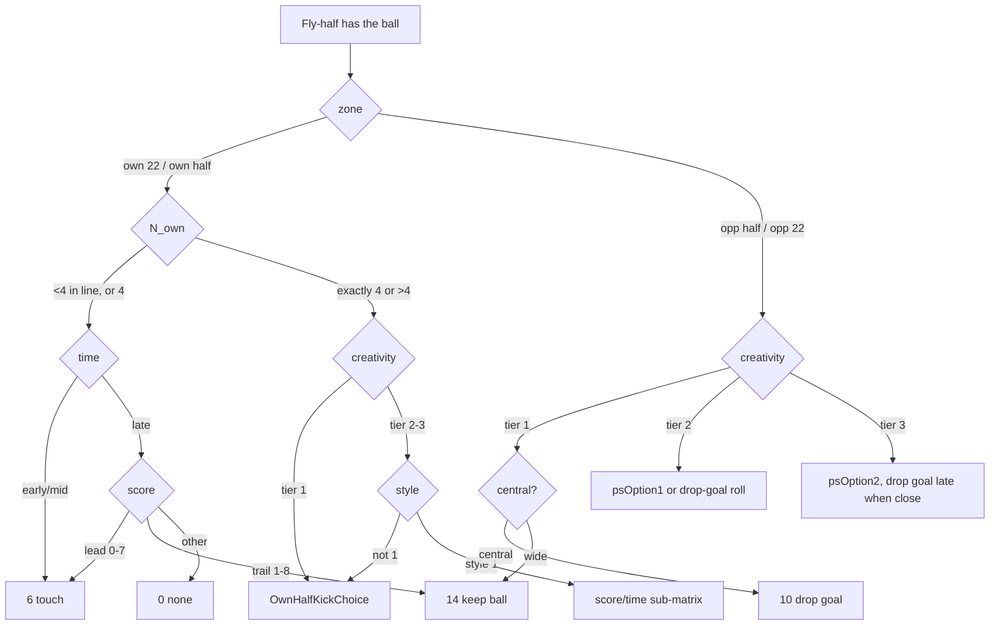

# 08 — AI: team brain, attack, defence, kicking, set-piece decisions, difficulty

Status: Phase 1, first full pass (p1-ai-lead with sweepers p1-ai-defense, p1-ai-setplay,
p1-ai-difficulty, p1-ai-control). Target: the SecuROM-repaired unpacked image
`Rugby08_unpacked.exe` (sha256 `aba7a647…`; addresses are the same as the original dump).
Function index: `.omc/research/functions/ai.tsv`. Working notes and sweeper reports:
`.omc/research/ai/{NOTES,defense,setplay,difficulty,control}.md`.

Every claim is labelled **[O]** observed (read in code or data), **[I]** inferred, or **[U]** unknown.
Evidence: REA Evidence IDs (`ev_…`) where the decompiler could see the whole function. Where Ghidra
cuts a function at a SecuROM trampoline, the evidence is `local:<VA>`, meaning the objdump listing
read with trampolines inlined (`.omc/research/rules/funcasm.py`). Shortened IDs used below:

| short | full Evidence ID | content |
|---|---|---|
| EV-PICK | ev_5e20a066502bdbd631098fb3783d8a074ab420371dc5cfbeb0bd63de31435f0b | table picker, score/time buckets, pitch zone, per-shirt decision installer, kick-id test |
| EV-FH | ev_cff79633a70c25387a3a4aa1cda338a7eab1839f57080945d926dd83a18ee165 | fly-half, centre, fullback-kick, drop-goal, penalty priors, line numbers, creativity tier |
| EV-PEN | ev_8405cda224713c3c4bdc732d733d487be94287d852b6d57a04a323c517cdf7e6 | CPU penalty option matrix and handlers |
| EV-DSP | ev_b554b17f04d997bf1afd542707835912a2381abf6f2072ebc1ae540793dec00a | DefensiveSetplay update |
| EV-HIT | ev_71c67a314bb6e221e9ddfa3bda450acaaa4ea5c330fe9348ff59acadc01997c3 | big-hit preference |
| EV-BLZ | ev_782b031c0f8717fa4b0ffc2184b680908adaf1f04e5ca901ef27d45fea07468e | blitz threshold |
| EV-NAMES | ev_3c158143d55bab688f6926baa78f67a4a4053876d5b55151c534628fc2c9b6b8 | 121 `ai_` names applied in the shared REA session |

Conventions used throughout this document:
- **Pitch frame [O]:** x is lateral, with 0 at the middle of the pitch. z is longitudinal, with
  0 at halfway. The try lines are at |z| = 50 m (static constant 50.0 at 0xa321e8, set from
  0x8eb098). The 22 m lines are at |z| = 28 m. Each team has an attack direction `dir` = ±1, held in
  the team as an int8.
- **Shirt numbers 1..15** are the positional slots (1 loosehead … 9 scrum-half, 10 fly-half,
  11 left wing, 12/13 centres, 14 right wing, 15 fullback) [O, string table 0x994890].
- **Player stats** are 0..100 bytes. Index 20 is *Creativity*; the enum comes from the players lead
  (`docs/re/09-players-teams-db.md`).

---

## 1. Scope and entry points

In scope: the team and player AI architecture, the ball-carrier decision engine (run, pass, kick,
offload), set plays (backline moves), defensive line and tackler selection, kicking decisions,
CPU set-piece *decisions* (penalty option, scrum/ruck/maul set-play choice), the human-teammate
interaction, and difficulty.

Not in scope, with the owning lead: scrum, lineout, ruck and maul *mechanics* (set-pieces lead,
`setpiece.tsv`); ball and kick physics and tackle resolution (physics lead, `phys.tsv`); laws
(rules lead); the player and team DB (players lead).

Key entry points. All are named `ai_*` in the shared REA session [EV-NAMES].

| VA | name | role | conf |
|---|---|---|---|
| 0x667690 | ai_GetCarrierDecisionFn | picks the per-player decision function by shirt | high [EV-PICK] |
| 0x667770 | ai_CarrierChooseAction | ball-carrier action = table action, then situational overrides | high, local:0x667770 |
| 0x6675b0 | ai_FlyHalfGetAction | fly-half: returns a pending set-play action, otherwise ChooseAction | med |
| 0x666170 | ai_FlyHalfDecision | fly-half situational decision (zone, time, score, line numbers) | high [EV-FH] + local |
| 0x666a20 | ai_CentreDecision | centres 12/13: `s_sAI12*` tables | high [EV-FH] |
| 0x667450 / 0x667230 / 0x667400 | ai_FullbackDecision… | fullback decision and the "no kick" replacement | med / high [EV-PICK] |
| 0x6650d0 | ai_PickActionFromTable | the 12-weight action table sampler | high [EV-PICK] |
| 0x664f20 / 0x665040 | ai_GetPitchZone | own 22 / own half / opp half / opp 22 | high [EV-PICK] |
| 0x633000 | ai_GetScoreState | score-margin bucket | high [EV-PICK] |
| 0x633100 | ai_GetMatchTimeBucket | match-minute bucket | high [EV-PICK] |
| 0x6653a0 | ai_GetLineNumbersState | how many players are in the attacking line, or how many defenders are in the defensive line | high [EV-FH] |
| 0x656ad0 | ai_GetCreativityTier | Creativity stat to tier 1/2/3 | high [EV-FH] |
| 0x7514a0 / 0x7517e0 | ai_RunWithBallTask_ctor / _Update | CPU carrier task: final overrides, gap exploitation, dodge, sidestep | med, local |
| 0x66b0c0 / 0x66abe0 | ai_CpuChoosePenaltyOption / ai_PenaltyOptionPriors | CPU penalty decision | high [EV-PEN][EV-FH] |
| 0x426280 / 0x4a44d0 | ai_CpuPenaltyDecide / ai_PenaltyEventDispatch | penalty dispatch (CPU and human menu) | high, local |
| 0x680b50 | ai_Setplay_Overlord_Choose | set-play chooser dispatch (ruck, scrum, maul, special) | high, local |
| 0x67fab0 / 0x67f840 | ai_RuckSetplayChooser_Choose / ai_Setplay_PercentageRoll | ruck set-play choice | high, local |
| 0x681a70 / 0x682bd0 | ai_Setplay_LoadAll / _LoadFile | loads `xml/setplays/*.xml` | high, local |
| 0x5ff9e0… 0x600b40 | CDefense (mark table) | per-team defensive marking | high, local |
| 0x614580 / 0x613610 | ai_GuardState_Update / _ComputeTarget | per-defender target pipeline | med, local |
| 0x650480 | ai_DefenseDirector_OnEvent_Blitz | ruck-edge blitz | med, local |
| 0x67b850 | ai_DefensiveSetplay_Update | defensive formation (DEF SP) | high [EV-DSP] |
| 0x619720 / 0x617140 | ai_Team_AssignChasers / CancelChasers | chaser and tackler assignment | high, local |
| 0x60fe50 | ai_Player_PreferBigHit | big-hit preference | high [EV-HIT] |
| 0x64bf40 | ai_Difficulty_Manager_Update | dynamic difficulty ("boost") | high, local |

---

## 2. Behaviour

### 2.1 Architecture (observed from RTTI and code)

There are three nested `Hbs::Ai::AiStateMachine<T>` levels [O, RTTI]:

| level | owner | states (RTTI class names) |
|---|---|---|
| Match | `CRugby` | Formation, Free, QuickOption, GoalKick, Kickoff, LineOut, Punt, DropOut22, Run, Empty |
| Team | `CRugbyTeam` | TeamStates::Follow, Formation, Free, Empty |
| Player | `CRugbyPlayer` | Forward, Guard, PassLine, Kick, Kicking, OutOfSight, Task, Human, Free, DropGoalShootout, FullBack, FullBackInLine, Catching, Chase, WillChase, OnGround, Sequence, SequenceNotAvail, ScrumHalfApproach, ScrumHalf, ScrumRun, SceneLeaving, GetUp, DivingTackle, HumanScriptInter, RunWithBall, Run, WingerDropBack, ScoreTry, Pickup, QuickOption, LineOutLeaving |

Every player has a **mode** int (getter 0x60a850). The debug name table at 0x998b98 is indexed by
mode [O]. A rebuild should use this enum as the player-state id:

`0 ERROR, 1 SCRUM H, 2 SH APRCH, 3 SP PLAY, 4 PAUSE, 5 PLAY, 6 ACTION, 7 FREE, 8 KICKOFF, 9 SHOWOFF,
10 FORMATION, 11 WILL CHASE, 12 GOAL K, 13 PEN K, 14 RUCKWAIT, 15 RUN WB, 16 PICK UP, 17 HUMAN,
18 KICKING, 19 DUMMY, 20 CHASE, 21 FORWARD, 22 PASSLINE, 23 LINE OUT, 24 GUARD, 25 SCN LEAV,
26 ONGROUND, 27 GET UP, 28 FULLBACK, 29 OUTSIGHT, 30 DGSHOOT, 31 SCORE TRY, 32 DEF SP, 33 QUICK OP,
34 PENDING, 35 22 DROP, 36 PEN PUNT, 37 FREE PUNT, 38 LO-LEAVE, 39 FB LINE, 40 RUN, 41 W DROPBK,
42 DIVE TKL, 43 NEWCATCH, 44 SEQ, 45 SEQ-NA, 46 SCRUM_RUN, 47 SC_INT, 48 TASK`

The base index comes from the fullback check "shirt 15 in mode 28" and agrees with every use found [I, high].

Team-level helper objects [O]:
- `CDefense` (marking, defence).
- `DefenseDirector` (ruck-edge blitz).
- `CPassLine` (attacking line slots, modes 1..3).
- `CForwards` (forward pods / guards).
- `CFullBack`.
- `Setplay::Overlord` (set plays).
- `CRuckTeam`, `CMaulTeam`, `CLineOutTeam` (set pieces; set-pieces lead).
- `Difficulty::Manager` (one per match).

**Update cadence and order [O; control.md, ev_4f295019… for 0x62e3a0]:**
- There is one AI tick per rendered frame with a variable dt: frame dt × time scale
  (0x99683c, default 1.0; the difficulty sim-speed factor from §6 also applies). A fixed
  1/60 s path exists but is dead code (selector 0x581990 always returns false). **For the
  rebuild:** run all of this inside the pinned fixed-step `_physics_process` (ADR-001); the
  original's variable step is not a gameplay feature.
- Per tick (0x62ed50):
  1. ball and possession update;
  2. match state machine (0x62f270);
  3. 0x62e3a0:
     - (a) both team state machines; which team goes first alternates with frame parity;
     - (b) all 30 players updated every tick, interleaved A1, B1, A2, B2 … A15, B15
       (0x60f230);
     - (c) both teams' TeamUpdate (defence object, then each human controller, `ai_ControlUpdate`
       0x6ae0f0);
     - (d) clock advance, fatigue time, period-end checks;
  4. difficulty manager (0x64bf40);
  5. set-play Overlord (0x682a20).

  There is no per-player throttling at framework level.
- **One shared id space:** the match, team and player machines all use the mode enum above.
  - Match registry 0x68cd70 maps 8/7/10/23/12/35/36/40/19/33 to Kickoff, Free, Formation, LineOut,
    GoalKick, DropOut22, Punt, Run, Empty and QuickOption.
  - Team registry 0x690460: 7 → Free, 10 → Formation, {8, 35, 36, 40, 23} → Follow,
    {12, 19, 33} → Empty. The team machine follows the match state id.
  - Player factory 0x696000 maps mode → Player state class. Modes 3, 10, 12, 14, 19, 23, 32 and 34
    use an empty state; 8, 35 and 36 use KickState.
- **Mode change:**
  - `ForceMode` (0x60d960) builds the new state and swaps it in.
  - `ForceModePending` (0x60d8f0) sets PENDING (34) and switches when a delay in seconds expires.
  - `GotoBestMode` (0x60f050) is a priority tree ending in QUICK OP, GET UP, RUN WB, HUMAN,
    FULLBACK, PASSLINE or GUARD, or FORWARD for forwards.
  - "changing MODE %s" is a separate gait machine (RUN 2 / SPRINT 3 at player+0x54), not the AI mode.
- **Decision timing:**
  - The carrier action is chosen when the run-with-ball task is created (0x7514a0). The per-frame
    update (0x7517e0) only applies the gap, dodge and sidestep overrides.
  - The fly-half caches its action ("returning stored action").
  - Per-state re-plan timers are not catalogued [U].
- The per-player decision-function pointer (player+0xc0) is set **once** in the CRugbyPlayer
  constructor (0x60a1a0 → setter 0x60a870). Substitutions swap only the player-data pointer, so the
  decision function belongs to the **slot (shirt)**, not the person [O].

### 2.2 The ball-carrier decision engine (attack: run / pass / kick)

**Action ids** (int; names inferred from debug strings and how each id is used):

| id | meaning | basis |
|---|---|---|
| 4 | DODGE: evasive run at a gap | "trying [DODGE] 2/3/4" sets 4; "ai taking advantage of gap" → 4 [O] |
| 5 | CRASH / take contact (forward-style carry) | default for shirts 1–5; never converted to dodge or sidestep [I] |
| 6 | KICK TO TOUCH | "ShouldEndGame" forces 6; "on the full" converts 6/7 to 9 [O/I] |
| 7 | kick variant routed to CrossPlay (cross-field kick) | ruck chooser: action 7 → set-play type 9 CrossPlay [I] |
| 8 | GRUBBER | "not grubbering, not threatened" tests action 8 [O] |
| 9 | DOWNFIELD kick (in-field punt) | "on the full [DOWNFIELD]" sets 9 [O] |
| 10 | DROP GOAL | "cancelled drop goal, was to far away" tests 10 [O] |
| 11 | other long kick (probably up-and-under/bomb) | kick range 6..11 [O]; meaning [U] |
| 13 | MISS PASS (CPU pass searching 3 players out along the line) | pass receiver search 0x698830 uses depth 3 for action 13, 1 otherwise; "looking for pass: %d %d" [O]; also set-play eligible |
| 14 | NORMAL (pass to the next man along the line) | "ShouldNotEndGame [NORMAL]" sets 14; CPU pass 0x698b50 with search depth 1 [O] |
| 16 | special override (0x667490 true) | [U] |
| 17 | FLY DUMMY (fly-half dummy kick/pass) | "FLY DUMMY ACTION" [O] |
| 18 | SIDE_STEP | "trying [SIDE_STEP]" [O] |

Kicks are exactly ids 6..11 [O, EV-PICK]. Ids 0, 1, 2, 3, 12 and 15 come from other paths
(set plays, scrum-half), [U].

**Per-shirt decision function** (installed at player+0xc0, chosen by 0x667690) [O, EV-PICK]:

| shirt | function |
|---|---|
| 10 | FlyHalfDecision |
| 12, 13 | CentreDecision |
| 15 | FullbackDecision |
| "Impact" star player (0x69baf0 && 0x69be30) | 0x667640 |
| anyone else | no function; **shirts 1–5 → 5 (crash), others → 4 (dodge/run)** [O] |

#### 2.2.1 Inputs (situation features) — all observed [EV-PICK][EV-FH]

**Zone** Z, from the carrier's `z·dir`:

| Z | name | condition |
|---|---|---|
| 1 | own 22 | z·dir < −28 |
| 2 | own half | −28 ≤ z·dir < 0 |
| 3 | opp half | 0 ≤ z·dir < 28 |
| 4 | opp 22 | z·dir ≥ 28 |

**Time bucket** T, from match minute m = clock_seconds / 60:

| T | condition |
|---|---|
| 3 (early) | m < 20 |
| 4 (middle) | 20 ≤ m < 65 |
| 1 (late) | 65 ≤ m < 80 |
| 2 (after 80) | m ≥ 80 |

The clock is the internal 80-minute match clock (g+0x18f0) [O]. How it relates to the user's half
length is the rules lead's.

**Score state** S, from margin Δ = own points − opponent points. Points are computed as
5·tries + 2·conversions + 3·penalties + 3·drop goals (0x632c60) [O].

| S | Δ |
|---|---|
| 1 | 0..3 |
| 2 | 4..7 |
| 5 | 8..14 |
| 6 | > 14 |
| 3 | −1..−3 |
| 4 | −4..−8 |
| 7 | −9..−14 |
| 8 | < −14 |

**Creativity tier** C, from the carrier's Creativity stat (index 20):

| C | Creativity |
|---|---|
| 1 | < 60 |
| 2 | 60..79 |
| 3 | ≥ 80 |

A stat byte of 0 is replaced lazily by a random 1..100 and stored (0x6558b0) [O].

**Team attack style** Y = team+0x58 (0..3): 0 and 1 → "Back(s)", 2 → "Bal(anced)",
3 → "Fwrd (forwards)". Who sets it is [U] (unknown_id unk_910c20…).

**Line numbers** N(team) (0x6653a0):

| team | condition | N |
|---|---|---|
| attacking | fewer than 4 players in mode PASSLINE | 1 |
| attacking | exactly 4 | 2 |
| attacking | more than 4 | 3 |
| defending | fullback (shirt 15) not in mode FULLBACK, i.e. he has come up | 4 |
| defending | fewer than 4 players in mode GUARD | 1 |
| defending | otherwise | 2 |

**Central channel** W (0x665070): |x| < 10 m → 2 (central), else 1 (wide).

#### 2.2.2 The table sampler (0x6650d0) [O, EV-PICK]

A table holds 12 floats t[0..11]. The sampler makes two independent uniform draws in [0,1)
(r₁, then r₂):

1. Category from r₁:
   - r₁ < t0 → **A (individual carry)**
   - else r₁ < t0+t1 → **B (kick)**
   - else → **C (pass / back line)**
2. Action from r₂:
   - **A:** r₂ < t3 → 4, else 5.
   - **B:** r₂ < t5 → 6; r₂ < t5+t6 → **6**; r₂ < t5+t6+t7 → 8; r₂ < t5+…+t8 → 9; else 11.
     t9 is never read; it is the implicit remainder for 11.
     **Faithfulness note:** the second branch also returns 6 (not 7), so action 7 is unreachable
     through tables. Reproduce this; a mod may "fix" it.
   - **C:** r₂ < t10 → 13, else 14. t11 is unused (the remainder).

#### 2.2.3 Centres (shirts 12, 13): `s_sAI12*` tables [O, EV-FH; data 0x996f00..0x997200]

Rows are t0..t11; table names are the original debug strings.

| table | t0 | t1 | t2 | t3 | t4 | t5 | t6 | t7 | t8 | t9 | t10 | t11 |
|---|---|---|---|---|---|---|---|---|---|---|---|---|
| Own22Back | .05 | .05 | .90 | .65 | .35 | 0 | .15 | .85 | 0 | 0 | .80 | .20 |
| Own22Bal | .15 | .55 | .30 | .15 | .85 | .85 | .15 | 0 | 0 | 0 | .70 | .30 |
| OwnHalfBack | .20 | .05 | .75 | .35 | .65 | 0 | .35 | .65 | 0 | 0 | .60 | .40 |
| OwnHalfBal | .40 | .05 | .55 | .15 | .85 | 0 | .65 | .35 | 0 | 0 | .30 | .70 |
| OwnHalfFwrd | .70 | .05 | .25 | .15 | .85 | 0 | .20 | .80 | 0 | 0 | .05 | .95 |
| OwnHalfBackL | .40 | .05 | .55 | .25 | .75 | 0 | 1 | 0 | 0 | 0 | 0 | 1 |
| OwnHalfBalL | .60 | .05 | .35 | 0 | 1 | 0 | 1 | 0 | 0 | 0 | 0 | 1 |
| OppHalfBack | = OwnHalfBack |
| OppHalfBal | = OwnHalfBal |
| OppHalfFwrd | = OwnHalfFwrd |
| OppHalfBackL | = OwnHalfBackL |
| OppHalfBalL | = OwnHalfBalL |
| Opp22Any | .30 | .05 | .65 | .35 | .65 | 0 | 0 | 1 | 0 | 0 | .70 | .30 |
| Opp22BackL | .35 | 0 | .65 | .35 | .65 | 0 | 0 | 0 | 0 | 0 | 0 | 1 |
| Opp22BalL | .50 | 0 | .50 | 0 | 1 | 0 | 0 | 0 | 0 | 0 | 0 | 1 |
| Opp22FwrdL | .70 | 0 | .30 | 0 | 1 | 0 | 0 | 0 | 0 | 0 | 0 | 1 |

"L" = the low-Creativity variant (tier 1 or 2) [O].

Table selection by zone, tier and style:

| Z | tier 3 | tier 1–2 |
|---|---|---|
| 1 own 22 | Y∈{0,1} Own22Back; Y=2 Own22Bal; Y=3 → action 6 | action 6 (always kick to touch) |
| 2 own half | Y∈{0,1} OwnHalfBack; 2 OwnHalfBal; 3 OwnHalfFwrd | Y∈{0,1} OwnHalfBackL; 2 OwnHalfBalL; 3 → action 5 |
| 3 opp half | **see bug note** | **see bug note** |
| 4 opp 22 | Opp22Any | Y∈{0,1} Opp22BackL; 2 Opp22BalL; 3 Opp22FwrdL |

**Bug, observed [O, EV-FH and local:0x666cb4]:** the zone-3 case has no `break`. The OppHalf*
tables are sampled (consuming RNG draws), but control then falls into the zone-4 code and
overwrites the result. **In the opposition half, centres effectively use the Opp22 tables.**
A faithful rebuild must do the same, including the extra RNG draws. The `modern-ai` mod can fix it.

#### 2.2.4 Fly-half (shirt 10) [O, EV-FH + local:0x666170..0x6668a7]

The fly-half uses two zone-specific tables (same 12-float format) [O, data 0x997200..0x997320]:

| zone | psOption1 | psOption2 |
|---|---|---|
| 1 | 0x997260 | 0x997260 |
| 2 | 0x997200 | 0x997230 |
| 3 | 0x9972f0 | 0x9972c0 |
| 4 | 0x997290 | 0x9972c0 |

| table | t0..t11 |
|---|---|
| 0x997200 | 0 .15 .85 1 0 .67 0 .33 0 0 .70 .30 |
| 0x997230 | 0 .40 .60 1 0 1 0 0 0 0 0 1 |
| 0x997260 | .10 .20 .70 1 0 .25 .50 .25 0 0 .33 .67 |
| 0x997290 | .10 .10 .80 1 0 0 0 1 0 0 .30 .70 |
| 0x9972c0 | .20 .10 .70 1 0 0 .60 .30 0 .10 .40 .60 |
| 0x9972f0 | .10 .20 .70 1 0 0 .75 .15 0 .10 .20 .80 |

Below, N_own = N(own team) and N_opp = N(opponent).

The decision function returns 0 ("no decision") in some cells. The later stages (§2.2.6) then still
apply. What action 0 does downstream is [U].

**Own half (Z = 1 or 2):**
- N_own ∈ {1, 4} (thin line):
  - T early or middle → **6**.
  - T late (1 or 2):
    - S ∈ {1, 2} (leading by up to 7) → 6.
    - S ∈ {3, 4} (trailing by up to 8) → 14.
    - S ∈ {5..8} → 0 (no table value; falls through to the overrides).
- N_own ∈ {2, 3} (≥ 4 in the line):
  - C = 1, or Y ≠ 1 → **OwnHalfKickChoice** (0x665fe0):
    - N_opp ∈ {3, 4} (the opposition fullback is up) → **9** (kick into the empty backfield).
    - T early or middle:
      - Z = 1 → 6.
      - Else first 20 min: 50% 6 / 50% 11.
      - Else: 80% 6 / 20% 11.
    - T late: S ∈ {1, 2} → 6, else 14.
  - C ≥ 2 and Y = 1:
    - S ∈ {3, 4} (trail 1..8) → weighted {6: 0.70, 13: 0.09, 14: 0.21}.
    - S ∈ {1, 2}:
      - Late → 6.
      - Early or middle: N_opp = 1 → psOption2; N_opp = 2 → 6; otherwise → 9.
    - S ∈ {5..8}:
      - Late → psOption1.
      - Early or middle: N_opp = 1 → psOption1; N_opp = 2 → 6; otherwise → 9.

**Opposition half (Z = 3 or 4):**
- C = 1: central → **10** (drop goal); wide → 14.
- C = 2:
  - Wide → psOption1.
  - Central, by S:
    - S ∈ {5..8} → psOption1.
    - S ∈ {1, 3}: T early or middle → DropGoalOrPass; T late → **10**.
    - S ∈ {2, 4}: T = 1 → DropGoalOrPass; otherwise → psOption1.
- C = 3:
  - Wide, or T early or middle → psOption2.
  - Late and central: S ∈ {1, 3} (one score either way) → **10**; otherwise → psOption2.

**DropGoalOrPass** (0x665280): in zone 4, P(10) = 0.8; in any other zone, P(10) = 0.7; else 14 [O].

**Fly-half post-filters** (in order) [O, local:0x66666e..0x6668a7]:
1. A team flag (team record +0xbb8 == 100; [U] meaning) turns any kick into 14.
2. **Fly dummy.** All of these must hold, then the action becomes **17**:
   - the action is 6 or 9;
   - the inside centre is in a specific animation (id 0x198a);
   - the inside centre is available;
   - the centre is within 15 m;
   - Z = 1;
   - a 0.6 roll succeeds.
3. **Too close to kick:** action 6 or 9 and z·dir > 30 (within 20 m of the opponent's line) → 14.
4. **Drop-goal range:** action 10 and z·dir ≤ 15 (more than 35 m from the posts) → 14.
5. Action 10 and team predicate 0x66b7f0 → 14 [U predicate].

#### 2.2.5 Fullback (shirt 15) [O/I]

FullbackDecision (0x667450) [O, ev_142f230cc0f2ae44d04b8f1b4dc57d0d6714cdae04718e6a494c2e2d5da2861c].
Weighted picks below are {action: weight}. Weights are taken as given; the pickers sum the weights
and draw in [0, Σ), which is inferred from the array picker 0x819b40.

- **Zone 3/4:** "no-kick" pick: tier 3 → {4: .5, 5: .4, 14: .1}; else 5.
- **Zone 1/2**, with H = (zone == 2, own half):
  - Tier 1, or style Y ≠ 1 → **Basic**:
    - T late: trailing (S ∈ {3, 4, 7, 8}) → 4, else 6.
    - Otherwise: H → {9: .6, 11: .2, 4: .2}; zone 1 → {6: .6, 9: .4}.
  - Tier ≥ 2 and Y = 1:
    - S ∈ {1, 2}:
      - T early or middle: H → {4: .55, 6: .2, 11: .2}; zone 1 → {4: .6, 6: .4}.
      - T late: H → 9; zone 1 → 6.
    - S ∈ {5..8}:
      - T = 3 → 9.
      - Otherwise: H → {4: .5, 11: .2, 6: .15, 9: .15}; zone 1 → {4: .6, 6: .25, 9: .15}.
    - S ∈ {3, 4} → 4.

When the "15NoKick" override fires (§2.2.6), the replacement is the same no-kick pick [O, EV-PICK].

#### 2.2.6 Common overrides in ai_CarrierChooseAction (0x667770) [O, local]

Applied in order to the result of §2.2.3–§2.2.5:

1. If the special predicate 0x667490 holds → 16. It checks the team flag and an opponent search
   within 5 m; details [U].
2. **"15NoKick":** game type == 2 and carrier shirt 15 and action is a kick → fullback replacement.
3. **"FinishedPassPhase"** (global flag 0xa31a9d) → 14.
4. **"WasSetPlay":** a set play just ran (setplay overlord has an active play) → 14.
5. **"goal-line":** the carrier is within 15 m of the opponent's try line (z·dir > 35) and the action
   is a kick → 14.
6. Action 10 and score/time special case (T = 2 and score state 4) → 14.
7. **"ShouldEndGame":** all of these hold → **6** (kick the ball dead):
   - the carrier's team is CPU;
   - clock > 4794 s (79.9 min);
   - leading by 1..7;
   - the carrier's role byte ∈ {9, 10}.

   Observed constants; the role-byte meaning is [I].

Then the CPU run-with-ball task applies (0x7514a0, 0x7517e0) [O]:
- Action 6/7 and team "ShouldNotEndGame" (trailing, S ∈ {3, 4, 7, 8}, and clock ≥ 4770 s) → 14.
- Action 6/7 and the kick would go out on the full from where he stands → 9.
- Carriers not in zone 1 with a predicted defender close ("DODGE 2/4") → 4.
- Each frame, gap detection (0x668ce0, look-ahead 1.3) with action ∉ {4, 5} → 4 ("ai taking
  advantage of gap"). The fly-half needs an extra check (0x6686f0 with −5 m).
- Sidestep attempt → 18 when allowed (not 5, not already 18).
- In the RunWithBall state (0x699350), a carrier holding action 5 switches to 4 ("trying [DODGE]")
  when the proximity test 0x6686f0 with 3.0 passes (a defender within about 3 m, [I]) [O, local:0x699a01].

### 2.3 Set plays (backline moves) [O unless noted; full detail in setplay.md]

**Data:** 8 files in `xml/setplays/`. They are present in `extracted/data.gob` under hashed names;
values are in `.omc/research/gamedata/tunables.json`.

| enum | file | xml type | name | buttons 1–4 → shirts |
|---|---|---|---|---|
| 0 | quickplay1 | 1 | classic | 10, 13, 15, 12 |
| 1 | quickplay3 | 3 | pivot | 13, 14, 15, 11 |
| 2 | pocket | 0 | pocket_play | (fly-half offset −6, −17 only) |
| 3 | quickplay2 | 2 | dummy switch | 10, 14, 15, 13 |
| 4 | quickplay4 | 4 | miss | 12, 14, 13, 15 |
| 5 | CrossPlay | 9 | cross_play | (offset −6, −17 only) |
| 6 | LoopPlay | 10 | loop | 10, 15, 13, 14 |
| 7 | PivotMiss | 11 | PivotMiss | 12, 14, 13, 15 |

**Quick-play fields:**
- Four option animation sequences (triangle, circle, cross, square) plus an intro.
- `ruckvalues` and `scrumvalues`, each with:
  - `flyHalfOffset` (x, z) [I: metres, fly-half's spot relative to the breakdown, ~8.5 wide, ~15.5 deep];
  - `cpurange` and `humanrange` (min, max). CPU teams sample uniformly from cpurange, humans from
    humanrange [O]. Unit [U].
- Scrum values are used when the restart type is scrum (global 0xa31a98 == 2), otherwise ruck values.

Each team has a table of 8 set plays plus **three assigned slots** (team bytes +0xbd8, +0xbda, +0xbd9).

**CPU choice at a ruck** (0x67fab0):
1. The fly-half's action A is computed first (§2.2.4).
2. A ∈ {3, 13, 14} → PercentageRoll.
3. A = 7 → CrossPlay.
4. A ∈ 6..11 → PocketPlay (fly-half drops into the pocket to kick).
5. A = 15 → set-play type 8.
6. Else none.

**PercentageRoll** (0x67f840) uses team byte B = teamdata+0xbca (0..100):

| B | P(set play) |
|---|---|
| > 75 | 0.75 |
| 51..75 | 0.5 on Elite, else 0.35 |
| ≤ 50 | 0.4 on Elite, else 0.1 |
| fly-half is the special player id 0x6b36 | 0.75 |

The **Elite** boolean is `ai_Difficulty_IsElite` 0x421840 (the sweeper left it unresolved; the
difficulty sweep identified the function) [O]. On success, a second roll picks
slot +0xbd8 (≤ 0.33), +0xbda (≤ 0.66), else +0xbd9. On failure: "percentage wise, no set play
happened".

**Other choosers:**
- **Scrum** (0x67fdd0): zone thresholds 35 / 28 / 44 m, score/time buckets, leaf probabilities
  0.05–0.8, a four-way slot pick 0.25 / 0.5 / 0.75 / else scrum-half runs. Matrix only partly
  decoded [O structure].
- **Maul** (0x67fbe0): run-from-maul probability by style Y = 1/2/3:
  - 0.75 / 0.90 / 1.0 within a 3 m margin;
  - 0.5 / 0.75 / 1.0 within a 5 m margin;
  - Y = 0 → 0.
- **"Gregan"** chooser for team id 0x2bfa [U team].

Debug cvar `setplay.cpu` forces a type [O].

**Human:** the four buttons map to `buttonPlayers`. A delayed "go" setplay can start after 1.0 s.

**Cancellation** [O strings]:
- a tackle on a set-play player;
- no replacement for a slot;
- a slot too close to the touchline;
- a position out of bounds;
- a ball-drop distance [U].

### 2.4 Defence [O/I; full detail in defense.md]

- **Man marking.** CDefense holds a 5-entry mark table, defender shirt → attacker shirt:
  - reset: 10→10, 11→14, 12→12, 13→13, 14→11;
  - match start: 10→9, 11→10, 12→12, 13→13, 14→11, with 11 and 14 swapped by ball side.

  Missing backs are covered by promoting a FORWARD (mode 21) to GUARD (mode 24).
- **Guard target each frame** (0x613610):
  - Track the marked attacker's position predicted **1.05 s** ahead.
  - If that attacker is unavailable or more than **8 m** away, switch to an alternate mark
    predicted **1.5 s** ahead.
  - Then the formation, quick-option, ball and set-play offsets apply; gap targeting ±2 m;
    "spreading wide" 2 m.
  - Lateral clip ladder by defender shirt: 10 → 7, 11 → 13, 12 → 21, 13/14 → 29 m. Clamped 3 m
    inside the touchline. Final depth clip: fullback −30 m, others −2 m.
- **Drift and line speed:** there is no explicit drift or rush parameter. Line movement *emerges*
  from tracking each attacker's predicted position [I].
- **Blitz** (0x650480): fires when the ball leaves the ruck (event 0xac).
  - "blitz 1": the ruck-edge defender rushes the scrum-half when rand(0,1) ≤ p. p comes from
    0x6503e0: 0 when a team flag is set, else a stored per-match value (key 0x21), else 1.1 or 0.5.
  - "blitz 2/3": the cheaper of two edge defenders goes at the fly-half.
- **Defensive formations (human):** Standard / Wide / Kick / Tight Defence are selectable at
  rucks and scrums [O, language DB]. Mechanism: DefensiveSetplay forces backs 10–15 in GUARD to
  mode 32 (DEF SP). It anchors on shirt 10's guard target, moves each back to anchor + per-shirt
  offset (mirrored by side), and ends if the anchor moves more than 20 m [EV-DSP]. **The per-formation
  offset numbers and the switch input were not found** (unk_19e40e…).
- **Tackler and chaser selection** (0x619720):
  - At most **4** players in WILL CHASE; extras are cancelled by arrival-time sort.
  - The best candidate is ordered to chase the carrier (within 2 m class check).
  - 0x617140 cancels chasers slower than a limit.
- **Big hit** [EV-HIT]: never when team rank > 2. Otherwise preferred when player.bigHitProb
  (+0x194) > rand(0, 100). The source of +0x194 is [U].
- **A related per-player timer** (0x610090): interval = 60 / (25 − 7·e/100) + U(0, 0.5) s, where
  e = player energy % (0x60fe20, fatigue 9..100; identified by the players lead) [O]. It is shorter
  when the player is tired. Whether it re-rolls the big hit or drives a cosmetic breathing cue is [U].
- **Fullback and wings:**
  - Fullback sweeps to the empty side (x = 1.5·dir, gated by a 70% roll).
  - When a ruck ends, a fullback still in DEF SP returns to FULLBACK.
  - On a set-play or formation kick, both wings go to W DROPBK (41).
  - In the attack AI, "fullback up" (not in FULLBACK mode) makes the fly-half kick downfield (9).
- **Ruck commitment** is in the set-pieces lead's area. Binding intensity uses
  `config/ruckdecisionlogic.xml` (per difficulty; see §6). **Scramble after a line break:** no code
  found [U].

### 2.5 CPU penalty decision [O, EV-PEN + local]

Options: **0 kick at goal, 1 scrum, 3 kick to touch (default and fallback), 4 tap and run**. The same numbering is used by the referee restart option at referee+0x10c (rules lead).
Option 2 is invalid (no-op handler).

The mapping is observed from the shared handlers:
- The CPU dispatch (0x426280, jump table 0x42637a) calls handlers 0x425af0 / 0x425fa0 / — / 0x426150 / 0x4260c0
  for options 0..4.
- The human menu dispatch (0x4a44d0) calls the same handlers for overlay events
  KICK 0xea / RUN 0xec / PUNT 0xed / SCRUM 0xeb.

After the decision, GEVENT_CPU_PENALTY_SELECTED (0xf1) fires.

**Zone priors** (0x66abe0): A = default choice, B = alternative, each a weighted pick.

| zone | A | B |
|---|---|---|
| 1 own 22 | {touch .5, tap .5} | – |
| 2 own half | {goal p, touch 0.25 − p/2, tap 0.75 − p/2} | – |
| 3 opp half | {goal .6, tap .15, scrum .1, touch .15} | {goal .05, tap .55, scrum .15, touch .25} |
| 4 opp 22 | {goal .6, tap .25, scrum .15} | {tap .65, scrum .35} |

p is an estimated goal-success probability from the team's goal kicker (0x66ab60 / 0x69bb10);
p = 0 if there is no kicker.

**Decision matrix** (0x66b0c0):

Zone 3 or 4:

| time | score state | choice |
|---|---|---|
| early (T = 3) | any | goal |
| late (T = 1, 2) | S ∈ {1, 2, 3, 5} | goal |
| late (T = 1, 2) | S = 4 | A |
| late (T = 1, 2) | S ∈ {6, 7, 8} | B |
| middle (T = 4) | S ∈ {5, 6} and style 1 | B |
| middle (T = 4) | otherwise | goal |

Zone 1 (own 22):

| time | score state | choice |
|---|---|---|
| early | any | touch |
| late | S ∈ {1, 2, 5} | touch |
| late | otherwise | A |
| middle | S ∈ {0, 8} | A |
| middle | S = 6 and style 1 | A |
| middle | otherwise | touch |

Zone 2 (own half):

| time | score state | choice |
|---|---|---|
| early or middle | S ∈ {7, 8} | A |
| early or middle | S ∈ {5, 6} and style 1 | A |
| early or middle | otherwise | touch |
| late | S ∈ {1, 2, 5} | touch |
| late | otherwise | A |

**Overrides**, applied in this order:
1. Match-type modifiers (0x405570 type 4) → random {scrum, tap}, or in the opp 22 random
   {scrum, touch} [O, meaning of the types U].
2. **Trailing late:** S ∈ {4, 7, 8}, choice ∈ {touch, goal}, T ∈ {1, 2} → {scrum 0.4, tap 0.6}.
3. Any invalid option → touch.

Other set-piece decisions:
- **Quick lineout and quick tap** checks: "checking to see if %s will quick lineout/penalty",
  0x62cc18 [O strings, rules not decoded].
- **Lineout call** (throw target) and **scrum** options are set-piece AI inside the set-pieces
  lead's code. Their difficulty-dependent CPU timings are listed in §6.

### 2.6 Difficulty [O; full detail in difficulty.md]

- **Levels:** 0 Club, 1 Pro, 2 Elite. The level is a global int (g+0x190c). It is set from the
  profile, or from a mission's `diff` attribute.
- **Dynamic boost** (Difficulty::Manager, per frame): while any *adjuster* is live and base <
  Elite, the global level is raised to base + 1. It drops back when no adjuster is live. Because
  the level is global, both sides read the raised values [I].

  | adjuster | active |
  |---|---|
  | TimeAdjuster(M) | while minute ≤ M |
  | CardAdjuster | created when the *human* side is carded; lasts until the sin bin ends |
  | PermanentAdjuster | whole match, when predicate 0x421980 holds [U] |
  | late-game | team id 13 (New Zealand) after minute 60, TimeAdjuster(999) |

  Fixture rivalry boosts (0x64c400): Wales v England (mode 0x20) 20 min; Ireland (mode 0x19)
  15 min; Crusaders (mode 0x30) 20 min; Perpignan 20 min; Argentina v France 20 min.
- **Everything that reads the level** is tabulated in §6 and the Answers section. No per-level
  reaction-time, pass-accuracy or tackle-chance scaling exists in the AI state machines. All 20
  direct readers of the level were enumerated by the sweeper [O, bounded negative].

### 2.7 Human control and teammates [O; control.md, ev_1a13c59a… (0x6ae0f0), ev_f2623e64… (0x6adc60)]

- **Controller link:** each human controller drives exactly one player (1:1), whose mode is HUMAN
  (17). `ai_ControlUpdate` runs every tick after the players.

  All other teammates, including those of a human team, keep running their normal AI states every
  tick. There are no special "support the human" states; the attack and defence AI above apply
  unchanged.
- **Auto-switch (every tick):** the controlled player is forced to HUMAN unless his mode is one of
  {1, 2, 3, 10, 12, 14, 17, 23, 25, 26, 34, 40, 43, 48} (set-piece, scripted, on-ground or task
  modes).
- **Stick switch:** if the controlled player is in NEWCATCH (43) and stick magnitude > 0.4, he is
  forced to HUMAN ("manual tugged switch").
- **Manual switch button:**
  - Ignored in match states LINE OUT (23), KICKOFF (8), GOAL K (12) and 22 DROP (35), and while
    the controlled player carries the ball.
  - Each press excludes the current shirt, then picks the best player.
  - The exclusion set resets after 4 shirts or 0.5 s without a press.
- **Best player** (`ai_ControlAssignBestPlayer` 0x6adc60): the minimum score wins; initial best is
  10000.
  - Score = distance to the reference point. The reference is the ball, or, when the ball is loose,
    the ball's position advanced 25 m [I: metres].
  - +100 if the player is busy or on the ground.
  - Not candidates: RUCKWAIT, ONGROUND, SCN LEAV, SCRUM H, SH APRCH, SP PLAY, PENDING, or a player
    already driven by another human on the same team.
- **Set-piece helpers:**
  - `ai_TeamAssignHumansBest` (0x61c360) gives a player to any controller without one.
  - "clear all humans" (0x62dbd0).
  - A human team's defending scrum-half is put into HUMAN through a 0.5 s pending change.
- The CPU-only gates elsewhere use "team is CPU" (team+0x120 == 2 means human). The difficulty
  **CardAdjuster** only triggers on cards to the human side.
- Unknown: exact veto predicates in the switch gate; what raises GEVENT_CONTROL_ASSIGN, REMOVE and
  SWITCH.

## 3. Constants and tunables

These become Godot `Resource` fields. All are [O] unless marked.

| Resource.field | value | unit | where (VA) | evidence |
|---|---|---|---|---|
| AiPitch.try_line_z | 50 | m | 0xa321e8 ← 0x8eb098 | local |
| AiPitch.twentytwo_z | 28 | m | 0x664f20 | EV-PICK |
| AiPitch.central_channel_half_width | 10 | m | 0x665070 | local |
| AiSituation.time_bucket_minutes | 20, 65, 80 | min | 0x633100 | EV-PICK |
| AiSituation.score_bucket_edges | lead 3/7/14, trail 3/8/14 | pts | 0x633000 | EV-PICK |
| AiCarrier.creativity_tiers | <60, <80, ≥80 | stat | 0x656ad0 | EV-FH |
| AiCarrier.default_action_by_shirt | 1–5 → 5, others → 4 | id | 0x667730 | EV-PICK |
| AiCarrier.centre_tables | §2.2.3 (16 × 12 floats) | prob | 0x996f00 | EV-FH + data |
| AiCarrier.flyhalf_tables | §2.2.4 (6 × 12 floats) | prob | 0x997200 | data |
| AiCarrier.flyhalf_trail_mix | {6: .70, 13: .09, 14: .21} | prob | 0x666334 | local |
| AiCarrier.ownhalf_kick_11_share | 0.5 (first 20 min), 0.2 later | prob | 0x665fe0 | EV-FH |
| AiCarrier.dropgoal_roll | 0.8 opp22, 0.7 elsewhere | prob | 0x665280 | EV-FH |
| AiCarrier.dropgoal_min_z | 15 (≤ 35 m from posts) | m | 0x666826 | local |
| AiCarrier.no_touch_kick_z | 30 (inside opp 20 m) | m | 0x6667c2 | local |
| AiCarrier.no_kick_goalline_dist | 15 | m | 0x6678d0 | local |
| AiCarrier.fly_dummy_roll / range | 0.6 / 15 | prob / m | 0x66673c | local |
| AiCarrier.fullback_nokick_mix | {4: .5, 5: .4, 14: .1} | prob | 0x667400 | EV-PICK |
| AiCarrier.end_game_kickout_clock | 4794 (lead 1..7) | s | 0x6189b0 | local |
| AiCarrier.no_kickout_when_trailing_clock | 4770 | s | 0x618a30 | local |
| AiCarrier.gap_lookahead | 1.3 | s or m [U] | 0x751913 | local |
| AiSetplay.chance_bands | >75: .75; >50: .5 Elite / .35; else .4 Elite / .1 | prob | 0x67f840 | local |
| AiSetplay.slot_split | .33 / .66 | prob | 0x67f840 | local |
| AiSetplay.maul_run_prob | (.75, .9, 1) / (.5, .75, 1) by style | prob | 0x67fbe0 | local |
| AiSetplay.xml (8 plays) | §2.3 | – | xml/setplays | data |
| AiDefence.mark_predict_time / alt | 1.05 / 1.5 | s | 0x613610 | local |
| AiDefence.mark_far_distance | 8 | m | 0x613610 | local |
| AiDefence.clip_ladder | 10:7, 11:13, 12:21, 13/14:29 | m | 0x612e80 | local |
| AiDefence.gap_offset / spread_wide | 2 / 2 | m | 0x614166 / 0x61423b | local |
| AiDefence.def_setplay_break_dist | 20 | m | 0x67b850 | EV-DSP |
| AiDefence.max_chasers | 4 | players | 0x6199b3 | local |
| AiDefence.bighit_rank_max | 2 | rank | 0x60fe50 | EV-HIT |
| AiPlayer.energy_timer_interval | 60 / (25 − 7·energy/100) + U(0, .5) | s | 0x610090 | local (purpose [U]) |
| AiDefence.fullback_empty_side_roll | 70 | % | 0x5ff155 | local |
| AiDefence.blitz_threshold_default | 1.1 / 0.5 | – | 0x6503e0 | EV-BLZ |
| AiPenalty.priors | §2.5 | prob | 0x66abe0 | EV-FH |
| AiPenalty.trailing_late_mix | {scrum .4, tap .6} | prob | 0x66b550 | EV-PEN |
| AiControl.switch_exclusion_reset | 4 shirts or 0.5 | count / s | 0x6ae0f0 | control.md |
| AiControl.loose_ball_lookahead | 25 | m [I] | 0x6adc60 | control.md |
| AiControl.busy_penalty / initial_best | 100 / 10000 | score | 0x6adc60 | control.md |
| AiControl.stick_switch_threshold | 0.4 | stick magnitude | 0x6ae0f0 | control.md |
| AiControl.def_scrumhalf_human_delay | 0.5 | s | 0x628176 | local |
| Difficulty.* | see Answers section | – | – | – |

## 4. Data structures that matter

- **AiActionTable** (Resource): 12 floats with the semantics of §2.2.2. Keep the *exact* sampling,
  including the 6/6 duplicate and the unused t9/t11, for fidelity.
- **CarrierDecisionProfile** per shirt role: which decision function applies (fly-half, centre,
  fullback, default), plus the tables it uses.
- **TeamAiProfile**: attack style Y (0..3), set-play frequency byte B (0..100), three set-play
  slots (enum 0..7). Source in the team DB [U].
- **PlayerAiStats used:** Creativity (tier), Tackling/Aggression-like `bigHitProb` (+0x194, source [U]),
  and Rucking + BallWinner flag (ruck binding, set-pieces lead).
- **SetPlay** (Resource) mirrors the XML: name, type, 5 sequence names, 4 button→shirt entries,
  ruck and scrum `{flyHalfOffset(x, z), cpuRange(min, max), humanRange(min, max)}`.
- **DefenceMarkTable:** 5 entries defender shirt → attacker shirt, plus a side-mirror flag.
- **DifficultyManager state:** base level, current level, adjuster list
  (kind, threshold minutes, card ref).

## 5. Mod hooks (PLAN 1d)

Expose as data:
- every table in §2.2.3–§2.2.4 and §2.5;
- zone, time and score bucket edges;
- creativity tiers;
- drop-goal and kick distance gates;
- end-game clock thresholds;
- set-play XML and chance bands;
- defence ladder and prediction times;
- chaser cap;
- big-hit gates;
- difficulty tables and adjuster triggers (fixture rivalry list, NZ late boost, card boost).

Expose as decision hooks (script layer):
- `choose_carrier_action(player, situation)` returning an action id;
- `choose_penalty_option(team, situation)`;
- `choose_setplay(team, restart)`;
- `defence_slot_target(defender)`.

Flags a `modern-ai` mod would flip:
- centre opp-half fall-through bug fix;
- make action 7 reachable;
- disable dynamic difficulty boosts.

## 6. Acceptance tests (GDScript-assertable)

1. `pitch_zone(z = -30, dir = +1) == 1`; `(z = -10) == 2`; `(z = 10) == 3`; `(z = 30) == 4`;
   with dir = −1 the zones mirror.
2. `time_bucket(minute = 19.9) == 3`, `(20) == 4`, `(64.9) == 4`, `(65) == 1`, `(80) == 2`.
3. `score_state(Δ)`: 0 → 1, 3 → 1, 4 → 2, 8 → 5, 15 → 6, −1 → 3, −4 → 4, −9 → 7, −15 → 8.
4. Table sampler: with t = Opp22FwrdL and r₁ = 0.69 → category A; r₂ = 0.0 → 5 (t3 = 0).
   With r₁ = 0.71 → C, and r₂ = any → 14.
5. Sampler kick branch: t5 = 0, t6 = 1 → returns 6 (never 7) for any r₂ in [0, 1).
6. A shirt-12 carrier with Creativity 90, style 2, in zone 3 uses Opp22Any (fall-through), not
   OppHalfBal.
7. A shirt-12 carrier, Creativity 50, zone 1 → action 6 regardless of RNG.
8. A shirt-3 carrier with no decision function → 5. A shirt-7 carrier → 4.
9. Fly-half, Creativity 50, zone 3, |x| = 5 → table action 10. If z·dir = 10 (≤ 15) the drop goal
   is cancelled → 14.
10. Fly-half action 6 at z·dir = 35 → 14 ("kicker too close").
11. Any kick action by a carrier at z·dir = 40 → 14 (goal-line rule).
12. CPU team leading by 5 at clock 4795 s, carrier role 9/10 → action 6. Trailing by 5 at clock
    4780 s with action 6 → 14.
13. CPU penalty in zone 4, T = 3 (minute 10) → kick at goal (0). Zone 1, minute 10 → touch (3).
    Trailing by 10, minute 70, zone 3, choice goal → result ∈ {scrum, tap} with
    P(tap) = 0.6 ± sampling error.
14. Ruck set play: team byte B = 80 → P(set play) = 0.75. B = 60 → 0.35 on Club/Pro, 0.5 on Elite.
15. Difficulty manager: base Club, one live TimeAdjuster(20) at minute 10 → effective level Pro.
    At minute 21 → Club. Base Elite never changes.
16. At most 4 players are in WILL CHASE at any time.
17. A defender whose mark is more than 8 m away switches to an alternate mark.
18. Manual switch: with the ball held by an opponent, pressing switch selects the team-mate with the
    lowest score = distance to the ball (+100 if busy or on the ground), excluding the current player.
    Pressing 5 times within 0.5 s cycles through 4 different players, then the exclusions reset.
19. The manual switch is ignored during a lineout or kickoff, and while the controlled player has
    the ball.
20. A substitute who comes on at shirt 10 uses the fly-half decision function (the slot decides,
    not the player).

## 7. Open questions / unknowns

- unk_9fe2eccd… (REA): the exact behaviour of action ids 4, 5, 7, 11, 12, 15, 16 (13/14 resolved as miss pass / normal pass). The
  RunWithBallState executor (0x699350) is not fully mapped.
- unk_19e40e20…: the numbers for the four human defensive formations, and the switch input.
- unk_910c20e4…: the source of team attack style (team+0x58), set-play frequency byte (+0xbca)
  and the three slots. "Change Tactics" and "Aggression" UI strings exist, but no code link to the
  AI was found. Players lead: the team DB record (104 bytes) has 8 "tactic" bytes at
  +0x58..+0x5f:
  - +0x5b is stored as 6 − x;
  - +0x5c..+0x5f are user-editable and restored from the profile (0x557b80);
  - there are 10 team rating bytes 0..100 at +0x4e..+0x57.

  These are the likely sources, but the copy into the runtime team object is not traced.
- The Impact (star) player behaviours (0x69f000–0x6ab000: Gregan, Giteau, Pichot, Umaga and others) are not covered.
  The "Impact player" decision function is 0x667640.
- Scrum set-play chooser matrix (0x680330 / 0x6804d0 / 0x680620) is only partly decoded.
- Pass-line depth and spacing, support lines, forward pods ("swapping into 8 role"): not decoded.
- Diving-tackle entry, chase speed, scramble: not found.
- Meaning of FH post-filter flag (team +0xbb8 == 100) and predicate 0x66b7f0; the special
  override 16 (0x667490).
- Units of set-play cpurange and humanrange; the flyHalfOffset axis convention.
- Team-state bodies (Follow, Formation, Free), per-state re-plan timers, and the switch veto predicates (control.md).

## 8. Confidence summary

| area | confidence | note |
|---|---|---|
| Situation features (zone, time, score, creativity, line numbers) | **high** | decompiled |
| Table sampler | **high** | decompiled |
| Centre tables, including the fall-through bug | **high** | decompiled |
| Fly-half decision tree | **high** | decompiled + local; a few cells return 0 |
| Carrier overrides | **high** | structure and constants |
| Action-id semantics | **medium** | 6, 8, 9, 10, 14, 17, 18 good; the rest medium/low |
| CPU penalty decision | **high** | including the option mapping via shared handlers |
| Set-play data, loader, ruck chooser | **high** | maul/scrum choosers medium |
| Defence: mark table, guard pipeline, chasers, big hit | **medium–high** | |
| Defence: formations, blitz numbers | **low** | |
| Difficulty manager and per-level data tables | **high** | both observed |
| Tick order and mode machinery | **high** | control sweep |
| Human switching | **medium–high** | constants high; scoring details medium |

---

## Answers for implementation (S1 team question: DifficultyProfile)

**Levels: 3.**

| id | name | UI string |
|---|---|---|
| 0 | Club | "Club" |
| 1 | Pro | "Pro" |
| 2 | Elite | "Elite" |

The XML files name the same levels easy/medium/hard (scrum) or #0/#1/#2 (goal kick).

Every value that varies by difficulty (observed; source → suggested `DifficultyProfile` field):

| field | Club | Pro | Elite | unit | source |
|---|---|---|---|---|---|
| sim_speed_scale | 1.10 | 1.10 | 1.15 | × dt | 0x632c10 (Club value forced in training flag) |
| stagger_keep_prob | 0.70 | 0.85 | 0.985 | prob | 0x642500 (meaning: keep nominal stagger level, else random 0..2) [I] |
| lineout_skill_class | Easy | Medium | Hard | class | 0x645200 |
| lineout_skill_a | 5.0 | 3.5 | 2.5 | [U] | 0x6452c0 (set-pieces lead consumes) |
| lineout_skill_b | 7.0 | 8.0 | 11.0 | [U] | 0x6452e0 |
| goalkick_gauge_speed_mult | 1.2 | 1.0 | 0.5 | × | 0x745136 |
| goalkick.primary_angle | 5 | 10 | 11 | deg [I] | GoalKickSettings.xml |
| goalkick.secondary_angle | 8 | 12 | 12 | deg [I] | same |
| goalkick.swing_threshold | 0.866 | 0.866 | 0.866 | – | same |
| goalkick.max_swing | 0 | 0 | 0 | – | same |
| goalkick.red_zone_multiply | 1.02 | 1.05 | 1.075 | × | same |
| goalkick.min_time / max_time | 1.3 / 2.3 | 1.0 / 2.0 | 0.8 / 1.3 | s | same |
| goalkick.min_power / max_power | 10 / 33 | 10 / 33 | 10 / 33 | – | same |
| goalkick.min_accel / max_accel | 0.5 / 1.3 | 0.8 / 2.0 | 1.0 / 2.4 | – | same |
| goalkick.dropgoal_max_speed | 2.0 | 2.5 | 3.0 | – | same |
| goalkick.dropgoal_speed_exponent | 1.25 | 1.30 | 1.32 | – | same |
| goalkick.dropgoal_shootout_modifier | 4.5 | 4.0 | 4.0 | – | same |
| scrum.early_cpu_drive_time | 0.4 | 0.0 | 0.0 | s | scrum_parameters.xml |
| scrum.late_cpu_drive_time | 3.0 | 2.0 | 1.5 | s | same |
| scrum.early_off_cpu_hook_time | 0.7 | 0.1 | 0.0 | s | same |
| scrum.late_off_cpu_hook_time | 2.0 | 1.5 | 0.9 | s | same |
| scrum.early_def_cpu_hook_time | 0.8 | 0.7 | 0.6 | s | same |
| scrum.late_def_cpu_hook_time | 1.7 | 1.2 | 0.9 | s | same |
| scrum.hook_radius | 0.85 | 0.85 | 0.85 | – | same |
| scrum.super_hook_chance | 0.75 | 0.80 | 0.85 | prob | same |
| scrum.elite_only_check | off | off | on | – | 0x66aa60 (semantics [U]) |
| maul.threshold_mult | 2.0 | 1.5 | 1.0 | × | 0x636ecc tables 0x996a04 / 0x996a10 |
| maul.slide_cutoff | 9999 (never) | 1.5 | 1.5 | s | 0x63ad6d table 0x996a34 |
| maul.phase_time_range | 60–70 | 60–70 | 60–70 | [U] | 0x635710 (flat) |
| maul.stat_blend_w | 0.8 | 0.8 | 0.8 | – | 0x636160 (flat) |
| setplay.chance_mid_band (B 51..75) | 0.35 | 0.35 | 0.50 | prob | 0x67f840 (IsElite) |
| setplay.chance_low_band (B ≤ 50) | 0.10 | 0.10 | 0.40 | prob | 0x67f840 (IsElite) |
| ruck.binding_intensity_tables | club table | pro table | elite table (+ field position, chanceTwo) | dist | config/ruckdecisionlogic.xml (all values in tunables.json, 470 keys) |

Non-numeric difficulty behaviour to model:
- The dynamic boost: effective level = min(2, base + 1) while any adjuster is live (§2.6).
- Rematch "Yes, but lower difficulty" lowers the base by one (0x576290).
- Trophy unlock text references Pro/Elite (not traced).

Not difficulty-dependent (bounded negative, all 20 level readers checked): carrier decision tables,
defence marking, reaction or pass accuracy. Do **not** invent a reaction-time scale for "faithful".
