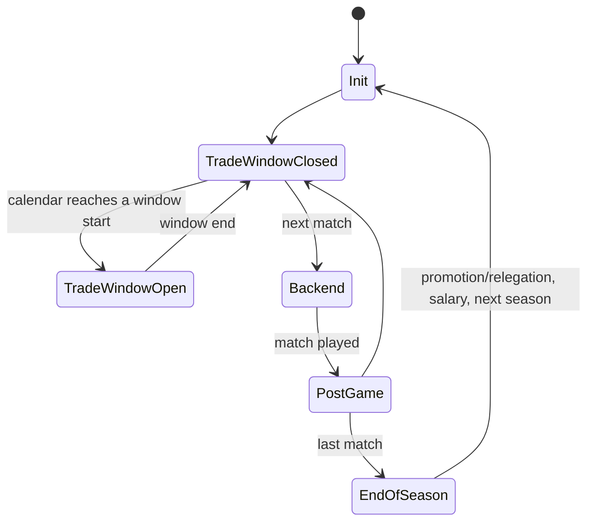

# 10 - Game modes and competitions

Status: Phase 1, data-driven pass. Tags: **observed** (read directly from shipped data or binary strings), **inferred**, **unknown**.
No game code or game text is reproduced beyond short identifying labels and rule numbers.

Evidence IDs used here (no REA evidence ids exist for this pass, see section 7):
- E-LANG: language database `extracted/data.gob/dc371d84ed78d4cf88a641a8d8abc38a.xml.unpacked` (2617 strings, id/name/english/french).
- E-WLCFG: World League config `extracted/data.gob/2de97b25...xml.unpacked`.
- E-RSG: 17 schedule files `extracted/data.gob/*.rsg.unpacked` ("Rugby Schedule Generation" tool output).
- E-MIS: 92 mission files `extracted/data.gob/*.mis.unpacked` plus history summary `82b27149...xml.unpacked`.
- E-TEAMS / E-STAD: team database `be2970b0...xml`, stadium database `119ba3f3...xml`.
- E-EXESTR: string table of `Rugby08_unpacked.exe` (event names, loader class names, file paths).
- E-QADBG: `c3c15942...xml` (QA debug options).
- E-AUDIO: `extracted/ogg/ref_eng.big/TUTORIAL_*`.
- Working catalogues: `.omc/research/modes/lang-catalogue.md`, `mis-catalogue.md`, `strings.tsv`.

## 1. Scope and entry points

No function addresses were obtained: the REA string/xref queries timed out on the shared session (see 7). Code entities identified from exe RTTI/strings (observed, E-EXESTR), unaddressed:

| Entity | Role (inferred from name) |
|---|---|
| `CRugbyScheduleGenerationLoader` | loads the `.rsg` schedule XML (paths `Frontend/Tournaments/*.rsg`, source file `tmnts.cpp`) |
| `CWorldCupLoader`, `CSixNationsLoader`, `CTriNationsLoader`, `CTenCountriesLoader`, `CLionsTourLoader`, `CSuper12Loader`, `CZurichPremiershipLoader`, `CEuroCupLoader`, `CMasterLeagueLoader` | one loader per competition |
| `WorldLeagueState` family: Init, TradeWindowOpen, TradeWindowClosed, Backend, PostGame, EndOfSeason | state machine of the World League (Master League) season |
| Menu callbacks `OnTournament*`, `OnMasterLeague*`, `OnPractice*`, `OnGameModes*`, `ChallengeMode*`, `OnMyRugbyTrophyCabinet*` | front-end handlers; tournament logic is shared across competitions, with per-competition `...StandingsKnockoutTreeInit` handlers for World Cup, Super 14 (`S12`), Euro Cup, Master League |
| Events `GEVENT_ENTER_TOURNAMENT`, `GEVENT_TUTORIAL_START/PAUSE/RESUME/UNPAUSE/SOUND`, `GEVENT_PRACTICE_SETPLAY_CHANGED`, `GEVENT_PLAYER_INJURED`, `GEVENT_INJURY_SUB_SELECTED` | match-level hooks |
| Loading-screen keys `l1prem l1wrldlg l1euro l1s12 l1tennat l16natn l13natn l1wal l1saf l1sco l1nzl l1ire l1fra l1eng l1aus l1wrldcp` | one load screen per competition and per tour nation |
| Trophy assets `06_Trophy_{Lions,Premiere,Super12,EuroCup,10Nations,6Nations,TriNations,WLKO,WL3D,WL2D,WL1D,Elite,Bledisloe}`, `08_Trophy_WorldCup` | trophy cabinet |

## 2. Behaviour

### 2.1 Mode list (observed unless marked)

Main menu entries (E-LANG): PLAY NOW, GAME MODES, MY RUGBY, EA SPORTS EXTRAS, TOURNAMENTS. Game modes and their sources:

| Mode | Description | Evidence |
|---|---|---|
| Play Now (quick match) | pick teams, stadium, settings, controllers; representative and Lions teams selectable once unlocked | E-LANG |
| Rugby World Cup 2007 | 20 nations, 4 pools of 5, knockout stages; also 1999 and 2003 pool schedules shipped | E-RSG, E-LANG |
| RBS 6 Nations | 6 teams, single round robin (15 games), 2007 and 2005 schedules | E-RSG |
| Tri-Nations | AUS/NZ/RSA, home and away (6 games), contains the Bledisloe Cup (AUS v NZ) | E-RSG, E-LANG |
| Ten Nations | Tri + Six Nations + Argentina, single round robin (45 games) | E-RSG |
| Lions Tour | tours of Australia, South Africa, New Zealand, each with and without warm-up matches (six schedules). Home-team control is an unlockable | E-RSG, E-LANG |
| Super 14 | 14 teams, single round robin (91 games), top 4 to elimination finals | E-RSG, E-LANG |
| European Trophy | 24 clubs, 6 pools of 4 (12 games per pool, home and away), pool winners plus the two next best seeded qualify | E-RSG, E-LANG |
| Guinness Premiership (loader "Zurich Premiership") | 12 clubs, home and away (132 games, 22 rounds), 2nd v 3rd semi-final then winner v 1st in the final | E-RSG, E-LANG |
| World League (class `CMasterLeagueLoader`, "Master League" in handler names) | 4 tier promotion/relegation career, see 2.4 | E-WLCFG, E-LANG |
| World League Knockout Cup | runs parallel to the league (rounds KO R1, R2, R3, QF, SF, Final) | E-LANG |
| Challenge Mode ("history" matches) | 39 scripted scenario matches grouped by World Cup year 1987, 1991, 1995, 1999, 2003, gold medal in every challenge of a year unlocks a reward | E-MIS summary, E-LANG |
| Basic Training / Rugby 101 | drills and a forced tutorial, see 2.6 | E-LANG, E-AUDIO, drill XMLs |
| Trophy Cabinet / Hall of Fame / Challenge Tracking | progression UI, see 2.7 | E-LANG, E-EXESTR |
| Multiplayer local | no mode strings found; controller assignment per team exists (`OnTournamentToggleTeamControlledBy`, multitap warnings). Treat as Play Now with two controllers (inferred) | E-LANG, E-EXESTR |
| Kicking and goal-kicking drills | part of Basic Training; "Drop Goal Shootout" is a challenge objective | E-LANG, E-MIS |

### 2.2 Standings points (observed, E-LANG)

Table per competition, shown in each competition's "Points System" help text:

| Competition | Win | Draw | Loss | 4+ tries bonus | Lose by 7 or fewer bonus |
|---|---|---|---|---|---|
| World Cup pools, Tri-Nations, Ten Nations, Super 14, European Trophy | 4 | 2 | 0 | 1 | 1 |
| World League (standings) | 4 | 2 | 0 | 1 | 1 |
| RBS 6 Nations | 2 | 1 | 0 | none | none |

Premiership points are not stated in text (unknown). The World League config carries a second points table (2.4) used for the transfer-point economy, distinct from standings.

Tie-break order inside a table: **unknown** (the UI has a "BP" column and a sort-by-column handler, `OnTournamentStatsSortColumn`; no tie-break text found).

### 2.3 Fixtures, calendars and knockout

- Observed: pool and league fixtures are shipped as fixed data, not generated at runtime. Each `.rsg` lists teams (alias plus team-database index), locations (stadium index), and games with home team, away team, location, year, month (1-based), day, and an `environment` code 0..3 (see 2.8).
- Observed shapes: Six Nations 15 games (2006 dates, Feb to Mar), Tri-Nations 6 games (2007, Jun 16 to Jul 21), World Championship 22-team lists with 4 pools of 10 games each (1999, 2003, 2007; 2007 opens 7 to 8 Sep), Ten Nations 45 games, Super 14 91 games (2006 dates), European 24 teams in 6 pools of 12, Premiership 12 teams 132 games, World League 36 teams 165 games (a partial schedule, see unknowns), AUS/SAF Lions tour 8 games, NZ tour 9 games, tour no-warmup variants 3 games.
- Observed: knockout games are not in the `.rsg` (World Cup lists only the 40 pool games), so quarter-final to final pairings are produced at runtime from pool results. Handlers `...WorldCupStandingsKnockoutTreeInit`, `...S12...`, `...EuroCup...`, `OnTournamentKnockoutTreeSelect` confirm bracket screens.
- Stated knockout structure (E-LANG): World Cup: pools then quarter-final, semi-final, final (UI names also include "Round 1/2" day labels, strings 1104, unverified). Super 14: top 4 to elimination finals (semi, final). European Trophy: 6 pool winners plus the 2 best runners-up = 8 into elimination. Premiership: 2v3 semi, winner v 1st in final.
- Observed (E-LANG): extra time in World Cup knockout games: two 10 minute periods, then a third 10 minute period where first score wins. Inferred: same rule used in other cup knockouts; the "Extra-Time" label and mission objectives `in_extra_time` exist.
- Observed: a "Simulate win to last" debug callback (`TournamentSimulateWinToLast`) shows AI-vs-AI results can be simulated; the result model is unknown.

### 2.4 World League (career) economy (observed, E-WLCFG unless noted)

Structure: 4 tiers named Elite League, Division 1, 2, 3 (ids 0..3), 44 teams stated in help text (12 per Division as ladder tables go to position 12; Elite also plays twice per season, others once).

State flow (inferred from state class names; mermaid):

Constants:
- Trade windows: 2. Window 0 runs 12 March to 2 April, window 1 runs 16 April to 30 April. Trades per window by tier: 31 each. Message strings state when a window opens/closes.
- Currency: one "point" = 4500 units (display currency). Starting base balance per listed team: -10 (12 teams listed).
- League points table used by the config (per tier win/draw/loss/try/lossby7orless): Elite 12/6/0/0/1; Div 1 10/5/0/0/1; Div 2 8/4/0/0/1; Div 3 6/3/0/0/1; Knockout cup 15/3/0/1/1. Meaning is **inferred**: these are transfer-point rewards per result (UI labels "Match Won/Drawn/Lost", "Result Bonus", "Try Scoring Bonus", "Total Transfer Points"), not standings points. The try value is 0 in leagues and 1 in the cup.
- Trade point calculation (end of season): base value Elite 60, Div 1 30, Div 2 10, Div 3 0, plus a ladder bonus by finishing position 1..12 (Div 1: 30, 25, 22, 18, 12, 8, 3, 0, -1, -3, -5, -8; Div 2: 20, 18, 15, 12, 7, 5, 3, 2, 1, 0, -1, -2; Div 3 starts at 10, 9, 8, 7, 6, ...; Elite has base only).
- Job security (initial value / win streak points for 1..5 wins / lose streak points for 1..5 losses): Elite 40 / 1,3,4,5,6 / -3,-4,-7,-10,-15; Div 1 45 / 1,3,5,7,8 / -2,-4,-6,-8,-12; Div 2 50 / 2,4,6,8,10 / -1,-4,-5,-8,-10; Div 3 55 / 3,4,8,10,12 / -1,-3,-4,-5,-6. "High profile" teams (6: Toulouse, Leicester, London Wasps, Paris, Crusaders, Brumbies) take extra loss-streak penalties -5,-8,-10,-15,-20.
- Job offers: window 7 Feb to 26 Apr; offer chance by win streak 1..5: 5, 15, 25, 40, 50 percent; signing bonus per offering team (11 to 26). New funds by season progress: 50% at 5 Mar, 70% at 15 Mar, 80% at 5 Apr, 90% at 15 Apr, 100% at 5 May.
- Season goals offered per tier, enumerated 0..11: top 3, division champion, win the Knockout Cup, avoid relegation, get promoted, win division, top 4, top half, reach cup final, reach cup semi-final, top 5, reach cup quarter-final. Elite: {0,1,2,3}; Div 1: {2..8}; Div 2: {3,4,5,7,9,10}; Div 3: {4,5,7,10,11}. Extra goal strings: keep 75 percent win rate, win all remaining league matches, earn funds to pay salary.
- Incentives: loyalty reward by consecutive seasons 1..10: 10,10,12,12,14,18,18,20,20,24. Home-win attendance reward: Elite 4, Div 1 3, Div 2 2, Div 3 1. High-profile sponsorship chance by win streak 2/3/5: 10/20/40 percent; four bonus kinds (stadium 2, club 1, kit 2, good press 1).
- Trade distribution tables (forwards by prop/hooker/second row/flanker/number 8; backs by scrum half/fly half/wing/centre/full back) per tier and per player value band, plus restricted-player and free-agent counts per tier: Elite 4 restricted/7 free (forwards), 7/7 (backs); Div 1 6/4 and 6/4; Div 2 3/6 and 3/5; Div 3 0/5 and 0/5. Restricted lists name 21 (Elite) and 30 (Div 1) star players (roster data, owned by p1-players-lead).
- Starting swaps: 12 teams get scripted initial player swaps (roster data).
- Promotion/relegation: top 2 promoted, bottom 2 relegated per division. Salary total is paid at season end to stay in the competition.

### 2.5 Match settings (observed, E-LANG, E-QADBG)

| Setting | Options | Default |
|---|---|---|
| Half length | 5, 10, 20 minutes per half (index 1, 2, 3; 40 min exists in the table) | 5 minutes (index 1) |
| Difficulty | Club, Pro, Elite | Club (inferred) |
| Day/Night, Weather (rain level none/light/medium/strong), Wind, Pitch detail, Stadium/Location | selectable in Play Now | unknown |
| Injuries, Fatigue, Advantage, Auto instant replay | on/off style options under RULES AND OPTIONS | unknown |
| Camera | presets Skyside, Side, Classic variants, Locked, Above 1/2, Action; open-play and breakdown cameras; custom camera with angle/height; presets TRUCK/SIDE/BROADCAST/CHASE/END ON/HOVER and zoom STANDARD/WIDE/SUPER WIDE/NEAR/SUPER NEAR | unknown |
| Advanced Game Settings | Advanced Line-out Control, Simulation Offload Mode | off (inferred, unlock text) |
| Player display | None/Names/Numbers; radar/game help | unknown |
| Audio | commentary, crowd, field, music, menu SFX volumes, commentary name | unknown |
| Autosave | on/off | unknown |
| Tournament settings screens | per competition (`OnWorldLeagueSettingsDone`, `OnSixNationsSettingsDone`, `OnTriNationsSettingsDone`), half length, difficulty, year (2007/RANDOM in a toggle) | unknown |
| QA debug | `enable`, `halflength` override, `gremlins`, `always_injured` | all off (observed) |

Form and morale (E-LANG 1427): per-player form and morale ratings in tournaments adjust attributes before each match; influenced by recent performance, injuries, inclusion, discipline, team morale. Injured players are out for N weeks (message "out for %d more week(s)").

### 2.6 Training and tutorial (observed)

Basic Training drills (E-LANG, drill XMLs in data.gob): sprinting and scoring, tackling (basic, dive, moving targets, parts 1 and 2), passing (short, long, parts 1 and 2), rucks (killing the ball, using hands), kicking (punting for touch defensive and offensive, grubber, drop goals), scrums, line-outs, goal kicking, and special moves (hand-off, sidestep, shoulder charge, combined). Each drill has a time limit and a points or success requirement with failure reasons (out of time, tackled before the pass, out of bounds, not enough points, kick too short). Drill XMLs carry `TimeLimit`; common drill file default -1 (no limit).
Referee tutorial voice files (E-AUDIO) by section with counts: INTRODUCTION 13, SPRINTING 9, PASSING 16, TACKLING 16, RUCKS 16, SCRUMS 26, LINEOUTS 22, KICKING 12, GOALKICKING 15, CONCLUSION 18; PCG/PCK/XBOX variants are per-platform button-prompt versions (PCG 40, PCK 44, XBOX 41). A forced first-time tutorial exists (`OnStartForcedTutorial`).

### 2.7 Challenge missions, rewards, saves

- Mission files (E-MIS): 92 XML files with `MISSION` attributes name, date, league (international 50, club 42), halflength (1 or 2, units unknown), stadium, home and away team ids, difficulty, matchtype/subtype, control; a `GAME` block sets weather (pitch, temp, precipitation, wind), a starting `STATE` (score events SS_TRY/SS_CONVERSION/SS_PENALTY/SS_DROPGOAL with player and time, mode e.g. KICK OFF, FORMATION, LINE OUT, PEN K, offensive team, period, time), and `OBJECTIVES` plus `UNLOCKABLES` (e.g. match ball). 23 objective types; the most used are PlayerEvent, WinGame (with `amount`, `in80minutes`, `in_extra_time`), ScoreWithPlayerRange, ScoreType, WinMatch, GamePlay (long pass), plus MinScore, HalfTimeLead, Possession, Turnover, KickForTouch, SoccerKick, Run, DropGoalShootout and others. `mustpass` marks mandatory objectives; others grade the medal (inferred).
- History summary: 39 entries, with starttime in game-seconds-style units, scores and stadium; years 1987 to 2003.
- Unlock rewards (E-LANG): filling the trophy cabinet on Pro or Elite unlocks the Lions team in Play Now; World League Elite title on Pro or Elite unlocks home-team control in Lions Tour; cabinet on Elite unlocks editing representative teams; World Cup win unlocks a video; Tri-Nations win unlocks a video; Super 14 win unlocks a video. Trophy cabinet filter lists 16 entries (Show All, Bledisloe, European, 6 Nations, World Cup, WL KO Cup, WL D1 to D3, Ten Nations, Tri-Nations, Super 14, Basic Training, three Lions tours); difficulty toggle on the cabinet.
- Save: tournament save/resume (`MemcardSaveTournament`, `MemCardResumeTournament`), "NEW TOURNAMENT / LOAD TOURNAMENT", autosave. The three LOCH `.loc` files in data.gob hold only save/load messages (EN/FR, PC and PS2 variants), not mode text. Save file layout: unknown.

### 2.8 Environment codes in schedules

Schedule `environment` 0..3 appears to bias day/night or weather per fixture (Six Nations: 9 games code 0, 3 code 1 at Paris, 3 code 2 at Dublin). Meaning **inferred** (venue-based weather class); stadium database carries per-stadium `type` (day, night, overcast, cold), `DirtType`, `ProbabilityDirt` and `ProbabilityPrecipitation` (None..Very_High), 60 stadiums.

### 2.9 Team categories

Team DB `Type`/`FeGroup` (E-TEAMS): `international` group 24 teams, `european` group (England 13, France 7, Wales 4, Ireland 3, Scotland 2, Italy 2), `representative` allstars 6, college 16, user/storage teams. Super 14 teams come from `Type` = southern-hemisphere clubs (inferred). Roster content belongs to p1-players-lead.

### 2.10 Binary findings (offline asm plus one REA decompile, tag observed unless noted)

Evidence: ev_801cd0ffa1c763990f197110f1037e57a45c1d19b15009b718e986d31ad19162 (World League post-game handler) and offline disassembly via `.omc/research/rules/funcasm.py`. Function names and addresses are in `.omc/research/functions/modes.tsv`.

- **Competition standings row.** The tournament block holds 4 pools by 5 team rows (pool stride 0x50, row stride 16 bytes). A row holds: wins, losses, draws (bytes), points for and points against (16-bit), total points and bonus points (16-bit). The standings list shows: played (= W+L+D), W, D, L, PF, PA, difference with a sign, BP, points. Observed: the UI derives "played" and difference on the fly. Not yet found: the code that adds 4/2/0 plus bonuses into the row (only the UI side and a row-lookup helper were located; the update routine is probably behind a SecuROM-relocated body, retry on the repaired binary).
- **World League post-game (user's team only).** After a match the state compares the two scores and, only if the user's team played, updates: division wins (tiers 1..4) or cup wins counters, division/cup losses, draws; a signed streak (win: if streak >= 0 then +1 else reset to 1; loss: if streak > 0 then -1 else decrement; draw resets to 0); and a job security value `S` clamped to [0, 100] changed by the streak-points table of the config. The match type field distinguishes 1..4 = the four divisions and 5..10 = the six knockout-cup rounds (R1, R2, R3, QF, SF, Final). Winning the cup final adds 30 to a second confidence byte `C` (set to 100 if it was already 71 or more). Losing a cup tie while the active season goal is a cup goal (goal ids 2, 8, 9 or 11 as in the goals table, restricted by round) sets `C` to 25 if it was below 71, else subtracts 30. Interpretation of `C` as "season goal confidence" is inferred.
- **Cup ties and draws.** A drawn cup tie (scores equal in rounds 5..10 and the clock condition passed) is flagged and a different routine runs before the result is applied (inferred: extra time or replay).
- **Mission loader.** Per mission file the header attributes are read into: name, date, type, matchtype (default 0), matchsubtype (default 0), control, hometeamid, awayteamid, stadiumid (default 1), halflength (no default set), league (flag set when the value is "international"), diff (default 0).
- **Profile / progress save for Challenge Mode.** A profile document root `USERDATA` stores firstname, lastname, clubteam, nationalteam and difficulty; each played mission is a `MISSION` node with `file`, `outcome`, `primary`, `secondary` (medal and objective results). Filename pattern is a format of two strings plus an index. Tournament saves use separate memory-card calls (`MemcardSaveTournament`), layout still unknown.
- **Callback table.** Front-end handlers are registered as name/function pairs (table near 0x592500 to 0x592900); standings fill is at 0x55f1d0, sort-column at 0x5622e0, next match 0x54d480, simulate-win-to-last 0x54d450.

## 3. Constants and tunables

Proposed Godot Resource fields (values observed unless noted):

| Name | Value | Unit | Where used | Evidence |
|---|---|---|---|---|
| `standings_win_points` | 4 (2 in Six Nations) | pts | standings | E-LANG |
| `standings_draw_points` | 2 (1 in Six Nations) | pts | standings | E-LANG |
| `standings_loss_points` | 0 | pts | standings | E-LANG |
| `bonus_tries_threshold` | 4 | tries | try bonus (not Six Nations) | E-LANG |
| `bonus_try_points` | 1 | pts | | E-LANG |
| `bonus_losing_margin` | 7 (loss by 7 or fewer) | match points | losing bonus | E-LANG |
| `bonus_losing_points` | 1 | pts | | E-LANG |
| `extra_time_period_minutes` | 10 (two periods then golden score period) | min | World Cup knockout | E-LANG |
| `half_length_options` | 5, 10, 20 | min | settings | E-LANG |
| `difficulty_options` | Club, Pro, Elite | enum | settings | E-LANG |
| `wc_pool_count` / size | 4 / 5 | | WC | E-RSG |
| `euro_pool_count` / size | 6 / 4, 8 qualifiers | | Euro | E-RSG, E-LANG |
| `promotion_slots`, `relegation_slots` | 2, 2 | teams | World League | E-LANG |
| `wl_trade_windows` | (12 Mar to 2 Apr), (16 Apr to 30 Apr) | date | World League | E-WLCFG |
| `wl_trades_per_window` | 31 | trades | | E-WLCFG |
| `wl_currency_point` | 4500 | currency | | E-WLCFG |
| World League tier tables | see 2.4 | | | E-WLCFG |

## 4. Data structures

- Schedule: tournament {name, rounds, teams[alias, index], locations[alias, stadium index], rounds[pools[games[home, away, location, y, m, d, environment]]]}.
- World League config: see 2.4 sections (BASEBALANCE, SWAPS, TRADEWINDOWS, JOBSECURITY, JOBOFFERS, RESTRICTED, POINTS, SEASONGOALS, INCENTIVES, TRADEDISTRIBUTION, TRADEPOINTCALC, TRADESPERTRADEWINDOW, CONSTANTS).
- Mission: attributes and children per 2.7.
- Standings row (inferred from UI columns): played, won, drawn, lost, points for/against, tries, bonus points, total points.

## 5. Mod hooks

Competition definitions as data (teams, pools, rounds, fixtures, points table, bonus thresholds, tie-break order, knockout seeding rule); World League economy tables; match setting option lists and defaults; mission objectives as plugin types; unlock conditions; extra-time rule.

## 6. Acceptance tests

1. Standings: a win gives 4, a draw 2, a loss 0 in World Cup pools; a team scoring 4 or more tries gains +1; a team losing by 7 or fewer gains +1; a team that wins with 4 tries gains 5; a 20-17 loser scoring 4 tries gains 2.
2. Six Nations: win 2, draw 1, loss 0, no bonuses.
3. World Cup 2007 loader yields 20 teams, 4 pools of 5 with 10 games each (40 pool games), first match dated 7 to 8 Sep 2007.
4. Six Nations 2006 data has 15 games where every team plays each other once; Tri-Nations 6 games, each pair twice.
5. European Trophy: 24 teams, 6 pools, 12 games each, 8 qualify (6 winners, 2 best runners-up).
6. Premiership: 12 teams, 132 games; after the season 2nd v 3rd, winner v 1st.
7. Super 14: 14 teams, 91 games, top 4 advance.
8. World League: win streak of 3 in Elite gives +4 job security from initial 40; a loss streak of 2 in Div 1 gives -4.
9. Extra time in a tied qualifying knockout: up to three 10 game-minute periods, then a drop-goal shoot-out if still level. Whether the third period ends on the first score remains unverified (see `docs/re/05-rules.md` §2.8); do not assert golden-point behaviour until resolved.
10. Half-length setting accepts exactly 5, 10 or 20 real minutes per half; a half is 2400 game seconds; clock rate is 8, 4, 2 game seconds per real second respectively; default 5.
11. Standings update: a team scoring 4 or more tries gets +1 point and +1 bonus point; a loser by 7 or fewer gets +1 and +1; a 4-try loser by 5 gets 2; a 4-try winner gets 5; no bonuses in the Six Nations.
12. Tie-break: with equal league points the higher points difference ranks first; then higher points for; then random.
13. World Cup quarter-finals pair runner-up A v winner B, runner-up D v winner C, runner-up B v winner A, runner-up C v winner D; semi-finals pair winner QF2 v winner QF1 and winner QF4 v winner QF3.
14. Competition type ids: 1 World Cup, 2 Tri-Nations, 3 Six Nations, 4 Lions Tour, 5 Ten Nations, 6 European Trophy, 7 Super 14, 8 Premiership, 10 World League.

## 7. Open questions and unknowns

- U1: No binary-level evidence. REA `search_strings` timed out repeatedly (330 s) while the shared Ghidra session was loading, so no function addresses, no xrefs, no `record_unknown`, no evidence bundle. Follow-up: resolve loaders and the standings/bonus calculation, tie-break order, knockout seeding, and where defaults for half length, difficulty and options are initialised.
- U2 (resolved for pools, see 2.11): points, then difference, then points for, then random. Open: ranking of runners-up across pools (Euro Trophy, 0x5cc030) and the Super 14 / Premiership playoff seeding.
- U3 (partly resolved, see 2.11): half length default 5 min per half (index 1), mission `halflength` is that index and `starttime` is game seconds. Still unknown: defaults for weather, injuries, fatigue, camera, advantage; exact front-end menu to index mapping.
- U4: Premiership standings points; Super 14 knockout seeding (1v4, 2v3 assumed, not observed).
- U5 (partly resolved, data only): the World League schedule file lists 44 teams and 44 locations but only three pools of 66, 43 and 56 games (165 total, Feb to May 2007, game ids local to each pool); only 12 distinct team slots appear as home/away in the games, so the file is a template of dates and venues that the runtime fills per tier, not a full season. Earlier text: World League schedule file has 165 games for 36 teams (not all 44 teams, not full seasons), so season schedule is likely built per tier at runtime; mechanism unknown. Division membership at start unknown.
- U6: Mapping of the 39 history entries to the 92 mission files, and of `.rsg` hashes to loader slots (file contents identify them, not names).
- U7: Meaning of schedule `environment` values and mission `type`/`matchtype`/`matchsubtype`.
- U8: Multiplayer mode specifics, tournament save-file format, how unplayed AI-vs-AI matches get scores (candidates 0x53b7d0, 0x53bb50, 0x53c490, 0x529910, 0x52b0b0).
- U9: Meaning of the World League POINTS table (inferred as transfer points).

## 8. Confidence summary

| Area | Confidence |
|---|---|
| Mode list and competition names | high |
| Standings points and bonuses | high (UI text), exact code behaviour unverified |
| Schedules (teams, pools, dates) | high |
| World League economy numbers | high as data, medium on semantics |
| Knockout structure | medium |
| Extra time rule | high (stated), applicability beyond World Cup low |
| Settings options | high, defaults unknown |
| Tie-break, 4/2/0 and bonus update, WC bracket, clock mapping | high (observed in code) |
| Unplayed-match simulation, tournament save format | unknown |

Sub-agents: p1-modes-strings (Haiku, low), p1-modes-mis (Haiku, low).
Not covered: binary tracing, per-fixture listing of Lions tours, French strings, full roster data, `.rfe` UI layout files (binary, 7 competition screen sets found: menu, fixtures, standings, settings, teamselect, knockouttree, winner).

## 9. Resume plan

1. After the REA restart: `binary_session`, then `search_strings` for `lossby7orless`, `bonuspoints`, `tmnts.cpp`, `loadworldcup`, `HALFLENGTH`, `halflength`, `difficulty`; `find_xrefs_to_name` to reach the XML/RSG parsers and the settings defaults.
2. Resolve the standings update function (win/draw/loss, 4-try and 7-point losing bonuses, tie-break sort) and the knockout seeding builder; name them `modes_*` and append to `.omc/research/functions/modes.tsv`.
3. Find defaults for half length, difficulty, weather, injuries, fatigue (settings struct initialisers) to fill the "unknown" defaults in 2.5.
4. Decode one `.rfe` settings screen only if the defaults are not in code. `record_unknown` for U1 to U9 and export the evidence bundle to `.omc/research/evidence/modes/`.

### 2.11 Binary pass results (repaired binary, offline disassembly plus REA; supersedes earlier inferences)

Evidence: ev_801cd0ffa1c763990f197110f1037e57a45c1d19b15009b718e986d31ad19162 (REA decompile of the World League post-game handler), ev_742a7609a43ed3b29f19fa01304c1bdb9574b5d3cbb579b1bbd96ab0cbe5bb4e (REA name application), offline listings via `.omc/research/rules/funcasm.py`, and the p1-rules-lead clock note `.omc/research/rules/clock/clock_findings.md` (E-CLOCK). Names are in `.omc/research/functions/modes.tsv`.

**Competition type id** (game-data field at +0x24): 1 World Cup, 2 Tri-Nations, 3 Six Nations, 4 Lions Tour, 5 Ten Nations, 6 European Trophy, 7 Super 14, 8 Premiership ("Zurich"), 10 World League; 9 unseen (observed from the nine `On*SettingsDone` handlers). **Stage id** (+0x28): 1..4 World League divisions (Elite to Div 3), 5 = pool/league stage (every settings handler starts at 5), 6 and 7 other cup rounds, 8 quarter-final, 9 semi-final, 10 final. The six cup stages 5..10 match the UI labels KO R1, R2, R3, QF, SF, Final in World League (inferred for 5..7 there).

**Match-length answer (S1 question).** Observed (E-CLOCK): the match clock is one float of game seconds from kick-off: first half 0 to 2400, second half 2400 to 4800, extra time 1 to 3 end at 5400, 6000 and 6600. A game minute is therefore 60 game seconds and a "half" is always 40 game minutes. The half-length setting is an index with real minutes per half: index 0 = 2, 1 = 5, 2 = 10, 3 = 20, 4 = 40 (plus debug 10 s and 99). Clock rate in game seconds per real second = 40 / real minutes per half:

| Menu option | Settings index (see note) | Real minutes per half | Clock rate (game s per real s) | Real time for 2400 game s |
|---|---|---|---|---|
| 5 MINS | 1 | 5 | 8 | 300 s |
| 10 MINS | 2 | 10 | 4 | 600 s |
| 20 MINS | 3 | 20 | 2 | 1200 s |

Note: mapping of the three front-end menu entries to indices 1, 2, 3 is inferred (the menu shows 5/10/20 and the mission files use 1 and 2 meaning 5 and 10, E-CLOCK). A fourth entry (40 min, index 0 rate 1) exists in the settings table but not in the menu strings seen. Extra-time periods are 600 game seconds each, so 75 s, 150 s, 300 s of real time per period at 8, 4, 2. The match ends at the first qualifying referee report after the period end time is reached, as detailed in `docs/re/05-rules.md` §2.8; it does not end at the exact instant. **Default:** the in-match settings object is reset to index 1 = 5 minutes per half (E-CLOCK). The tournament settings screens read the half length and difficulty from list widgets into game-data fields +0x30 and +0x34 (zero-initialised in the constructor, so the first menu entries, "5 MINS" and "CLUB", are the starting selections, inferred). Difficulty default therefore Club (index 0), inferred. Mission `halflength` is the same index (1 = 5 min, 2 = 10 min); mission times are game seconds.

**Standings row update (observed).** Each pool has 5 rows; a row holds wins, losses, draws (bytes), points for, points against (16-bit), league points, bonus points (16-bit), tries scored (16-bit) and a signed streak byte. After a match, for each of the two teams in the pool stage and in the QF/SF/final stages (stage ids 5, 8, 9, 10; stages 6 and 7 do not touch the table) the row is updated: points for and against are added, tries scored are added; a win adds 1 win and 4 league points; a draw adds 1 draw and 2 league points; a loss adds 1 loss and nothing else; the streak becomes +1 or increments on a win (0 on a draw, -1 or decrements on a loss). Bonuses, applied only when the competition's bonus flag is set (that flag is read through a helper that is false for the Six Nations, inferred from the 2/1/0 rule): +1 bonus point and +1 league point to a team that scored 4 or more tries in the match (win, draw or loss), and +1 bonus point and +1 league point to a losing team whose points-for plus 7 is at least points-against (margin 7 or less). Both bonuses can apply to the same team. Win/draw/loss points are fixed constants 4/2/0 in code (Six Nations 2/1/0 per UI text, branch not re-verified).

**Tie-break (observed).** Ranking a pool picks teams by repeated comparison: higher league points; if equal, higher points difference (points for minus points against); if equal, higher points for; if still equal, a random coin flip each time two rows are compared. Head-to-head and tries are not consulted. Bonus points are not a separate criterion. Source: the row comparator at 0x5cb640 (named `modes_Tourn_RowGreaterOrEqual`) used by pool winner (0x5c9ad0) and runner-up (0x5c9be0) selection; larger sorts (0x5cb730, 0x5cc030) also use it.

**World Cup knockout pairing (observed).** After the pool stage, quarter-finals (stage 8): QF1 = runner-up of pool A (home) v winner of pool B; QF2 = runner-up D v winner C; QF3 = runner-up B v winner A; QF4 = runner-up C v winner D. Semi-finals (stage 9): SF1 = winner QF2 (home) v winner QF1; SF2 = winner QF4 (home) v winner QF3. Final (stage 10): the two semi winners; a second match is built from the two semi losers (third-place play-off, inferred). The match result field is a small signed value: 1 = home side won, 0 = away side won, 2 = draw. The Euro Cup and Super 14 / Premiership playoff builders were not decoded in this pass.

**World League post-game (observed, REA decompile).** See 2.10. Cup rounds 5..10 are the six stages; a match type 1..4 is a division match.

**Simulation of unplayed matches.** Not found. `TournamentSimulateWinToLast` is a stub that returns a constant and does nothing; the post-match pipeline (0x52b0b0) applies the user match to the table (0x526fa0) and runs further per-competition routines (0x53b7d0, 0x53bb50, 0x53c490, 0x529910) that each read the two team scores via the match accessors; whether they generate AI scores or only apply results is unverified. Open.

**Competition save layout.** Only the Challenge Mode profile (`USERDATA`, `MISSION` with file, outcome, primary, secondary) was found. Tournament save layout: still unknown.
