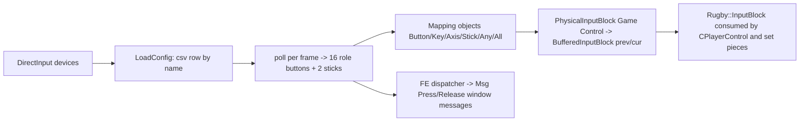

# 11 - Input, camera, HUD, menu flow, settings, save format

Subsystem tag `frontend`. Labels: **observed** (read from data or disassembly), **inferred**, **unknown**. Evidence: REA evidence ids where REA was used (`ev_...`), otherwise offline disassembly of the repaired image (`rules/funcasm.py`, address cited), or a data file. Supporting working notes (full detail, not part of this deliverable): `.omc/research/frontend/{input_notes.md,screens.md,screens_catalog.md,ui_strings_summary.md,ui_strings_english.tsv,control_textures.md}`. Function index: `.omc/research/functions/frontend.tsv`.

## Answers for implementation (S1/S9 questions)

**1. Complete action list and default bindings.** The engine normalises every device to a virtual PlayStation-style pad of 16 role buttons plus two analogue sticks (observed, 0x81fd80, 0x821af0). Gameplay names actions by role; the same physical role is reused for different actions depending on the game state (context). Default keyboard keys and the matching generic-pad button (readme numbering, 1-based) are:

| Role (glyph) | Keyboard | Generic pad | Actions by context |
|---|---|---|---|
| X | S | Button 2 | kick (punt) in open play; dive tackle (defence); scrum feed; maul add player; lineout throw to front; start/stop kick gauge and set power (goal kick); menu confirm |
| Square | Q | Button 1 | up-and-under kick; scrum hook; scrum No.8 pick-up left; ruck scrum-half run (jink) left |
| Triangle | W | Button 4 | grubber / chip kick; ruck box kick; lineout throw to back; menu back |
| Circle | E | Button 3 | drop kick / drop goal; defensive touch-down; scrum No.8 pick-up right; ruck run (jink) right; lineout throw to middle |
| L1 | A | Button 5 | pass left; long ruck pass left; initiate set play |
| R1 | D | Button 6 | pass right; long ruck pass right; initiate set play |
| L2 | Left Shift | Button 7 | change controlled player (defence); short ruck / scrum-half pass left; hold = long pass (string 84) |
| R2 | Space | Button 8 | sprint (hold); short ruck pass right; scrum-half run right |
| L3 | Left Ctrl | Button 9 (stick click) | no bound game action found |
| R3 | Left Alt | Button 10 (stick click) | ruck cheat / collapse scrum or maul / kick pocket (inferred) |
| Up / Down / Left / Right | arrow keys | D-pad (and left stick) | move; scrum drive; goal-kick aim; lineout jump trigger: Down = front, Right = middle, Up = back; defensive formation selection (up/right/down/left glyphs, Standard/Tight/Kick/Wide) |
| Right stick (digital substitute: numpad 4/6/8/2) | numpad | right analogue | special moves direction: sidestep / hand-off / shoulder charge (see answer 3) |
| Start | Esc | Start | pause menu |
| Select | Enter | Select | menu shortcut (e.g. team-select hot buttons) |

Sources: key table 0x821af0 (observed); readme "Hints and Tips" (observed: Space/Button 8 sprint; A,D/Button 5,6 pass; E,Q/Button 3,1 jink; W/Button 4 kick; S/Button 2 feed and gauge; Q/Button 1 hook; Left Shift/Button 7 change player; lineout S/E/W = front/middle/back; Esc = pause); in-game Control Help strings 1330-1355 (observed); tutorial token-to-glyph table (observed). Action-to-context pairing is medium confidence: contexts were read from help text and the tutorial table, not traced into each gameplay consumer. In-game control help pages exist for General Play (offence, defence, kicking), Scrums, Rucks, Mauls, Line-outs, in a Keyboard and a Gamepad variant (strings 1883, 1885).

What `Data/controltypes.csv` implies: the file does not define the gameplay action bindings. It only (a) identifies a joystick by product-name globs, (b) selects which DirectInput axes form the right stick (via `Hardcoded Recognition`), and (c) for rows with `Map Buttons` > 0 re-maps the ten role columns. In the shipped file only Default, Keyboard, Mouse and the two Xbox 360 rows have `Map Buttons` > 0; every other pad uses the built-in default map: raw buttons 0..9 = Button1..Button10 = Square, X, Circle, Triangle, L1, R1, L2, R2, L3, R3 (observed 0x821af0, 0x8218a0). So the `Sqr..Sel` columns of the other 45 rows document layouts only (observed). Start/Select default raw buttons for pads outside the CSV gate are unknown.

**2. Analogue strength beyond movement.** Observed: the left stick is dead-zoned and normalised to a unit-disc vector with no response curve (0x821410). Digital inputs: every other action is a button (sprint is a held button, not trigger depth; pass and kick power are driven by hold time, not pressure: string 1336 "Hold down longer to give the kick more power", 405, 53, 56). The only analogue-pressure special case is the Xbox 360 combined trigger axis, thresholded to two digital buttons (L2 when axis fraction above 0.7, R2 when below 0.3; 0x820476). Whether movement speed (walk/jog/run) scales with stick magnitude is unknown (not traced); the player-control update compares the stick against 0.95 and -0.9 thresholds in a reversal-gesture style check (0x642880, unknown purpose). Mod/implementation advice: treat stick magnitude as direction plus (optionally) speed scale, everything else as digital.

**3. Right stick / aim.** Observed: the input block has two sticks (axes ids 0,1 and 3,4); the second stick is bound to a right-analogue device pair chosen by DEVICE_CONF (section 2.2) and has a digital keyboard stand-in (numpad 4/6/8/2, roles 16-19). The hand-off, sidestep and shoulder-charge events (GEVENT_MOVE_SIDESTEP/HANDOFF/SHOULDERCHARGE) are the right-stick actions: the tutorial text says the move is chosen by pushing the right stick (glyph "right analogue") at 90 degrees to the run direction (sidestep), in the run direction (shoulder charge) or opposite to it (hand-off) (strings 1375-1379), and the keyboard-pad route is "hold change-player and press Square/Circle (sidestep), Triangle (shoulder charge), X (hand-off)" (strings 1401-1403). There is no free-aim action with the right stick. Aiming in goal-kicks and feed aiming at scrums use the left stick / D-pad (strings 867, 1250, readme). Confidence medium (tutorial text, not the consumer code).

**4. Controller assignment in local multiplayer.** Observed: up to one keyboard (a single device object with one fixed key layout; the readme says two players cannot both use keyboard because of key ghosting), a mouse (menu pointer only) and any DirectInput joysticks. On the Select Teams screen each player "moves a specific input device left or right" to pick home or away (readme; handlers 0x4fb8c0/0x4fb970 read the current device and a stored side: 1 = left/home, 2 = right/away). In a match the Pause menu offers REASSIGN CONTROLLERS (screen 606; training 152, tutorial 153, practice 6666), and the game posts GEVENT_CONTROL_ASSIGN/REMOVE/SWITCH and CONTROLLER_REASSIGN_BEFORE/AFTER. A controller not assigned to a team triggers "The controller is not assigned to a team. Please return to Reassign Controller and choose a side." (1670/1997/2031); a newly connected controller can make a previous one ineligible (2028); in Tutorial and Practice only one controller may be used (2830). Each human side owns one input block whose mappings accept the set of devices assigned to it (axis values from several devices are merged by max magnitude); an unassigned side uses a null block. Whether more than two humans can play is unknown; the Control-block layout counts suggest one or two. Exact device-to-side table: unknown.

## 1. Scope and entry points
Names assigned (all in `functions/frontend.tsv`, applied in REA; addresses refer to the SecuROM-repaired image): CPCControl::LoadConfig 0x821cd0, control table load 0x822470, row parse 0x822100, name find 0x8226d0, glob matcher 0x891e00, apply row button map 0x8218a0, default role map 0x821af0, device poll 0x81fd80, SetButtonState 0x81c440, stick normalise 0x821410, PhysicalInputBlock ctor 0x62f800, BufferedInputBlock ctor 0x630bc0, FE role-message dispatcher 0x59f560, team-select handlers 0x4fb8c0/0x4fb970, CPlayerControl::Update 0x642880 (player lead owns); camera event handler 0x407810, camera preset loader 0x5769f2; radar update 0x58a0e0; memory-card file-type registration 0x6c2750.
Data used: controltypes.csv, readme, English string table (2530 strings, `.english`), 273 `.rfe` screens, `.loc`, `.mis`, `.ffn`, compiled `CameraPresetSettings` (`data.gob/19f5282a...xml`), goal-kick settings XML (`data.gob/2a49d4ed...xml`), camera library `rugbycam0.dat` (`data.gob/d0f346a4...dat`).

## 2. Behaviour

### 2.1 Input pipeline (observed unless stated; detail in input_notes.md)

- Device init classifies DirectInput type: mouse (2), keyboard (3), joystick (4). Keyboard and mouse bypass the CSV. For joysticks the product name (first 31 chars) is globbed against Name Pattern 1 then 2 of each row in file order; first match wins; no match = default config (no CSV remap).
- Glob: case-insensitive `*`, `?`, `#` (digit), plus `& | ^ ! ~` boolean operators (none used in the shipped file).
- `Hardcoded Recognition` = one of 17 DEVICE_CONF names (NULL, KEYBOARD, MOUSE, DEFAULT, ELIM, AXIS, RMBL, RMBP, DUAL, CLRP, ACTN, FREE, ELAF, MPSX, USB, PSX, NGC); it only chooses the right-stick axes: AXIS, DUAL, MPSX = Z/Rz; ELAF = Rz/Z; FREE = none; RMBL/RMBP/CLRP = slider based if axes 6,2,5 exist; others = Rz/Ry heuristic.
- Per frame each role is written to a 32-bit button field; the buffered block keeps previous and current bytes per button; "pressed" = cur and not prev.
- Tap events: second press within 400 ms of the first = double-tap; single-tap confirmed 500 ms after first press without a second; time base 10 ms resolution. Gameplay use of tap events not found.
- Stick: x = raw - 32767; y inverted; dead zone 16383 per axis (50 %), linear rescale to 0..1; length clamped to 1. Keyboard arrows give +-1 per axis (diagonals clamped by the normaliser). Axis mappings across devices take max magnitude.
- Front-end: each role press/release becomes `Msg<Role>Press/Release` for the focused widget; PC-only variants `MsgXPressPC`, `...Mouse` for clicks. Menus: D-pad moves focus through per-widget Left/Right/Up/Down neighbour ids; X activates; Triangle = back; Circle/Square/L1/R1/L2/R2/Start/Select are screen-specific shortcuts (e.g. team select: L1/R1 team, L2/R2 kit, Circle statistics).

### 2.2 `Data/controltypes.csv`
50 rows, 25 columns (observed). Columns: **Order** (0 built-ins, 1 known models, 2/10 loose, 100 families, 200 generic by button count; parsed but not used for sorting: file order decides, observed 0x822470), **Friendly Name** (display name; text "XBOX 360" enables the trigger hack), **CF** (hex-like code 40,41,42,61,62,a0; unused by code found), **Hardcoded Recognition** (DEVICE_CONF_*, above), **Name Pattern 1/2** (globs against device product name), **Image Tip** (GENE/GPRO/WING/SIDE/KEYB: help-image family; no consumer found), **Map Buttons** (gate, see answer 1), **Buts** (button count, `+` = at least; parsed, unused), **Dual** (dual-analogue flag; unused), **Sqr, Crs, Circ, Tri, L1, R1, L2, R2, Strt, Sel** (1-based DirectInput button number per role; applied only when Map Buttons > 0; empty = built-in default), columns **1-4** (extra, unused), **Notes**. Role identity: CSV column order is [role X(0), Square(1), Triangle(2), Circle(3), L1, R1, L2, R2, Start, Select]; the CSV header labels Sqr/Crs/Circ/Tri do not match the game's own glyph names, so use role numbers (input_notes s2.4). Anomaly: the two Xbox 360 rows have 24 fields (one missing), so the naive comma split shifts all later columns by one (observed). Two older copies of the file inside data.gob lack the Map Buttons column. The file is loaded as `data/controltypes.csv` (string 0x8cce68, ev_68576c68...).

### 2.3 Camera
Observed (0x407810, ev_6bcf1a42..., data files):
- Camera types, set by the user in Pause > Camera: Truck, Side (Sideline), Broadcast, Chase, End On, Hover (compiled CameraPresetSettings, 6 entries with index/type 0,1,2,3,3,3; the English table also lists Classic/Classic 2/Classic 3/Pocket/Action Camera and older Skyside/Above/Angled/Locked lists, from earlier builds).
- The camera manager is an event handler (jump table on event id) that selects a named camera from a library by (user camera type, game state): states Kickoff, Scrum, Lineout (four lineout variants Lineout Side / Broadcast / Truck / Hand Cam chosen by user type), GoalKick, AutoReplay, AutoReplayDropGoal, Replay_end_1/2, Rail Camera, Unique Camera (highlight cameras), plus PuntDrill and debug cameras.
- Zoom toggle (GEVENT_TOGGLE_CAMERA_ZOOM): switches the current camera to its zoom variant: Truck -> "Zoom Truck", Side -> "Zoom Side", Broadcast -> "Zoom Broadcast", Classic (end-to-end) -> "Zoom End to End Pos2" (observed).
- Camera library `rugbycam0.dat` (loaded 0x401bd6): 20 cameras; sizes from the shipped debug report: AutoReplay 980 B, AutoReplayDropGoal 980, Debug Ball/Player Far/Head/Head Short/Near/Upper Body/GameFaceFar 196 each, Kickoff 128 (fixed), Lineout Hand Cam 568, New End to End Pos2 2112 (and a backup copy), PuntDrill 2164, Rail Camera 196, Replay_end_1/2 2676, Scrum 1228, Sideline Pan New 2468, Sideline Truck New 2364, Sideline TruckPan New 2364, Unique Camera 54752 (data-driven keyframes). Record layout (name + keyframe tables) not decoded: unknown.
- Presets (user option "Custom vs Preset camera: STANDARD, WIDE, SUPER WIDE, NEAR, SUPER NEAR" = preset index 0..4). OP = open play, BD = breakdown (ruck, scrum, maul, lineout). Values observed in the compiled file:

| Camera | preset 0 STANDARD (OPZoom/BDZoom) | 1 WIDE | 2 SUPER WIDE | 3 NEAR | 4 SUPER NEAR | Height |
|---|---|---|---|---|---|---|
| Truck | 12 / 2 | 16 / 6 | 20 / 8 | 8 / 2 | 4 / 0 | not used |
| Sideline | 12 / 2 | 16 / 6 | 20 / 8 | 8 / 2 | 4 / 0 | not used |
| Broadcast | 12 / 2 | 16 / 6 | 20 / 8 | 8 / 2 | 4 / 0 | not used |
| Chase | -3 / -8 | 0 / -5 | 5 / 0 | -5 / -10 | -8 / -12 | OP -400, BD -600 |
| End On | 4 / -4 | 8 / -2 | 14 / 0 | 0 / -8 | -4 / -10 | -200 both |
| Hover | -6 / -10 | -2 / -6 | 4 / 0 | -10 / -14 | -14 / -20 | 1800 both |

  Zoom units are integers added to a camera distance; positive = wider (the ordering STANDARD < WIDE < SUPER WIDE confirms this for Truck/Side/Broadcast) (inferred; unit magnitude unknown). The Hover (index 5) preset list was parsed from a record where the last two presets share a corrupted tag layout; the values shown follow the document order (observed, moderate confidence).
- Option strings: ZOOM ENABLED, DEFENSIVE CAM (OFF | FORWARD PLAY), ZOOM LEVELS, OPEN PLAY CAMERA, BREAKDOWN CAMERA, HEIGHT LEVELS (2135-2141): separate camera settings for open play and breakdown. Reset-to-default prompt 2746. Replay camera choice: Highlight XML gives per-highlight percentages (broadcast/side/truck/classic/railcamera/uniqueCamera) plus startTime/delayTime; e.g. Try: startTime 10 s, delayTime 5 s, railcamera 100, uniqueCamera 100; Big Hit / High Tackle quality 60/65 (data observed, `byroot.json` Highlight).
- Goal-kick cameras: the 7 custom kick cameras (Height, Up, Side, Back, Speed, Interpolation, FOV; FOV = atan(PS2 FOV units / 240) degrees, e.g. 15.388 deg, 65.588 deg) exist only as commented-out XML in the shipped goal-kick file; live behaviour is the library camera "GoalKick" (unknown values).
- Follow/zoom/blend constants (smoothing, look-ahead, clamps): unknown (the cameras are keyframe-data driven in the library; engine side not traced).

### 2.4 HUD
In-game HUD is built from COverlay items fed by `ig_*` and `scorebox.rfe` style screens (nested archive `161d696f...big`: scorebox 121, goalkick 7, kickoff 90 (drop-goal shootout UI), penalty 88/95/97, playerinfo 110, teamlineup 85, team_anthem 86, replay 82, highlights 51, ig_raindrops 345) and `xml/ingamerfe/IGRugbyScreens.xml`, `ig_clock`, `ig_wind1-4`, `ig_tourn_*`, `ig_common`, `ig_training`. Item classes (vtables 0x8e1584-0x8e1fb0): ScoreBox, Clock, Radar, Dashboard, PlayerControls, Ruck, Scrum, Maul, LineOut, QuickLineOut, QuickRun, TeamLineup, SetPlayTut, Ticker, Mark, DefensiveFormation, DropGoalMeter, DropGoalShootout, RainDrops, TransitionMedallion, EATRAX (observed names).
- **Score/clock/ticker**: score box slides in with named animations (ScoreBGSlideIn etc.); minute captions "%dst/nd/rd/th minute"; card icons (yellow/red, sin-bin countdown "%.1f"), advantage flag and referee-signal animations (RefUp/Down, AdvantageFlag fades); stats captions TERR%, POSS%, CONS; scoring labels TRIES, CONVERSION, PENALTY, DROP GOAL; end captions HALF TIME, FULL TIME, END OF MATCH, BEGIN SECOND HALF, EXTRA TIME (strings). Possession indicator: shown as POSS% in statistics; an in-play possession arrow is not found (unknown).
- **Radar** (0x58a0e0, observed): option Off | Radar | Game Help | Both (1799). Hidden unless the option is on and the game is in a state that shows overlays. Each update loops 15 dots per team (two teams). A dot is hidden for players not on the field; the human-controlled player's dot colour depends on controller slot 1..4: slot 1 dark blue (0,70,140), slot 2 red (230,0,0), slot 3 light blue (0,165,255), slot 4 yellow (215,255,0) (channel order inferred); other dots use team colours. Dot art `radardot` 16x16. World-to-radar mapping not read: unknown.
- **Player display** None | Names | Numbers (275); offside marker toggle (300); auto instant replay (299).
- **Meters**: kick power is a held-button fill (power rises while the button is held; string 405/1336); goal-kick gauge shows wind strength and direction and starts/sets power/stops accuracy with X; ranges in the goal-kick settings XML (observed): three difficulty blocks (easy/normal/hard) with PrimaryAngle 5/10/11, SecondaryAngle 8/12/12, SwingThreshold 0.866, RedZoneMultiply 1.02/1.05/1.075, MinTime 1.3/1.0/0.8 s, MaxTime 2.3/2.0/1.3 s, MinPower 10, MaxPower 33, MinAccel 0.5/0.8/1.0, MaxAccel 1.3/2.0/2.4, DropGoalMaxSpeed 2.0/2.5/3.0, DropGoalSpeedExponent 1.25/1.3/1.32, DropGoalShootoutModifier 4.5/4/4; five kicker classes (excellent..terrible) with Top/Centre/Bottom accuracy fractions 0.343/0.230/0.125, 0.311/0.230/0.159, 0.286/0.230/0.182, 0.262/0.230/0.197, 0.250/0.230/0.210; debug aim lines at angles 0, +-3, +-6, +-13, +-20.1 degrees. (The set-piece lead owns kick physics.) Drop-goal meter: fill meter that must be released between the posts (405).
- **Set-piece overlays**: Ruck/Scrum/Maul/LineOut/QuickLineOut/DefensiveFormation items show the control prompts and timing bars; defensive formation labels Standard/Tight/Kick/Wide. Penalty menu: Kick at goal, Scrum, Run, Punt; "change line-up" hint (362-368).
- **Player name / stamina bars**: no stamina bar string or item found (unknown/likely absent). Prompts use `$TOKEN` substitution to button glyphs from a symbol font.

### 2.5 Menu flow
Fully data-driven by `.rfe` scripts (253 named screens + leftovers; 230 distinct IDs; format in screens.md: compiled `00 BE EF FF` stream or XML; widgets carry neighbour ids, Msg handlers `fez:GoToScreen(N)`, `fez:SendMessage`, named C++ handlers such as `OnEnterPlayNow`). Skeleton (edges observed from GoToScreen, others inferred):
```mermaid
flowchart LR
 boot[bootup_memcard 4405 / popup_profile_initial 4410] --> title[title 2 'Press START']
 title --> main[main_menu 5: PLAY NOW, RWC 2007 (120), Challenge 800, GAME MODES 10, MY RUGBY 14, EXTRAS 13]
 main --> pn[Play Now team select 6 -> controller select -> match]
 main --> gm[Game Modes 10 -> Tournaments 11 -> tournament settings, team select, hub, fixtures, standings, knockout]
 main --> mr[My Rugby 14: profile, rosters, create player, hall of fame, load/save]
 main --> ex[EA Extras 13: credits, control help 18, game help 17, unlockables]
 gm --> pr[Practice / Rugby 101 -> practice controller select 6666]
 pn --> match((match))
 match --> pause[Pause 113: resume, replay, objectives, stats, camera 44, options 117, reassign controllers 606, quit]
 pause --> main
 match --> ht[half-time 115 / full-time 116] --> main
```
Screen IDs are reused across contexts (e.g. 120, 121, 141-144, 300-302), so key screens by (context, ID) or file. Fonts are `.ffn` "FntF" bitmap fonts (Futura-family fonts 1-5, sizes 14-18; font to file mapping unknown; decoder `tools/openrugby_tools/fntf.py`). Boot movies before the title are not screens (unknown).

### 2.6 Settings and persistence
- Options (strings): audio: sound mode Stereo/Surround/Mono, volumes Commentary, Crowd, Field, Music, Menu SFX, vibration, jukebox; display: resolution (1024x768 ... 1600x1200), antialiasing, shadows Complex/Simple, force LOD, texture filtering Trilinear/Point/Bilinear, pitch detail, gamma, screen format Standard/Widescreen, Best Settings, Apply Settings; gameplay: difficulty Club/Pro/Elite, half length 5/10/20 (40 in some modes) minutes, rules Basic/Intermediate/Advanced, offload mode Simulation/Arcade, line-out control Basic/Advanced, assistance Normal/Assisted/CPU, radar, offside marker, auto replay, camera. No master-volume or key-remap screens exist; "REASSIGN CONTROLLERS" and "CONTROL HELP" are the only control-related options. A modder's controller table is `controltypes.csv`.
- Registry (config.xml, observed): `HKLM\SOFTWARE\EA SPORTS\Rugby 08\{Locale,MemberName,Registered}` and `HKLM\SOFTWARE\Electronic Arts\EA SPORTS\EA Sports Rugby 08\ergc\` (registration code). These hold language and EA registration only. All gameplay settings live in the Profile (string 1579/2025).
- Save kinds: Profile `*.pro`, Roster `*.ros`, Tournament `*.tmt` (file masks registered at 0x6c2750 with a memory-card library interface `MemoryCardLibInterface` reused on PC as "PC hard disk"; autosave option). Titles "EA SPORTS Rugby 08 Profile/Roster/Tournament". Load/Save screen shows Size, Date, Status VALID/INVALID; operations: save, load, delete, autosave on/off, show changed, reset profile settings or rosters to defaults; unsaved-change prompts before quitting; corrupt-file prompt (0x8efd48). Strings for dialogs come from `.loc` tables (short PC set of 14 and long memory-card set of 40, UTF-16, `%1`).
- Folder, naming and the binary layout of `.pro/.ros/.tmt` are unknown (no saves available; serializer not read).

## 3. Constants and tunables
| Name | Value | Unit | Where | Evidence |
|---|---|---|---|---|
| input_double_tap_window | 400 | ms | 0x81c440 | observed |
| input_single_tap_confirm | 500 | ms | 0x81c440 | observed |
| input_tick | 10 | ms resolution (100 Hz) | 0x81c6a0 | observed |
| stick_deadzone | 16383 of 32767 | raw counts (50 %) | 0x821410 | observed |
| stick_clamp | radial, length <= 1 | unit | 0x821410 | observed |
| xbox_trigger_l2_above / r2_below | 0.7 / 0.3 | axis fraction | 0x81fd80 | observed |
| csv_max_line | 4096 | chars | 0x822470 | observed |
| camera_preset_zoom tables | section 2.3 | camera units | CameraPresetSettings | observed |
| camera zoom pairs | Truck/Side/Broadcast/Classic -> Zoom variants | n/a | 0x407810 | observed |
| radar_dots_per_team | 15 | count | 0x58a0e0 | observed |
| radar_controller_colours | (0,70,140) (230,0,0) (0,165,255) (215,255,0) | rgb | 0x58a0e0 | observed/inferred channel order |
| goalkick_* | section 2.4 | various | goal-kick XML | observed |
| match_length_options | 5/10/20/40 | min | strings 490/657 | observed |

## 4. Data structures
- `ControllerProfile` (from CSV row): order:int, name, glob1, glob2, conf (enum of 17), image_family, map_buttons:bool, buts, dual, role_buttons{x,square,triangle,circle,l1,r1,l2,r2,start,select}.
- `InputBlock`: 16 buttons (prev/cur), 4 axes (ids 0,1,3,4), 2 sticks; roles masks: X 0x1, Square 0x2, Start 0x4, Select 0x8, Up 0x10, Down 0x20, Left 0x40, Right 0x80, L1 0x100, L2 0x200, L3 0x400, R1 0x800, R2 0x1000, R3 0x2000, Triangle 0x4000, Circle 0x8000, plus right-stick digital 0x10000-0x80000.
- `CameraPresetSettings`: list of cameras {index, type, name, presets[5]{op_zoom, bd_zoom, op_height?, bd_height?}}.
- String table `.english`: u32 count, u32 payload bytes, u32 max id, then records (u16 id, NUL-terminated cp1252); `$TOKEN` placeholders; high bytes = symbol-font glyphs.
- `.rfe`, `.ffn`, `.mis`, `.loc`: see screens.md and `tools/openrugby_tools/{fntf,loch}.py`.

## 5. Mod hooks
`controltypes.csv` rows (device globs, DEVICE_CONF, Map Buttons rows); default role-to-key table; stick dead zone; tap windows; camera preset zoom/height tables and camera library; highlight camera percentages; goal-kick settings XML; English string table (control help text); `.rfe` screens and HUD item layout; radar colours and option set; match-length and difficulty options.

## 6. Acceptance tests
1. controltypes.csv parses to 50 rows x 25 columns except the two Xbox 360 rows (24 fields); parsing the Xbox rows naively yields Map Buttons=12.
2. Glob `*Logitech*DualAction*` matches "Logitech Dual Action" case-insensitively; first match in file order wins over later duplicate rows.
3. Default keyboard: S -> X role, Q -> Square, W -> Triangle, E -> Circle, A -> L1, D -> R1, Left Shift -> L2, Space -> R2, Esc -> Start, Enter -> Select.
4. Stick: raw 49150 on one axis gives 0 (inside dead zone edge); raw 65534 gives +1.0; combined (1,1) is normalised to length 1.
5. Two presses of one button 300 ms apart give press, double-tap, press; a single press then 600 ms idle gives press, release, single-tap.
6. Xbox trigger axis fraction 0.8 -> L2 down; 0.2 -> R2 down; 0.5 -> neither.
7. Camera: Truck preset 2 (SUPER WIDE) has open-play zoom 20 and breakdown zoom 8; End On preset 0 has height -200; Chase height OP -400/BD -600; the Zoom toggle on a Broadcast camera selects "Zoom Broadcast".
8. Radar shows 15 dots per team and colours the human dot by controller slot as listed.
9. String table parses to exactly 2530 entries; id 1330 = "Basic Controls"; id 1883 lists 10 pages.
10. Only one keyboard device can be assigned; a controller not assigned to a side blocks play with string 1670.

## 7. Open questions / unknowns
1. Default raw Start/Select for pads with Map Buttons = 0.
2. Gameplay meaning of stick thresholds 0.95/-0.9 (0x642880) and whether walk/jog speed scales with magnitude.
3. Right-stick consumer code for sidestep/hand-off/shoulder charge (tutorial text only).
4. Camera engine constants: follow target, smoothing, look-ahead, zoom unit; camera library record layout; live goal-kick camera values.
5. Radar world-to-screen mapping; possession arrow and name labels behaviour; clock formatting/real-to-game minute scale (rules lead).
6. Profile/roster/tournament file location, header, checksum and field layout; settings serialization.
7. Boot sequence before the title; CF/Image Tip/Order column consumers; symbol-font glyph to button map (only X inferred); font file to Font1-6 mapping.
8. Handler bodies behind dashed edges in the screen graph; Story mode (704-740) and Ten Nations (280-286) reachability.
REA evidence: ev_6bcf1a42..., ev_68576c68..., ev_956de205...; most input conclusions come from offline disassembly cited by address.

## 8. Confidence summary
High: controltypes.csv structure and loader behaviour, role/key table, stick processing, tap timing, string table format, camera preset values, zoom toggle mapping, registry keys, screen formats. Medium: action-to-context bindings, right-stick special-move behaviour, radar behaviour, menu graph edges, camera state selection. Low/unknown: camera numeric behaviour, save file layout, HUD layout numbers, assignment data structure.

## Not covered
Clock/time scaling (rules), full HUD geometry (positions/colours per widget; available in screens_catalog.md), audio/video options plumbing, `.mis` mission semantics (modes lead), debug/test screens (9000-9004, 9878, 15000).
