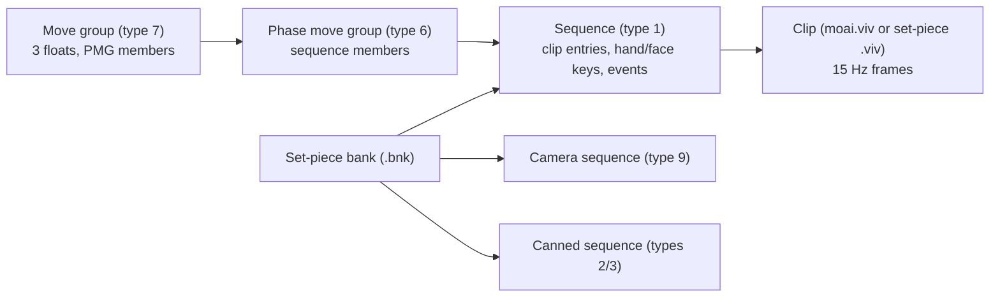

# 12 - Motion and animation data (Rugby 08 PC)

Status: the animation clip format is fully decoded and verified on every shipped clip. Clips play
on the `!skel.o` player skeleton and can be exported to glTF. The sequence-bank framing
("motion script") is decoded. Event semantics are not decoded yet.

Tools:

* `tools/openrugby_tools/motion.py` runs as `python -m openrugby_tools.motion {census,dump,gltf}`.
  Tests are in `tools/tests/test_motion.py`.
* The research parser for sequence banks is `.omc/research/motion/scripts/bankparse.py`.
* Notes: `.omc/research/motion/` (`lead-notes.md`, `bank-and-dof.md`, `ymud.md`, `clip-census.md`).

Labels:

* **observed** means read directly from shipped data or code. For code, the Evidence ID is a REA
  ID (`ev_...`), or `OD:<addr>` for offline disassembly of the SecuROM-repaired image at the same
  addresses.
* **inferred** means the reading fits all the data but has no direct code confirmation.
* **unknown** means not resolved.

Engine lineage: the code is EA's FIFA animation system. RTTI names it `FIFAANIM::Sequence`,
`CannedSequence`, `CameraSequence` and `SequenceInstance`. The source path string is
`.\src\fifa\FIFAAnim\`. In the code, clips are called "MO" animations (`Animation::MOPoseEngine`).

## 1. Scope and entry points

| Address | Name | Role | Evidence |
|---|---|---|---|
| 0x6c8f00 | `motion_AnimationStore_AnimInit` | Loads `data/motion/moai.viv` (or `gameface/motion/moai.viv`) whole into memory, then `motion/animlist.bin` into the "Global SequenceBank" | OD:6c8f00 |
| 0x6c9310 | `motion_AnimationStore_InitPoseEngine` | Builds `Animation::MOPoseEngine` (0x70a590) and registers the viv members (0x70abd0) | OD:6c9310 |
| 0x70abd0 | `motion_MOPoseEngine_RegisterViv` | Caches each clip in a slot ("Caching MO Animation : %s") | OD:70abd0 |
| 0x709720 | `motion_GetAnimDurationSeconds` | Clip duration = (frames - 1) / 15 s | ev_da145873.. |
| 0x70b3e0 | `motion_TicksToFrame` | Playback time in ticks: frame = trunc(ticks x 0.25), plus a fraction | ev_e7cb6801.. |
| 0x70b7c0 | `motion_ClipRecordAt` | Random access to frame record i | OD:70b7c0 |
| 0x70ba40 | `motion_DecodeFrameCached` | Sequential delta decode with a 4-frame ring cache | ev_a3c67967.. |
| 0x70deb0 | `motion_UnpackDeltaChannels` | Bit-packed delta reader | ev_08e124af.. |
| 0x70be40 | `motion_SamplePoseAtTime` | Time to frame pair, heading offset, sample | OD:70be40 |
| 0x70c2b0 | `motion_SampleClipPose` | Interpolate two frames into a bone pose; mirror path | ev_69181fa3.., OD:70c39e |
| 0x70b430 / 0x70b580 / 0x70b6d0 | `motion_ClipRootPosition` / `motion_ClipTargetPoint` / `motion_ClipHeadingAtTime` | Header-channel queries | ev_85c76f1d.., ev_b6595928.. |
| 0x713060 | `motion_TargetDistanceBearing` | Distance and bearing from the root to the target point | OD:7130ca |
| 0x7180e0 | `motion_SequenceBank_ctor` | Sequence-bank parser; see section 4.4 | OD:7180e0 |
| 0x714a10, 0x717540, 0x712d70, 0x727810, 0x725360 | Sequence, canned sequence, camera sequence, phase group and move group constructors | | OD (sub-agent) |

All names are applied in REA (ev_9f938e0f..) and listed in `.omc/research/functions/motion.tsv`.

### Files

| File | Count | What it is |
|---|---|---|
| `Data/motion/moai.viv` (= `data.gob/1942abb7...viv`) | 537 clips | Gameplay clip library |
| `Data/motion/script.big` (= `data.gob.nested/_level2/4bff1461...big`) | 1,687 `.viv` archives | Set-piece and cut-scene packages. Each holds clips, one `<name>.bnk` sequence bank and one `<NAME>.dof.xbox.set` |
| `data.gob/3d165fb4...bin` | 1 | `motion/animlist.bin`, the global gameplay sequence bank (1,641 sequences; all 537 clip names resolve into moai.viv) |
| `data.gob/e347a377...bin` | 1 | A small bank of the idle and locomotion layer (`STAND_LOOP`, `PHASE_WALK_*`, `PLAYER_WALK_MG`) |
| `*.dof.xbox.set` | 1,838 | 5-number camera depth-of-field settings. Not motion; see `13-game-data-catalogue.md` |
| `*.jdi` ("YMUD") | 1,788 | Stadium particle-emitter definitions. **Not motion.** Spec is in `.omc/research/motion/ymud.md` |
| `!eagl` (`__AnimationBank:::bank`) | 2 | EAGL animation bank next to `!skel.o` (string `motion/eaglanim.big`). **Not decoded.** |

Counts of clip files (observed, census):

* 16,308 files start with `01 0B`; 1,735 of them have distinct contents. The script.big content
  also appears inside data.gob.
* All 1,735 distinct clips decode to the last byte, and their frame counts match the header.
* They hold 178,667 frames in total.
* Layouts:
  * 1,705 compressed clips with 116 channels;
  * 29 raw (all key frames) clips with 116 channels;
  * 1 compressed clip with 191 channels (`AAAAAA`, translation on all 26 bones).

## 2. Behaviour

### 2.1 Clip decoding (observed, high)

A clip is a header, an optional bit-width table, then one record per frame.

1. **Header** (section 4.1): the frame count, the channel count C, the bone masks and the offset
   of the first record.
2. **Channels.** Each frame is a vector of C signed 16-bit integers:
   * channel 0: frame flags;
   * channels 1-8: header channels (section 2.4);
   * 3 channels for each bone with a translation track;
   * 4 channels for each bone with a rotation track.
   C = 9 + 3T + 4R.
3. **Records.** Each record starts with `u16 size, u16 flags` and the 8 header channels as raw
   int16.
   * Frame 0, and every frame of a clip whose header flag bit 15 is set, continues with the other
     channels as raw int16.
   * Every later frame of a compressed clip continues with a bitstream of the remaining channels
     in order, `width[i]` bits each.
4. **Bitstream rule.**
   * Words are little-endian u16, consumed most-significant bit first. The reader keeps a 32-bit
     window whose first word is in the high half.
   * Each field is sign-extended (two's complement) and **added to the same channel of the
     previous frame**, with int16 wrap-around.
   * A width of 0 means the channel holds its value.
   * Records are padded to 4 bytes.
   * All delta records of a clip have the same size, so record i starts at
     `first + size(0) + size(1) x (i-1)`.
   * Evidence: ev_08e124af.., ev_a3c67967.., OD:70b7c0.
5. **Decode order.** The engine decodes forward from frame 0 and keeps the last 4 decoded frames.
   A seek backwards restarts from frame 0 (OD:70ba40). A Godot port should decode a clip fully at
   load time instead: it is small, at most 480 frames.

### 2.2 Time and interpolation (observed)

* Playback time is kept in **ticks of 1/60 s**.
* The frame index is `trunc(ticks / 4)`. The fraction `ticks/4 - frame` interpolates between
  frame i and frame i+1. Frame indices are clamped to `frames - 1`.
* So clips are sampled at **15 frames per second**: `duration = (frames - 1) / 15`
  (ev_da145873.., ev_e7cb6801..).
* Data check: in the jump of `CA3024`, the hip height follows a parabola of about -2.2 units per
  frame squared. At 15 Hz that is about 495 units/s², which is 9.9 m/s² at 0.02 m per unit.
  At 30 Hz it would be 4 g. This confirms both the rate and the unit estimate from doc 04.
* Header u16 at 0x04 is the clip length in ticks: 4 x frames, or 4 x frames + 2 in 4,630 files.
  The +2 is unknown.

**Pose sampling (`motion_SampleClipPose`, observed).** For each animated bone b:

$$t_b = \tfrac{1}{32}\left(T_b(i) + \alpha\,(T_b(i{+}1) - T_b(i))\right),\qquad
q_b = \tfrac{1}{16384}\left(Q_b(i) + \alpha\,(Q_b(i{+}1) - Q_b(i))\right)$$

* Interpolation is component-wise linear on the quantised values, with no slerp and no
  renormalisation in the sampler.
* For the root bone, translation and rotation are then rotated about +Y by the actor's facing
  minus the clip's frame-0 heading. That alignment is the only place the heading enters the pose.
* A fast path is used when the translation mask is 1 and the rotation mask is 0x03FFFFFF
  (OD:70c2ea).

### 2.3 Skeleton binding (observed)

* Mask bit i is bone i of the 51-bone `!skel.o` player skeleton (doc 04 section 8).
* All shipped clips animate rotations on bones 0-25: Hips, the spine, the neck and head, both arm
  chains with twist bones, and both legs to the toes. Face and finger bones (26-50) keep their
  bind pose.
* Translation is animated on bone 0 (Hips) only, except in `AAAAAA`.
* **Quaternion convention:** a stored quaternion is the conjugate of the `!skel.o` local-rotation
  convention. Glossary: (x, y, z, w) maps to (-x, -y, -z, w) in skeleton and glTF convention.
* Evidence: idle frames match the bind pose only after conjugation, for example RToe stored
  (0, 0, 0.208, 0.978) against bind (0, 0, -0.208, 0.978).
* Rendered check: `.omc/research/motion/previews/CA3024_side.png` shows a run, a jump with the
  arms above the head, and the landing. `EP007A1C.png` shows a standing line-out player. In both,
  the feet touch y = 0.
* The hips translation channel is the hip position relative to the root, in 1/32 units. Standing
  idle is about 1,900, which is 59 units.

### 2.4 Header channels, root motion and target point (observed layout, partly inferred meaning)

| Channel | Meaning | Unit | Evidence |
|---|---|---|---|
| 1 | Root heading, absolute per frame | 1/1024 turn. The engine wraps differences at ±512 and divides by 1024. Data: the change in heading x 360/1024 equals the change in body yaw (CA3024: 480 units = 169° vs 170° measured) | OD:70b748, data |
| 2 | Always 0 | | data |
| 3, 4, 5 | Root trajectory point x, y, z in clip space, absolute per frame. y equals the hips height | 1/32 unit (engine: `v << 11` / 65536) | ev_85c76f1d.. |
| 6, 7, 8 | Clip **target point** x, y, z. Constant within every shipped clip; y is always 0 | 1/32 unit | OD:70b5ce |

* **Root trajectory.** Channels 3–5 store an absolute per-frame trajectory point in clip space.
  The accessor `motion_ClipRootPosition` (0x70b430) samples it (ev_85c76f1d…). The separate
  pose sampler `motion_SampleClipPose` (0x70c2b0) writes sampled per-bone pose records
  (ev_06b21373…). The offline pose check adds the root trajectory to the rendered pose: mean
  planted-foot slide falls from 3.8 to 0.8 model units per frame over 150 moai clips. Adding the
  heading rotation as well makes the slide worse. This validates the offline pose reconstruction;
  it does not by itself establish how the match runtime updates an actor's world position.
* **Runtime use observed so far.** The resolved direct caller of `motion_ClipRootPosition` is
  `motion_GetClipRootPosition3` (0x7098d0; ev_06f7411f…, ev_b73a708a…). The two resolved callers
  are target-distance/bearing helpers. `motion_TargetDistanceBearingBetweenClips` (0x712f90)
  samples two root positions, computes their XZ distance and bearing, then subtracts heading
  (ev_b5a3750f…). This confirms a target/alignment calculation but not world-position integration.
  `phys_ActorUpdate` (0x723f30) snapshots a separate position accessor and calls its animation
  state update at 0x70ef50 (ev_0ad25531…, ev_4a806b08…); direct callers of that update are limited
  to 0x723f30 (ev_edd3b286…). The remaining transform and animation-mode callbacks include
  indirect dispatch, so this search does not rule out a separate root-delta consumer.
* **Safe implementation boundary [I].** Keep the absolute sampled clip-root point distinct from
  authoritative match world position. Never add each absolute sample to world position as though
  it were a per-frame delta. Until a complete open-play movement callback proves otherwise,
  translation ownership stays with the match locomotion simulation; any later root-motion adapter
  must consume an explicitly derived frame delta exactly once. This avoids cumulative double
  application while leaving the actual Rugby 08 movement ownership open for further RE.
* `motion_TargetDistanceBearing` computes root-to-target distance and bearing in XZ, minus heading.
  Its downstream selection use is not fully traced. It is probably alignment logic for a clip that
  reaches a ball or contact point (inferred). For example, the catch clip CA3024 has its target
  about 300 model units ahead (about 6 m).

### 2.5 Frame flags (observed correlation, inferred meaning)

* Bit 1 (0x2) = **left foot planted**. The left toe is within 4 units of the ground in 94% of
  flagged frames.
* Bit 2 (0x4) = **right foot planted** (92%).
* Bit 15 is set on delta records. Other bits are never set.

### 2.6 Mirroring (observed)

The engine plays any clip mirrored. A mirrored clip uses these rules:

1. Bones are remapped through the table at 0x99db60: L/R arm chains 6-11 swap with 12-17, and
   legs 18-21 swap with 22-25.
2. Stored quaternion components x and z are negated (in the stored convention).
3. Translation x is negated.
4. The heading, the root trajectory x and the target x are negated.

Evidence: OD:70cb44, OD:70b3c8, ev_85c76f1d...

### 2.7 Sequences ("motion script"), from the sequence banks (framing observed; semantics partly inferred)

Sequence banks (format version 6) hold named objects, sorted by (type, category), with a
10 x 34 first-index table.

The hierarchy is Move Group (type 7) → Phase Move Group (type 6) → Sequence (type 1) → clip
entries. For example, `PLAYER_WALK_MG` → `PLAYER_WALK_FWD_PMG` → `PHASE_WALK_FORWARD`, `_2`,
`_3`.

* **Clip entry** (52 bytes): clip name; start frame (negative = lead-in); blend frames; frames
  played; a3; speed multiplier; flags, where bit 0 = loop. Field meanings except the name are
  inferred.
* **Hand/face pose key** (44 bytes): pose name (`HANDFTL`, `HANDRELX`, `FACESERF`...), slot
  (2 face, 4 left hand, 8 right hand), frame range and weight.
* **Events:** `u16 code, i16 frame` plus a payload. The payload size is set by a 20-entry class
  table (code to class through 0x99eeaa). Frame stamps are observed; code meanings are
  **unknown**. Candidates:
  * `JUMP_CATCH` carries code 47 at frame 34;
  * `PUNT_STAND` carries 79 at frame 6 and 77/78 at frame 43, probably the kick contact;
  * every kick-off sequence carries 56 at frame 0.
* **Triggers** (569 in animlist): from-sequence → to-sequence transition rules. Fields b and c
  are unknown.
* **Set-piece banks** name their sequences `<stem>`, `<stem>_2`..`_n` (one per actor), plus
  `<stem>_BALL` (a ball path) and `<stem>_CAMERA` (camera keys).
  * Clip references resolve to the set-piece archive (12,172) or moai.viv (4,273), with 0
    missing.
  * There are 1,302 stems over 1,687 archives (`06_LineOut_TeamA_01`..., `06_Rucks_*`,
    `PlayerFocus_*`, `Tunnel_Exit`, `Anthem_Line` and so on).

Full field tables and the parser are in `.omc/research/motion/bank-and-dof.md`.

## 3. Constants and tunables

| Name | Value | Unit | Where used | Evidence |
|---|---|---|---|---|
| `clip_frame_rate` | 15 | frames/s | duration, sampling | ev_da145873.. |
| `ticks_per_frame` | 4 | ticks (1/60 s) | `motion_TicksToFrame` | ev_e7cb6801.. |
| `translation_scale` | 1/32 (0.03125) | model units per stored unit | bone translations, root trajectory, target | OD:70c39e, ev_85c76f1d.. |
| `rotation_scale` | 1/16384 (Q14) | quaternion component | rotations | OD:70c5d4 |
| `heading_units_per_turn` | 1024 | units | channel 1; differences wrap at ±512 | OD:70b748, data |
| `animated_bone_count` | 26 | bones | mask 0x03FFFFFF; bones 0-25 of `!skel.o` | data, OD:70c2c5 |
| `mirror_bone_map` | [0..5, 12..17, 6..11, 22..25, 18..21] | bone index | mirrored sampling | table 0x99db60 |
| `frame_cache_size` | 4 | decoded frames | `motion_DecodeFrameCached` | OD:70bb57 |
| `max_channels_for_multiframe` | 256 | channels | above this the clip is treated as 1 frame | OD:70bb02 |
| `mo_slot_count`, `pose_pool` | 500, 200 (call arguments) | slots | `InitPoseEngine` → 0x70a5d0 | OD:6c93f6 (meaning inferred) |
| `model_unit` | ≈ 0.02 | m | gravity check above | inferred |

## 4. Data structures

### 4.1 Clip header (little-endian, 0x24 bytes)

| Off | Type | Field | Notes |
|---|---|---|---|
| 0x00 | u8, u8 | version 1, type 0x0B | observed constant |
| 0x02 | u16 | offset of the first frame record | 0x98 (compressed, C = 116), 0xE4 (C = 191), 0x24 (raw) |
| 0x04 | u16 | length in ticks | 4 x frames (+2 sometimes) |
| 0x06 | u16 | frame count | |
| 0x08 | 6 bytes | 0xFF | |
| 0x0E | u16 | clip flags | bit 15 = raw clip (every record is a key frame); bit 0 always set |
| 0x10 | u16 | channel count C | 9 + 3T + 4R |
| 0x12 | u16 | 5 | unknown |
| 0x14 | u16 | T, translation bone count | 1 or 26 |
| 0x16 | u16 | R, rotation bone count | 26 |
| 0x18 | u32 | 0x04000000 | unknown (bit 26) |
| 0x1C | u32 | translation bone mask | bit i = bone i |
| 0x20 | u32 | rotation bone mask | 0x03FFFFFF |
| 0x24 | u8[C] | bit width per channel (compressed only) | 0-16. Channels 0-8 are always 16 |

### 4.2 Decoded frame (what the Godot resource should hold)

| Field | Type | Unit |
|---|---|---|
| `flags` | int | bit 1 left plant, bit 2 right plant |
| `heading` | float | turns (channel 1 / 1024) |
| `root_position` | Vector3 | model units (channels 3-5 / 32) |
| `bone_translation[T]` | Vector3 | model units, local to the parent (/32) |
| `bone_rotation[R]` | Quaternion | skeleton convention: conjugate of the stored value / 16384 |

Per clip: `target_point` (Vector3), `frame_count`, `length_ticks`, the bone masks and the name
(BIGF member name, 6-8 characters, for example `CA3024`).

### 4.3 Units and axes

* Model space follows doc 04: +Y up, players face +Z, about 0.02 m per unit.
* Heading increases with a right-handed rotation about +Y, that is +Z towards +X (data).

### 4.4 Sequence bank

See section 2.7 and `.omc/research/motion/bank-and-dof.md` for the header (7 u32), name block,
first-index table, triggers, nodes (24 bytes) and object types 1/2/3/6/7/9.

## 5. Mod hooks

* **Clip replacement:** any clip can be swapped by name. A Godot `AnimationLibrary` keyed by
  member name keeps the bank links intact.
* **Playback rate:** `clip_frame_rate` and the per-entry speed multiplier.
* **Mirroring:** the mirror bone map, for custom skeletons.
* **Foot-plant flags:** for IK foot locking.
* **Target point:** reach and alignment tuning for catches and tackles.
* **Sequence banks:** transition triggers, blend frames, loop flags, and the per-actor clip lists
  of set pieces (new set-piece choreography).

## 6. Acceptance tests (GDScript-checkable)

1. Decoding any shipped clip consumes exactly the file length, yields `frame_count` frames, and
   every rotation has |q| within 0.0034 of 1 (verified for all 1,735 distinct clips).
2. In a compressed clip, decoding frame i equals frame i-1 plus the sign-extended deltas, with
   int16 wrap.
   * Synthetic test: one u16 word 0xABCD with widths (4, 8, 4) gives deltas (-6, -68, -3).
3. `duration(clip) == (frame_count - 1) / 15.0`. For CA3024 (44 frames) this is 2.8667 s.
4. Sampling at tick 6 interpolates frames 1 and 2 with alpha = 0.5.
5. At rest-like frames, conjugated rotations match the `!skel.o` bind pose: RToe in BAWUPC2 frame
   0 is within 0.01 of the bind quaternion.
6. For BAWUPC2 frame 0, posed with translation scale 1/32, the lowest toe is within 1 unit of
   y = 0, and the head is about 94 units high.
7. With root trajectory (channels 3 and 5 / 32) added, mean planted-foot slide over the moai
   clips is under 1 unit per frame.
8. Mirroring a clip twice gives the original pose. The mirrored left foot uses the right leg's
   track.
9. The heading change from first to last frame x 360/1024 matches the body yaw change within 5°
   for CA3024 (169°).
10. Every clip name referenced by `animlist.bin` exists in moai.viv. Every set-piece bank clip
    reference resolves to its own archive or to moai.viv.
11. Sampling the same absolute root-trajectory frame twice returns the same clip-local point and
    does not mutate the actor's authoritative world position.
12. Repeated sampling over successive frames never cumulatively adds absolute clip-root points to
    actor world position. If a verified movement adapter consumes root deltas, assert each
    adjacent-frame delta is applied at most once and independently from the absolute sample.
13. With animation sampling disabled, the match locomotion system still owns actor world position;
    enabling pose sampling changes only the sampled pose/root-trajectory output until a verified
    runtime movement contract adds an adapter.

## 7. Open questions (REA unknowns)

1. Event code meanings: ball release, catch, kick contact, sounds. Where is the runtime event
   dispatcher? (`unk_20c479e7..`)
2. Which open-play movement path commits actor world-position displacement: explicit speed/direction
   integration, clip-root deltas, or both? The resolved caller search only shows root sampling in
   target-distance/bearing helpers; unresolved mode/transform callbacks remain. Open unknown:
   `unk_2e39043917429d8f0848431850c1fc3336facd4630ede650393396ddf4b98e52` (revision 1).
   Evidence: `ev_0ad255315a49cede650e413763d3b30a96cd32587637c539dc044efdf4eb665e`,
   `ev_4a806b083fc8540902038ca72b84a08fc93d87d60af1f535caf5a30a50bf6f06`,
   `ev_edd3b28671e579d5a9b42dc16050a1f53235ed75166d88f88d9e96d290c760ba`,
   `ev_06f7411f6433d83014049553fd5556803fc9f250bdd6358bd3f7e9285ffac305`,
   `ev_b73a708afedc519fe9fcf0b58b40ea20e4bb1fa47687d67b6e0be46865c14853`,
   `ev_b5a3750fdfd746e1b9bc7c186287b1f034e387d7ca122cca7bb3a6c2ac05ec10`,
   `ev_06b21373b553127a72cc8df1447ff5f1271c0d1d79d24abc41d50ad3122ad95f`.
   Resume detail: `.omc/research/motion/actor-displacement-RESUME.md`.
3. What is the target point? How is the heading turned into radians before the sampler's sin/cos?
   The data show 1024 units per turn, but the code passes the value to the CRT `sin` after
   dividing by 1024. (`unk_dd309cd8..`)
4. Header u16 at 0x12 (5), u32 at 0x18, the +2 tick length, and the 0.958 scale of `AAAAAA`.
   (`unk_93c8b480..`)
5. Not decoded:
   * `!eagl` EAGL animation banks (`motion/eaglanim.big`, `EAGLAnim::FnAnimBank`);
   * `4bff1461...bin` (`04 00 04 01`; probably `motion/script.bin`, the ScriptLibrary);
   * `577964d6`/`eb487717` offset tables;
   * sequence-bank fields: trigger b/c, node floats, clip entry a3, camera key fields.
6. Facial animation (`FacialAnim`, the hand/face pose keys) and the blend between sequences (the
   `BlendTime` string, MG floats) are not traced.

## 8. Confidence summary

| Area | Confidence |
|---|---|
| Clip container, header, bit widths, delta bitstream, record addressing | high (code and full-corpus decode) |
| Scales (1/32, Q14), 15 Hz, 1/60 s ticks, linear interpolation | high (code). Rate also corroborated by ballistic flight. |
| Bone mapping to `!skel.o` 0-25, quaternion conjugation | high (data and renders) |
| Root trajectory channels 3-5, heading channel 1 | high for layout and units. Offline pose reconstruction is verified; runtime world-position integration remains unknown. |
| Open-play actor displacement ownership | unknown; actor update snapshots a separate position and animation state, but mode/transform callbacks remain indirect. |
| Foot-plant flags | medium (statistical) |
| Target point meaning | low |
| Mirroring | high for the remap table and sign flips; not tested in a render |
| Sequence-bank framing | high. Clip-entry fields medium. Event semantics unknown. |

## Verification artefacts

* `python -m openrugby_tools.motion census extracted/data.gob.nested extracted/moai.viv`: 0
  failures. The result is in `.omc/research/motion/census.json`.
* glTF exports and renders are in `.omc/research/motion/gltf/` and `previews/`. The renderer is
  `.omc/research/motion/scripts/animrender.py` (CPU skinning).
* The tests are synthetic only (`tools/tests/test_motion.py`, 17 tests).
